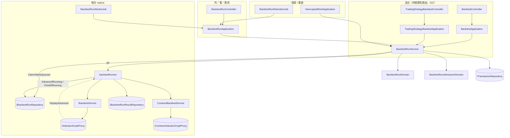

# 回測改為背景工作並留下回測輪次 — Architecture Design

**Status:** Confirmed
**Source PRD:** `.sdd/2026-10-10-background-backtest-runs/PRD.md`
**Tech context:** Go · Gin · GORM（Postgres）· Clean / Onion（`domain/models/{entities,domains,dto,vo}`、`domain/service`、`domain/interface`）· mockgen · 腳本在獨立 worker 行程（yaegi）跑

---

## 1. Design Goal & Guiding Principle

- **In one sentence:** 四個由使用者送出的回測路由改成「驗證通過就寫一筆 `BacktestRun`、回 202」，每台 replica 的 `BacktestRunWorkerJob` 以 `SKIP LOCKED` 認領排隊中的輪次、在 goroutine 裡用既有的 `BacktestService` / `ContractBacktestService` 跑完，把完整成績單寫進 `BacktestRunResult`；重演本身加上「區間起點之前多讀暖機歷史、重演時裁掉」。
- **Guiding principle:** **重演引擎不知道自己是在背景跑。** `BacktestService` / `ContractBacktestService` 的四個方法只多兩件事：時間上限由請求 DTO 帶進來（不再是 service 的常數），以及透過 `IReplayProgressSink` 回報走到第幾格。排隊、認領、取消、進度落地、重啟清掃全部在 `BacktestRunService` 與它旁邊的 `backtestRunner`；交易日誌比對與行情助手照舊直接呼叫 service，傳 90 秒的上限、不給 sink。

---

## 2. Change Scope

| Area | Action | What / Why |
| :--- | :--- | :--- |
| `domain/models/entities` | **Add** `BacktestRun`、`BacktestRunResult`；**Modify** `User` | 輪次一列、成績單另一列（列表不搬權益曲線）；`User` 加 cascade 關聯 |
| `domain/models/vo` | **Add** `BacktestRunStatusVo`、`BacktestRunKindVo`、`BacktestRunRequestVo` | 五種狀態、四種回測、請求快照（jsonb） |
| `domain/models/domains` | **Add** `BacktestRunDomain`、`BacktestRunAdmissionDomain`；**Modify** `BacktestDomain`、`ContractBacktestDomain`（及兩個 trading-strategy 包裝） | 狀態機與進度；每人上限；暖機讀取區間與重演裁切 |
| `domain/models/dto` | **Add** `BacktestRunDto`、`BacktestRunDetailDto`、`BacktestRunPageDto`、`BacktestRunListQueryDto`、`BacktestRunSubmissionDto`；**Modify** 四個 `*BacktestRequestDto` | 列表／明細形狀；請求 DTO 加 `TimeAllowance` |
| `domain/interface` | **Add** `IBacktestRunRepository`、`IBacktestRunResultRepository`、`IReplayProgressSink`；**Modify** `IIndicatorScriptProxy`、`IContractIndicatorScriptProxy` | 兩個 repository；進度回報能力；`ExecuteForEachCandle` 多一個 sink 參數 |
| `domain/service` | **Add** `BacktestRunService`、`backtestRunner`（service 旁邊的 goroutine 生命週期物件）；**Modify** `BacktestService`、`ContractBacktestService` | 送出／列／看／取消／認領／清掃／清理；時間上限改由 DTO 帶、把 sink 傳給 proxy、暖機 |
| `application` | **Add** `BacktestRunApplication`；**Modify** `BacktestApplication`、`TradingStrategyBacktestApplication`、`InterruptedWorkApplication`、`SpotTradeLiveComparisonApplication`、`ContractTradeLiveComparisonApplication`、`assistantqueries.TradingStrategyBacktestAssistantQuery` | `Run*` 改 `Submit*`（trading-strategy 那份保留 `Run*` 給助手）；清掃多一項；當場算的呼叫端帶 90 秒上限 |
| `controller` | **Add** `BacktestRunController`；**Modify** `BacktestController`、`TradingStrategyBacktestController` | 列／看／取消；四個既有路由改回 202 + `BacktestRunDto` |
| `job` | **Add** `BacktestRunWorkerJob`、`BacktestRunRetentionJob` | 每台 replica 認領並跑；值班 replica 清掉到期的 |
| `infrastructure/persistence` | **Add** `BacktestRunRepository`、`BacktestRunResultRepository`；**Modify** `SchemaMigrator` | 認領用 `SKIP LOCKED`；條件更新守門 |
| `infrastructure/script` | **Modify** `indicatorScriptCompartment`、`indicator_script_worker`、`indicator_script_response`、兩個 yaegi proxy | worker 逐格送回結果，parent 邊收邊回報進度；取消時殺掉子行程 |
| `config` / `cmd/server` | **Modify** | `BacktestRunConfig`（worker 數、每人上限、背景時間上限、保留期限、輪詢間隔）；組裝 |
| `UL-MAP` / Postman | **Modify** | 已更新詞彙；Postman 補三個新路由並改四個回測路由的回應 |
| 交易日誌實盤 vs 回測、行情助手回測 | **Not touched**（只改成帶 90 秒上限的呼叫） | PRD §US-09：當場算、不留輪次 |
| 腳本沙箱的記憶體上限與同時隔間上限 | **Not touched** | 背景回測仍佔一個隔間名額、仍受 512MB 約束；PRD 已列為已知限制 |
| 成績單的任何算法（`BacktestSimulationDomain`、合約帳戶） | **Not touched** | PRD Out of Scope |

---

## 3. New Classes / Modules

| Name | Kind | Responsibility (purpose) | Collaborators | Satisfies (PRD scenario) |
| :--- | :--- | :--- | :--- | :--- |
| `BacktestRun` | Entity（`BacktestRuns`） | 一筆輪次：`ID`、`OwnerID`（FK Users，cascade）、`Kind`、`Symbol`、`Interval`、`StartTime`、`EndTime`、`StrategyScriptID *uint`、`TradingStrategyID *uint`（列表依來源篩）、`SubjectName`（腳本或策略名稱快照）、`Request`（`BacktestRunRequestVo`，`serializer:json;type:jsonb`）、`Status`、`CompletedBarCount`、`TotalBarCount`、`ReplicaName`、`CancelRequestedAt *time.Time`、`FailureReason`、`TotalReturnRate`／`MaximumDrawdown`（`decimal.NullDecimal`）、`TradeCount`、`SubmittedAt`、`StartedAt *`、`FinishedAt *`；index `(owner_id, id desc)`、`(status, id)`、`(finished_at)` | — | US-01、02、03 |
| `BacktestRunResult` | Entity（`BacktestRunResults`） | `BacktestRunID`（PK，FK `BacktestRuns` cascade）、`Kind`、`Result`（jsonb：`BacktestResultDto` 或 `ContractBacktestResultDto` 原樣） | — | US-02「完成的輪次帶完整成績單」 |
| `BacktestRunStatusVo` | VO | `queued` / `running` / `succeeded` / `failed` / `cancelled`；看不懂的讀成 `failed` | — | US-02 |
| `BacktestRunKindVo` | VO | `spotScript` / `contractScript` / `spotTradingStrategy` / `contractTradingStrategy` | — | US-01「三種回測同樣先回輪次」 |
| `BacktestRunRequestVo` | VO（jsonb） | 已解析的請求快照：四個 `*BacktestRequestDto` 各一個指標、恰好一個非 nil（腳本內文、旋鈕、信號來源都已解析，之後腳本被改也不影響這筆） | — | US-01 |
| `BacktestRunDomain` | Domain Model | 狀態機與規則：`Claim(replica, now)`（queued→running）、`Advance(completed, total)`、`Succeed(summaryFigures, now)`、`Fail(reason, now)`、`Cancel(now)`（queued/running→cancelled，終態拒絕 `ErrBacktestRunAlreadyEnded`）、`IsActive()`、`ProgressPercent()`、`ToDto()`；建構子把非法狀態正規化 | `BacktestRunStatusVo` | US-02、05 |
| `BacktestRunAdmissionDomain` | Domain Model | `Admit(activeCountOfOwner)`：到了每人上限回 `BacktestRunOwnerLimitReached(limit)`（哨兵＋上限數字） | — | US-04 |
| `IBacktestRunRepository` / `BacktestRunRepository` | Interface / Repository | `Save`、`FindOne(id)`、`FindOneOwned(ownerID, id)`、`FindPageByOwner(ownerID, query) ([]BacktestRun, int64, error)`、`CountActiveByOwner`、`ClaimOldestQueued(replica, now) (BacktestRun, bool, error)`（transaction：`FOR UPDATE SKIP LOCKED` 選最舊一筆 queued → 改 running/replica/started_at）、`AdvanceIfRunning(id, replica, completed, total) (bool, error)`（條件更新，回傳是否仍在 running：runner 以此得知已被取消）、`FinishIfRunning(id, replica, patch) (bool, error)`、`CancelIfActive(ownerID, id, now) (BacktestRun, error)`、`FailRunningOutside(liveReplicaNames, reason, finishedAt)`、`DeleteFinishedBefore(cutoff)` | — | US-02～06 |
| `IBacktestRunResultRepository` / `BacktestRunResultRepository` | Interface / Repository | `Save(result)`、`FindOne(runID)` | — | US-02 |
| `IReplayProgressSink` | Interface | `ReplayAdvanced(completedBarCount, totalBarCount int)`；由 `backtestRunner` 實作、由 proxy 在每收到一格結果時呼叫；多信號來源時 service 把各來源的格數累加後再報 | — | US-02「進行中的輪次說得出進度」 |
| `BacktestRunService` | Domain Service | `Submit(ctx, ownerID, submission) (BacktestRunDto, error)`：`Atomically{ CountActiveByOwner → Admit → Save }`；`List(ctx, ownerID, query) BacktestRunPageDto`；`Get(ctx, ownerID, id, wait) BacktestRunDetailDto`（wait > 0 時每秒重讀直到終態或等滿，最多 60 秒）；`Cancel(ctx, ownerID, id)`；`ClaimAndRun(ctx) (bool, error)`：`ClaimOldestQueued` 成功就 `go runner.run()`；`FailInterruptedRuns(ctx, live)`；`DeleteExpiredRuns(ctx)`。持有 `runningCount`（atomic）讓 job 知道還能不能再認領 | 兩個 repository、`BacktestService`、`ContractBacktestService`、`ITransactionRepository`、`IClockProxy` | 全部 |
| `backtestRunner` | goroutine 生命週期物件（service 旁） | 一筆進行中的輪次：`context.WithTimeoutCause(Background, allowance, errReplayTimeAllowanceSpent)` → 依 `Kind` 呼叫對應 service、自己當 `IReplayProgressSink`（每 `ProgressWriteEveryBars` 格 `AdvanceIfRunning`，回 false 就 cancel ctx）→ 成功：`Atomically{ result.Save; FinishIfRunning(succeeded + 摘要) }`；失敗：`FinishIfRunning(failed, reason)`；ctx 因取消而結束：不寫（列已是 cancelled）；recover panic → failed「回測服務壞掉」；結束時 `runningCount--` | `BacktestRunService` 的 repository 與 service | US-02、05、06 |
| `BacktestRunApplication` | Application | `ListRuns`、`GetRun(wait)`、`CancelRun`、`RunClaimedBacktests(ctx)`（給 job：在 `runningCount < WorkerCount` 時反覆 `ClaimAndRun` 直到拿不到）、`DeleteExpiredRuns` | `BacktestRunService` | US-02～06、08 |
| `BacktestRunController` | Controller | `GET /backtest-runs`（`status`、`strategyScriptId`、`tradingStrategyId`、`limit` 寬鬆解析）→ `BacktestRunPageDto`；`GET /backtest-runs/:id?waitSeconds=`→ `BacktestRunDetailDto`；`POST /backtest-runs/:id/cancel` → `BacktestRunDto`；404 for not found/foreign，409 for already ended | `BacktestRunApplication` | US-02、03、05 |
| `BacktestRunWorkerJob` | Job | 每 `PollInterval`（2s）呼叫 `RunClaimedBacktests`；每台 replica 都跑（不看值班）；Stop 不等 goroutine（runner 用 Background ctx，關機由清掃收尾——PRD「正常關機時放掉手上的輪次」：Stop 時對手上的 runner 逐一 cancel 並 `FinishIfRunning(failed, interrupted)`） | `BacktestRunApplication` | US-06 |
| `BacktestRunRetentionJob` | Job | 值班 replica 每小時 `DeleteExpiredRuns` | `BacktestRunApplication`、`JobLeadershipApplication` | US-02「到期的輪次不再出現」 |
| `BacktestRunConfig` | Config | `BACKTEST_RUN_WORKER_COUNT`=2、`BACKTEST_RUN_OWNER_ACTIVE_LIMIT`=3、`BACKTEST_RUN_TIME_ALLOWANCE_MINUTES`=30、`BACKTEST_RUN_RETENTION_DAYS`=30、`BACKTEST_RUN_POLL_INTERVAL_SECONDS`=2、`BACKTEST_RUN_PROGRESS_WRITE_EVERY_BARS`=100、`BACKTEST_DEFAULT_WARMUP_BAR_COUNT`=200；不成立用預設 | — | US-08 |

---

## 4. Modified Components

| Component | Current role | Change needed |
| :--- | :--- | :--- |
| `BacktestRequestDto` / `ContractBacktestRequestDto` / 兩個 trading-strategy 請求 DTO | 一次重演的輸入 | 加 `TimeAllowance time.Duration`（0 = 只受呼叫端 ctx 約束）。`ToBacktestRequestDto()` 帶過去 |
| `BacktestService` / `ContractBacktestService` | 當場重演 | 建構子拿掉 `replayTimeAllowance`；四個方法改 `WithTimeoutCause(ctx, requestDto.TimeAllowance, …)`（0 不包）；多一個 `progress domaininterface.IReplayProgressSink` 參數（nil 允許）傳給 proxy；多信號來源時用 `sourceProgressSink{offset}` 包一層累加；`refusalFor` 以 DTO 的上限數字組訊息 |
| `BacktestDomain` | 驗證、讀取區間、重演 | 加 `warmupBarCount`（`parameters.MaximumLookbackCount()`，0 時用系統預設）；`KCandleQuery()` 起點改 `startTime − warmup × interval`；`SourceCandleLimit()` 加上暖機格數；新 `TradeStartIndex(inputKCandles)`（第一根 `OpenTime ≥ startTime`）；`ReplayOver` 先把 `inputKCandles / signals / conflictedFlags` 裁到 `[tradeStartIndex:]` 再做現在的事；`splitIndexOf` 在裁切後算；`SelectInputCandles` 的「至少兩根」改以裁切後的根數判 |
| `ContractBacktestDomain`（及 `ContractKCandleAlignmentDomain`） | 合約版 | 同上：讀取區間含暖機；`ReplayOver` 以 `alignment.TradeStartIndex()` 裁切 bars、signals、settlements |
| `TradingStrategyBacktestDomain` / `ContractTradingStrategyBacktestDomain` | 多來源包裝 | 不改介面；暖機由內層 `BacktestDomain` 決定（取所有來源 `MaximumLookbackCount` 的最大值） |
| `IIndicatorScriptProxy` / `IContractIndicatorScriptProxy` | 跑腳本 | `ExecuteForEachCandle(..., progress IReplayProgressSink)`；mock 重產 |
| `indicatorScriptCompartment.executeForEachElement` / worker / response | 一次收完整回應 | worker 改為每算完一格就 `gob` 送一則 `perElementMessage{Index, Values}`，最後一則 `done`；parent 邊讀邊 `ReplayAdvanced(i+1, total)`；ctx 取消時 `command.Process.Kill()`（現在用 `exec.Command`，改 `CommandContext` 或在 ctx.Done 時 kill） |
| `BacktestApplication` | 當場重演 | `RunBacktest` → `SubmitBacktest(ctx, viewerID, subject, request) (BacktestRunDto, error)`：解析腳本（同今天）→ 用 `domains.NewBacktestDomain` 驗證（同今天的拒絕）→ `BacktestRunService.Submit`；合約同理。**解析與驗證都在送出時做**，所以不合法的要求不留輪次 |
| `TradingStrategyBacktestApplication` | 當場重演 | 加 `SubmitTradingStrategyBacktest` / `SubmitContractTradingStrategyBacktest`（同上）；保留 `Run*` 給助手，呼叫時帶 `TimeAllowance = onDemandAllowance` |
| `SpotTradeLiveComparisonApplication` / `ContractTradeLiveComparisonApplication` | 實盤 vs 回測 | 呼叫 service 時 `TimeAllowance = onDemandAllowance`、sink nil |
| `BacktestController` / `TradingStrategyBacktestController` | 回 200 成績單 | 回 202 `BacktestRunDto`；每人上限滿 → 429（`BacktestRunOwnerLimitReached`）；其餘錯誤對映不變 |
| `InterruptedWorkApplication` | 清掃 | `failWorkOutside` 多呼叫 `BacktestRunService.FailInterruptedRuns`；`InterruptedWorkDto` 加 `BacktestRuns` |
| `User` | 帳號 | 加 `BacktestRuns []BacktestRun` cascade |
| `SchemaMigrator` | AutoMigrate 清單 | 加兩個 entity |
| `config.ApplicationConfig` | 設定 | 加 `BacktestRun BacktestRunConfig`、`BacktestDefaultWarmupBarCount`；`BacktestTimeAllowance` 改名用途「當場重演的上限」保留 |
| `cmd/server/dependencies.go` | 組裝 | 組 repository / service / application / controller / 兩個 job；`backgroundJobsFor` 加入 worker job 與 retention job；`serve` 關機時先 `StopAll`（worker job 的 Stop 會收掉手上的 runner） |

---

## 5. Component Relationships

**一筆輪次的時序**：送出（解析＋驗證＋每人上限，寫 queued）→ 任一 replica 的 worker job `ClaimOldestQueued`（SKIP LOCKED，改 running）→ runner 以 30 分鐘上限跑 service → proxy 逐格回報 → 每 100 格 `AdvanceIfRunning`（回 false 代表已被取消 → cancel ctx）→ 成功 `Atomically{ 存成績單；FinishIfRunning(succeeded) }`／失敗 `FinishIfRunning(failed)`。取消：`CancelIfActive` 直接把 queued/running 改成 cancelled；進行中的 runner 在下一次進度寫入時發現並停下。重啟／replica 消失：`FailRunningOutside(live, "interrupted by restart")`；排隊中的列不動。

---

## 6. Extensibility & Handoff Notes

- **Most likely next requirement:** 批次送出（一次送一組旋鈕掃描）或「同一筆輪次重跑」。
- **Where it lands:** `BacktestRunRequestVo` 已是完整的可重跑快照，`BacktestRunService.Submit` 收的是 `BacktestRunSubmissionDto`（kind + request vo + 來源識別）；批次就是迴圈 Submit，重跑就是拿舊輪次的 vo 再 Submit。
- **How to add it:** 新增一種回測種類＝加一個 `BacktestRunKindVo` 值、`BacktestRunRequestVo` 加一個指標、`backtestRunner` 的 dispatch 多一個 case；送出端的解析各自在 application。
- **Patterns applied & why:** 與歷史同步、機器人輪次相同的「列即工作」＋條件更新守門（`AdvanceIfRunning` / `FinishIfRunning` 都帶 `status = running AND replica_name = me`），讓取消、清掃、完成三方寫同一列而不互相蓋掉；`IReplayProgressSink` 讓 proxy 不認識輪次。
- **Do not hardcode:** worker 數、每人上限、背景時間上限、保留期限、輪詢間隔、進度寫入間隔、預設暖機根數。
- **Known debt / deferred:**
  - 每人上限的計數在 transaction 內做，但 Postgres 無法擋住兩個同時插入的幻影列；極罕見情況下一個人會短暫有 4 筆。要補的話用 owner 列上的 `FOR UPDATE` 當序列化點。
  - 暖機讀取量算進 `SourceCandleLimit` 但不算進「回測根數上限」；腳本宣告超大 lookback 時讀取會變重，由 `BACKTEST_MAX_CANDLE_COUNT` 以外的 `KCANDLE_QUERY_MAX_RESULTS` 兜底。
  - worker 關機時手上的 runner 被標成「被重新啟動打斷」而不是重排；排隊再跑是下一步。

---

## 7. Traceability

| PRD Scenario | Fulfilled by |
| :--- | :--- |
| US-01 合法的合約腳本回測立刻回覆排隊中的輪次 | `BacktestController.RunContractBacktest`（202）→ `BacktestApplication.SubmitContractBacktest` → `BacktestRunService.Submit` |
| US-01 很短的區間一樣先回輪次 | 同上（驗證通過即 queued） |
| US-01 區間顛倒／別人的腳本／旋鈕沒宣告 當場拒絕、不留輪次 | `BacktestApplication.Submit*` 的解析與 `NewBacktestDomain` 驗證在 `Submit` 之前 |
| US-01 三種回測同樣先回輪次 | `TradingStrategyBacktestApplication.Submit*`、`BacktestRunKindVo` |
| US-02 完成的輪次帶完整成績單 | `backtestRunner` 寫 `BacktestRunResult`；`BacktestRunService.Get` 組 `BacktestRunDetailDto` |
| US-02 進行中的輪次說得出進度 | `IReplayProgressSink` → `AdvanceIfRunning`；`BacktestRunDomain.ProgressPercent` |
| US-02 腳本出錯／超過時間上限 | `backtestRunner`：service 回錯 → `Fail(reason)`；`errReplayTimeAllowanceSpent` → 「超過時間上限」 |
| US-02 看別人的輪次「找不到」 | `FindOneOwned` → `ErrBacktestRunNotFound` → 404 |
| US-02 到期的輪次不再出現 | `BacktestRunRetentionJob` → `DeleteFinishedBefore` |
| US-03 列表（新到舊、總數、狀態篩、摘要、limit 20/200） | `FindPageByOwner` + `BacktestRunListQueryDto`（clamp）；摘要欄位在 `BacktestRun` 列上 |
| US-04 到了同時進行上限就排隊 | `BacktestRunWorkerJob` 只在 `runningCount < WorkerCount` 時認領；其餘留在 queued |
| US-04 每人同時上限滿了就拒絕／各算各的／終態不計 | `CountActiveByOwner` + `BacktestRunAdmissionDomain.Admit` → 429 |
| US-04 要求本身的錯先判 | application 先驗證再 `Submit` |
| US-05 取消排隊中／進行中／已結束拒絕／別人的找不到 | `CancelIfActive`（ownerID 守門；終態 → `ErrBacktestRunAlreadyEnded` → 409）；runner 在 `AdvanceIfRunning` 回 false 時停下、不寫成績單 |
| US-06 同時認領只有一台拿到 | `ClaimOldestQueued` 的 `FOR UPDATE SKIP LOCKED` |
| US-06 分身倒下：進行中失敗、排隊中不受影響 | `InterruptedWorkApplication` → `FailRunningOutside`（只動 running） |
| US-06 只有一台分身時行為相同 | `FailWorkLeftByLastRun` 在啟動時掃；worker job 啟動後認領 queued |
| US-06 正常關機放掉手上的輪次 | `BacktestRunWorkerJob.Stop` cancel 所有 runner 並 `FinishIfRunning(failed, interrupted)` |
| US-07 暖機四個情境 | `BacktestDomain.KCandleQuery` / `TradeStartIndex` / `ReplayOver` 裁切；`MaximumLookbackCount` 為 0 用 `BacktestDefaultWarmupBarCount`；起點之前不夠多時 `TradeStartIndex` 自然落在較前面 |
| US-08 設定預設與不成立 | `BacktestRunConfig` 用 `positiveIntWithDefault` |
| US-09 實盤 vs 回測／助手當場算 | 兩個 live-comparison application 與助手查詢直接呼叫 service（`TimeAllowance` 90s、sink nil） |

---

## 8. Risks & Open Decisions

- **Risks / trade-offs:**
  - 逐格串流改動 worker 協定，是這一刀最容易出錯的地方；用既有 `infrastructure/script/tests` 的黑箱測試保護（相同輸入得相同每格結果），並加「progress 單調遞增且最後等於格數」的測試。
  - 成績單 jsonb 可能數 MB（1h 四年 ≈ 35,000 點權益曲線）；列表不讀它，明細才讀；保留 30 天自動清。
  - 背景回測占用腳本隔間名額（全域 6）；每 replica 2 個 worker × 3 replica = 6，剛好把隔間吃滿會讓機器人輪次排隊（機器人優先權已存在，只是會等）。部署端把 worker 數設 1 或把隔間上限調高，在 deploy 切片決定。
- **Open decisions (for implementation):**
  - `Get(wait)` 的輪詢間隔（1 秒）與上限（60 秒）寫成常數還是設定：先常數。
  - 進度 `TotalBarCount` 在多來源時是「格數 × 來源數」；百分比對使用者仍是 0–100，不暴露來源數。
