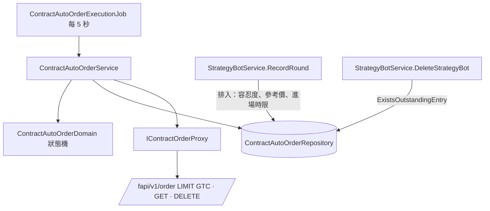

# 自動下單限價進場（滑價容忍度）— Architecture Design

**Status:** Confirmed（autonomous run — decisions recorded below）
**Source PRD:** `.sdd/2026-10-12-auto-order-limit-entry/PRD.md`
**Tech context:** Go · Gin · GORM（AutoMigrate, code-first）· PostgreSQL · Clean/Onion（`internal/{controller,application,domain,infrastructure}`）

---

## 1. Design Goal & Guiding Principle

- **In one sentence:** 自動下單委託的「開倉」步驟改成兩段——**掛進場單**（限價 GTC，價格由委託自己從參考價與容忍度算出）與**跟進場單**（每 5 秒查一次，該收尾就撤單、以撤單後的成交量收尾）——其餘（平倉、保護、結束、通知、先查再送、claim）原封不動。
- **Guiding principle — 進場單只是委託狀態機上多出來的一個步驟。** 不另立「進場單」實體或第二條佇列：
  委託本來就是「一步一寫回、可重入、先查再送」的 outbox，跟進場單只是一個會 **等待**（回到 ready、5 秒後再領）的步驟。
  所以多 replica 安全、重啟續做、同一台機器人的委託依序執行，全部沿用既有機制；所有「何時撤、成交多少算什麼、說什麼」的規則都住在 `ContractAutoOrderDomain`。

---

## 2. Change Scope

| Area | Action | What / Why |
| :--- | :--- | :--- |
| `entities.StrategyBot` | **Modify** | 加 `AutoOrderEntrySlippageTolerancePercentage decimal`（`numeric(38,18) not null default 0.1`）——AutoMigrate 加欄時既有列得到 0.1。`ToDto` 帶出 |
| `dto.StrategyBotDto` / `dto.StrategyBotWriteDto` / `models.StrategyBotRequest` | **Modify** | 讀：`autoOrderEntrySlippageTolerancePercentage`；寫：`decimal.NullDecimal`，沒給＝建立用 0.1、改寫保留原值 |
| `domains.StrategyBotDomain` | **Modify** | 驗證 0～5（含），沒給用預設 0.1；`ToEntity` 帶出 |
| `persistence.StrategyBotRepository.Save` | **Modify** | 改寫的欄位白名單加這一欄 |
| `service.StrategyBotService` | **Modify** | `UpdateStrategyBot` 沒給就沿用 stored 值；`RecordRound` 排入委託時把鎖住的那一列機器人整個交給 `NewQueuedContractAutoOrderDomain`；`DeleteStrategyBot` 有掛著的進場單就拒絕 |
| `entities.ContractAutoOrder` | **Modify** | 加 `ReferencePrice`、`EntrySlippageTolerancePercentage`、`EntryFillDeadline`、`EntryLimitPrice`、`EntryExchangeOrderID`、`EntryPlacedAt`、`EntryExecutedQuantity`、`EntryStatus`；`ToResultDto` 帶出 |
| `dto.ContractAutoOrderIntentDto` / `ContractAutoOrderIntentDomain` | **Modify** | 意圖帶參考價；沒有參考價 → 不開倉原因 |
| `domains.ContractAutoOrderDomain` | **Modify** | 新步驟 `followEntry`；`EntryOrder(tickSize)`（限價與取整）、`AfterEntryPlaced`、`ShouldWithdrawEntryAt`、`AwaitingEntry`、`AfterEntryEnded`（全部／部分／沒有成交）、滑價計算；`withOpenFailure` 在進場單可能還掛著時補一句請擁有者自己撤 |
| `domains.ContractAutoOrderMessageDomain` | **Modify** | 📌 參考價／限價／滑價、部分成交、沒有成交 |
| `vo.ContractAutoOrderOutcomeVo` | **Modify** | 加 `unfilled` |
| `vo.ContractLimitOrderVo`、`vo.ContractOrderStateVo`、`vo.ContractOrderProgressVo`、`vo.ContractEntryStatusVo` | **Add** | 限價單請求、幣安上一張單的狀態（進行中／全部成交／已結束＋成交量、均價、交易所編號）、進場單狀態 |
| `IContractOrderProxy` / `BinanceContractOrderProxy` | **Modify** | 加 `PlaceLimitOrder`、`FindOrder`、`CancelOrder`（`/fapi/v1/order` POST LIMIT GTC／GET／DELETE）。`PlaceMarketOrder`/`FindMarketOrder` 只剩平倉在用 |
| `IContractAutoOrderRepository` / `ContractAutoOrderRepository` | **Modify** | 加 `ExistsUnsettledAfter(botID, id)`（有新結論排在後面）與 `ExistsOutstandingEntry(botID)`（擋刪除）；`SaveProgress` 欄位白名單加進場欄位 |
| `service.ContractAutoOrderService` | **Modify** | `open` 改為掛進場單；新增 `followEntry`；共用 `resolveEntry(state)` 收尾 |
| `controller.StrategyBotController` | **Modify** | 新哨兵錯誤 → 409 `reason: autoOrderEntryOutstanding` |
| `postman/` | **Modify** | 機器人建立／改寫 body 與回應多一欄；執行紀錄的下單結果多欄 |
| 平倉、保護單、claim、時限、通知佇列 | **Not touched** | 行為不變 |
| 現貨機器人 | **Not touched** | 現貨不下單、`RecordRound` 只替合約意圖排入，沒有共用開倉路徑 |
| `config` | **Not touched** | 5 秒查單間隔是業務規則，放 domain 常數（與既有 5 秒重試同一個量級，跟著 5 秒掃描） |

---

## 3. New Classes / Modules

| Name | Kind | Responsibility (purpose) | Collaborators | Satisfies |
| :--- | :--- | :--- | :--- | :--- |
| `vo.ContractLimitOrderVo` | VO | 一張限價進場單：標的、方向、數量、價格、客戶端編號 | — | 例 8–10 |
| `vo.ContractOrderStateVo` | VO | 幣安上一張單現在的樣子：`Progress`（working / filled / ended）、成交量、均價、交易所編號 | — | 例 13–20 |
| `vo.ContractEntryStatusVo` | VO | 進場單狀態：working / filled / partiallyFilled / unfilled | — | 下單結果 |
| `ContractAutoOrderDomain.EntryOrder(tickSize)` | Domain method | 限價＝參考價 ×（1 ± 容忍度/100），做多 floor、做空 ceil 到跳動單位；沒有跳動單位回 false | — | 例 8–11 |
| `ContractAutoOrderDomain.ShouldWithdrawEntryAt(now, superseded, botRunning, autoOrderEnabled)` | Domain method | 進場時限到、有新委託、自動下單關、機器人停 → 撤 | — | 例 15–19 |
| `ContractAutoOrderDomain.AfterEntryEnded(position, state, tickSize, now)` | Domain method | 撤單或幣安結束後：有成交 → 同 `AfterOpen`（以實際成交量），標全部/部分成交；沒成交 → 回報「要結束成沒有成交」 | — | 例 15–16、20–21 |
| `ContractAutoOrderService.followEntry` | Service step | 查單 → 全部成交收尾／還在等就決定撤或等／撤單後再收尾；撤單時幣安說不在就再查一次 | proxy、repository | 例 13–20 |

### 狀態機（只列有變的部分）

```
NextStep:
  … 平倉照舊 …
  open        目標≠空手、尚未開倉、進場單尚未送出
  followEntry 進場單已送出（EntryPlacedAt 有值）且尚未開倉
  protect     開倉完成（含部分成交）且有停損/停利
  settle

open:
  有金鑰 → FindOrder(open 編號)：找到 → AfterEntryPlaced(state) 寫回 → 交給 followEntry；找不到才往下
  refuseToSend（時限、煞車、雙向持倉）照舊
  EntryOrder(tickSize) 不成立 → 結束「沒有價格跳動單位」
  設逐倉與槓桿 → PlaceLimitOrder → AfterEntryPlaced 寫回（委託進度，持倉不變）

followEntry:
  沒有金鑰／打不開 → 結束（not placed／partiallyDone），原因補「進場單可能還掛在幣安上，請自己到幣安撤單」
  FindOrder → filled / ended → resolveEntry
            → working → ShouldWithdrawEntryAt? 
                 否 → AwaitingEntry（記下已成交量，ready、5 秒後）→ 等
                 是 → CancelOrder → ended → resolveEntry
                                   → notFound → FindOrder 再查 → filled/ended → resolveEntry；仍 working → 等
                                   → uncertain → 等（下次再查再撤）
  其他失敗 → 照舊 fail（不確定就等，拒絕就結束並分類）

resolveEntry:
  成交量 > 0 → AfterEntryEnded → recordStep（委託＋機器人持倉同一交易）→ protect
  成交量 = 0 → 結束：unfilled（或反手時 partiallyDone）
```

---

## 4. Modified Components

| Component | Current role | Change needed |
| :--- | :--- | :--- |
| `NewQueuedContractAutoOrderDomain` | 從零散參數排入委託 | 改收鎖住的 `entities.StrategyBot`：ID、擁有者、標的、容忍度、觸發間隔都從那一列讀（進場時限＝ranAt＋觸發間隔） |
| `ContractAutoOrderDomain.openRefusal` | 沒有數量、非整數槓桿 | 加：沒有參考價（舊委託） |
| `ContractAutoOrderDomain.ToResultDto` | 結果形狀 | 加參考價、限價、容忍度、要求數量、進場單狀態、已成交量、滑價百分比 |
| `ContractAutoOrderService.open` | 市價開倉 | 掛限價進場單 |
| `StrategyBotService.DeleteStrategyBot` | 直接刪 | 有掛著的進場單 → `ErrStrategyBotAutoOrderEntryOutstanding` |

---

## 5. Component Relationships



---

## 6. Extensibility & Handoff Notes

- **Most likely next requirement:** 追價（沒成交時改價重掛）、在等待中先替已成交部分掛止損、平倉也用限價、現貨自動下單。
- **Where it lands:**
  - 追價與等待中保護：都只在 `followEntry` 的「還在等」分支多一個決定（domain 新 method），不動其他步驟。
  - 平倉限價：同一套 `PlaceLimitOrder`／`FindOrder`／`CancelOrder` 已在 proxy 上；平倉步驟可比照加 `followClose`。
  - 現貨：另一個委託實體（見上一個切片的 ARCH），容忍度欄位已在機器人上、與市場種類無關，可直接重用。
- **Patterns applied & why:** 狀態機多一步（可重入、可等待）；固定客戶端編號當冪等鍵；條件更新的 claim。
- **Do not hardcode:** 容忍度上下限與預設、5 秒查單間隔放 domain 常數；幣安網址與逾時照舊在設定。
- **Known debt / deferred:**
  - 部分成交的倉位在等待期間沒有止損（最長一個觸發間隔）。
  - 進場單等待中金鑰被刪：撤不掉，通知請擁有者自己撤。

---

## 7. Traceability

| PRD Scenario | Fulfilled by |
| :--- | :--- |
| 例 1–5 容忍度預設與範圍 | `StrategyBotDomain` 建構子 |
| 例 6 改寫保留 | `StrategyBotService.UpdateStrategyBot` |
| 例 7 既有機器人 0.1 | 欄位 `default:0.1` + AutoMigrate |
| 例 8–10 限價與取整 | `ContractAutoOrderDomain.EntryOrder` + `PlaceLimitOrder` |
| 例 11 沒有跳動單位 | `EntryOrder` false → 結束 |
| 例 12 沒有參考價 | `ContractAutoOrderIntentDomain` 不開倉原因（舊委託：`openRefusal`） |
| 例 13–14 全部成交 | `followEntry` filled → `AfterEntryEnded` → protect；`ContractAutoOrderMessageDomain` |
| 例 15 部分成交 | `ShouldWithdrawEntryAt`（時限）→ `CancelOrder` → `AfterEntryEnded` 部分 |
| 例 16 沒成交 | 同上 → unfilled |
| 例 17–18 新結論 | `ExistsUnsettledAfter` → 撤；下一筆委託照舊平倉／「不需要平倉」 |
| 例 19 煞車 | `ShouldWithdrawEntryAt`（自動下單關／停止） |
| 例 20 撤時已成交 | `CancelOrder` notFound → `FindOrder` |
| 例 21 反手沒成交 | `withEntryUnfilled` 反手措辭 |
| 例 22–23 刪除 | `ExistsOutstandingEntry` + 哨兵錯誤 + 409 |

---

## 8. Risks & Open Decisions

- **Binance 細節**：LIMIT 需 `timeInForce=GTC`、`price` 須為跳動單位倍數；DELETE `/fapi/v1/order` 回該單最後狀態；已全成交的單撤單回 `-2011`（歸為找不到）。`newOrderRespType=RESULT`。
- 幣安的價格保護（PERCENT_PRICE）若拒絕限價：歸「交易所不收這一筆」，與今天一致。
- 進場單的成交量 ≠ 要求數量時，止損止盈數量用實際成交量（沿用 `AfterOpen`）。
