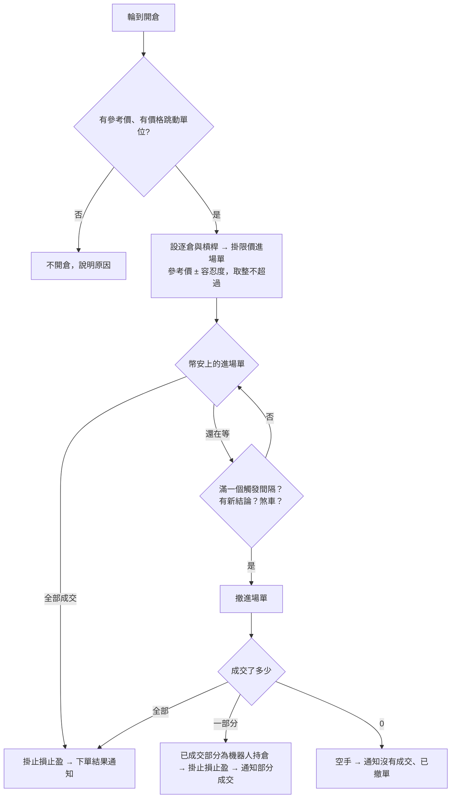

# Product Requirements Document (PRD) — 自動下單限價進場（滑價容忍度）

**Status:** Finalized
**Version:** v1.0
**Owner:** James Hsueh
**Stakeholders:** Engineering

---

## 1. Background & Goal (Why & Goal)

- **Problem Statement:**
  合約機器人自動下單用市價開倉，成交價沒有上限。2026-10-12 合約機器人 #33（BTCUSDT、3 倍、15 分鐘）買入的參考價 84,154，
  市價開多成交 84,208.6，比參考價貴 0.065%、比訊號收盤價貴 0.13%。這台短線突破策略的止損距離約 0.2%，每筆因此被吃掉約半個 R。
- **Expected Outcome:** 可驗證的結果有六項：
  1. 每台機器人有一個**進場滑價容忍度**（0～5%，預設 0.1%，既有機器人也是 0.1%），建立、改寫、讀取都看得到。
  2. 合約機器人開倉改為**限價進場單**，價格＝參考價 ± 容忍度，照價格跳動單位**往不超過容忍度的方向**取整；數量照舊。
  3. 進場單**最多等一個觸發間隔**：全部成交 → 照舊掛止損止盈；部分成交 → 撤掉剩下、保留並保護已成交的部分；沒成交 → 撤單、空手、記「沒有成交」。
  4. 進場單還在等時，**策略說出新結論、擁有者關掉自動下單或停止機器人**，進場單**立刻撤掉**；已成交的部分照上面處理，新結論要平倉就用市價平。
  5. **進場單還掛在幣安上時不能刪除機器人。**
  6. 下單結果與通知寫出**參考價、限價、成交均價、滑價百分比**，部分成交與沒成交講清楚。
- **Out of Scope:**
  - 現貨機器人（目前不下任何單、沒有共用的開倉路徑）。
  - 平倉改成限價；止損止盈單的任何改變；追價重掛；在等待中先替已成交部分掛止損。
  - 外掛與前端畫面的修改（另案依本份跟進）。

---

## 2. User Personas

- **Primary Role(s):**
  - **機器人擁有者**：替合約機器人開了自動下單；決定每台機器人能接受多少進場滑價。
  - **外掛**：讀得到下單結果；可以讀、改機器人的進場滑價容忍度（它是機器人設定），但仍不能下單、撤單、改自動下單開關。
- **Usage Context:** 機器人在背景跑；擁有者在手機上收 Telegram，事後在瀏覽器或透過外掛看執行紀錄、調整容忍度。

---

## 3. User Stories & Acceptance Criteria

### US-01 — 設定每台機器人的進場滑價容忍度 [priority: P0]

**As a** 機器人擁有者，**I want** 替每台機器人設定開倉時最多接受多少滑價，**so that** 短線策略的進場價不會被市價吃掉一大截。

```gherkin
Scenario: 沒給容忍度就是 0.1%（例 1）
  When 擁有者建立一台機器人，沒有給進場滑價容忍度
  Then 這台機器人的進場滑價容忍度是 0.1

Scenario: 容忍度可以是 0（例 2）
  When 擁有者建立一台機器人，進場滑價容忍度給 0
  Then 建立成功，進場滑價容忍度是 0

Scenario: 容忍度可以是上限 5（例 3）
  When 擁有者建立一台機器人，進場滑價容忍度給 5
  Then 建立成功，進場滑價容忍度是 5

Scenario: 超過上限被拒絕（例 4）
  When 擁有者建立一台機器人，進場滑價容忍度給 5.01
  Then 建立被拒絕，說明「進場滑價容忍度必須介於 0 到 5 之間（單位：%）」

Scenario: 負數被拒絕（例 5）
  When 擁有者建立一台機器人，進場滑價容忍度給 -0.1
  Then 建立被拒絕，說明「進場滑價容忍度必須介於 0 到 5 之間（單位：%）」

Scenario: 改寫時沒給就保留原值（例 6）
  Given 一台已停止的機器人，進場滑價容忍度是 0.3
  When 擁有者改寫這台機器人，沒有給進場滑價容忍度
  Then 這台機器人的進場滑價容忍度仍是 0.3

Scenario: 既有的機器人一律是 0.1%（例 7）
  Given 一台在這個功能上線前就建立的機器人
  When 擁有者讀這台機器人
  Then 它的進場滑價容忍度是 0.1
```

### US-02 — 開倉掛有上限的限價進場單 [priority: P0]

**As a** 機器人擁有者，**I want** 自動下單開倉時價格不超過參考價加上我的容忍度，**so that** 每筆的滑價有上限。

```gherkin
Scenario: 做多的限價往下取整（例 8）
  Given 參考價 84154，進場滑價容忍度 0.1，價格跳動單位 0.1
  When 自動下單做多
  Then 幣安上掛著一張買進的限價進場單，價格 84238.1，掛到撤為止

Scenario: 做空的限價往上取整（例 9）
  Given 參考價 84154，進場滑價容忍度 0.1，價格跳動單位 0.1
  When 自動下單做空
  Then 幣安上掛著一張賣出的限價進場單，價格 84069.9

Scenario: 容忍度 0 就掛在參考價（例 10）
  Given 參考價 84154，進場滑價容忍度 0
  When 自動下單做多
  Then 限價進場單的價格是 84154

Scenario: 沒有價格跳動單位不開倉（例 11）
  Given 這個合約標的還沒有價格跳動單位
  When 自動下單做多
  Then 不對幣安下任何單
  And 下單結果寫著「這個合約標的還沒有價格跳動單位，無法掛限價進場單，不下單」

Scenario: 沒有參考價不開倉（例 12）
  Given 這一輪沒有參考價
  When 自動下單做多
  Then 不對幣安下任何單
  And 下單結果寫著「這一輪沒有參考價，無法掛限價進場單，不下單」
```

### US-03 — 進場單在一個觸發間隔內收尾 [priority: P0]

**As a** 機器人擁有者，**I want** 進場單成交就保護、等太久就撤，**so that** 我不會有沒人照顧的掛單或沒止損的倉位。

```gherkin
Scenario: 立刻全部成交（例 13）
  Given 要求數量 0.002、停損距離 1.5%、參考價 84154、限價 84238.1
  When 進場單立刻全部成交，均價 84180
  Then 機器人持倉為多 0.002
  And 幣安上掛著止損，觸發價從 84180 往下 1.5% 起算
  And 下單結果通知寫著參考價 84154、限價 84238.1、成交 0.002 @ 84180、滑價 +0.031%

Scenario: 等了一陣子才全部成交（例 14）
  Given 要求數量 0.002，觸發間隔 15 分鐘
  When 進場單在 5 分鐘後全部成交
  Then 那時才掛上止損止盈，機器人持倉為多 0.002

Scenario: 時候到了只成交一部分（例 15）
  Given 要求數量 0.002，觸發間隔 15 分鐘
  When 從那一輪起滿 15 分鐘，進場單只成交 0.001
  Then 剩下的被撤掉
  And 機器人持倉為多 0.001，止損止盈照 0.001 掛上
  And 下單結果通知寫著「部分成交 0.001／0.002，其餘已撤單」

Scenario: 時候到了一點都沒成交（例 16）
  Given 觸發間隔 15 分鐘
  When 從那一輪起滿 15 分鐘，進場單一點都沒成交
  Then 進場單被撤掉，機器人持倉為空手
  And 下單結果為「沒有成交」，寫著「進場單沒有成交，已撤單」，並帶參考價與限價

Scenario: 等待中策略說要出場，已部分成交（例 17）
  Given 只做多；進場單還在等，已成交 0.001
  When 下一輪結論變成賣出
  Then 進場單立刻被撤掉，機器人持倉為多 0.001
  And 下一輪的下單以市價平多 0.001

Scenario: 等待中策略說要出場，一點都沒成交（例 18）
  Given 只做多；進場單還在等，一點都沒成交
  When 下一輪結論變成賣出
  Then 進場單被撤掉，下單結果為「沒有成交」
  And 下一輪的下單結果寫著「沒有自動開出的倉位，不需要平倉」

Scenario: 等待中擁有者關掉自動下單（例 19）
  Given 進場單還在等，已成交 0.001
  When 擁有者關掉自動下單
  Then 進場單立刻被撤掉
  And 機器人持倉為多 0.001，止損止盈照 0.001 掛上

Scenario: 要撤的時候幣安說單已不在（例 20）
  Given 進場單到時候了
  When 撤單時幣安說這張單已經不在（剛好全部成交）
  Then 以幣安上這張單最後的成交收尾：全部成交，掛上止損止盈

Scenario: 反手時進場單沒成交（例 21）
  Given 多空反手；機器人持倉多 0.002
  When 結論賣出，平多成交，做空的進場單在時限內一點都沒成交
  Then 下單結果寫著「已平倉，但做空沒開成：進場單沒有成交，已撤單」
  And 機器人持倉為空手
```

### US-04 — 進場單掛著時不能刪機器人 [priority: P1]

**As a** 機器人擁有者，**I want** 系統擋下會留下孤兒掛單的刪除，**so that** 不會在我不知道時冒出一個沒有止損的倉位。

```gherkin
Scenario: 進場單還掛著（例 22）
  Given 這台機器人有一張進場單還掛在幣安上
  When 擁有者刪除這台機器人
  Then 刪除被拒絕，說明「這台機器人還有一張進場單掛在幣安上，請先關掉自動下單，等它撤單後再刪除」
  And 機器人仍在

Scenario: 進場單已收尾（例 23）
  Given 這台機器人沒有掛著的進場單
  When 擁有者刪除這台機器人
  Then 機器人被刪除
```

---

## 4. Business Flow & Logic

- **Flow Diagram:**



- **Core Business Rules:**
  - **進場滑價容忍度**：百分比，0～5（含）；每台機器人一個；新建預設 0.1、既有機器人 0.1；改寫時沒給保留原值；只有已停止的機器人改得動（與其他設定相同）。
  - **限價**：做多 ＝ 參考價 ×（1 ＋ 容忍度 ÷ 100），**往下**取到價格跳動單位；做空 ＝ 參考價 ×（1 − 容忍度 ÷ 100），**往上**取到價格跳動單位。
    參考價是那一輪說出結論時最新一根一分鐘 K 線收盤價（訊息上寫的那個）。容忍度取**排入下單那一刻**機器人的設定。
  - **進場單**：限價、掛到撤為止、數量＝建議數量；與今天一樣先設逐倉與槓桿；帶著系統給的編號；送出後不確定就先查再送。
    送出這件事仍受 **2 分鐘下單時限**約束。
  - **進場時限**：從那一輪說出結論起算**一個觸發間隔**。系統約每 **5 秒**看一次進場單。
  - **收尾**：
    | 進場單在幣安上 | 收尾條件 | 結果 |
    |---|---|---|
    | 全部成交 | 一看到就收尾 | 機器人持倉＝成交數量；以成交均價掛止損止盈 |
    | 還在等 | 進場時限到、同一台機器人有新的下單排在後面、自動下單已關、機器人已停止 | 撤單 → 依撤單後的成交數量收尾 |
    | 撤單後部分成交 | — | 機器人持倉＝已成交數量；照已成交數量掛止損止盈；說明部分成交 |
    | 撤單後沒有成交 | — | 空手；結果「沒有成交」 |
    | 幣安自己結束了（過期、被拒）而沒成交 | — | 同「沒有成交」 |
  - **撤單時幣安說單已不在**：再查一次這張單，以它最後的成交為準。
  - **撤單結果不確定**：稍後再撤再查；在確定之前不當作已撤掉。
  - **滑價百分比**：以參考價為基準、**對擁有者不利為正**：做多 ＝（均價 − 參考價）÷ 參考價 × 100；做空 ＝（參考價 − 均價）÷ 參考價 × 100；取到小數第三位。
  - **刪除**：機器人有已送出、還沒收尾的進場單時拒絕刪除。
  - **下單結果（執行紀錄）多帶**：參考價、限價、進場滑價容忍度、要求數量、進場單狀態（等待成交／全部成交／部分成交／沒有成交）、滑價百分比（有成交時）。
  - **結果種類多一種「沒有成交」**：進場單送出了但一點都沒成交、已撤單；沒有平倉也沒有開倉。反手時平倉已成、進場沒成交則照舊為「部分完成」。
  - **通知格式**（沿用今天的格式，加一行進場資訊）：
    ```
    🤖【自動下單】<機器人名稱>
    <合約標的> 永續合約｜<動作>
    ✅ 成交 <成交數量> @ <均價>
    📌 參考價 <參考價>｜限價 <限價>｜滑價 <+0.031%>
    🛡 止損 <價位>｜止盈 <價位>
    ⚠️ 部分成交 <成交數量>／<要求數量>，其餘已撤單
    ```
    沒成交時：`📌 參考價 <參考價>｜限價 <限價>` 加上 `❌ 進場單沒有成交，已撤單`。

- **Decisions on the brief's open questions:**
  - 看進場單的間隔：約 5 秒（跟著自動下單的掃描）。
  - 欄位名稱與通知格式：如上。
  - 「沒有成交」為新的結果種類。

- **Edge Cases:**
  - **系統在送出進場單後、記下之前重啟**：下一台以編號查到這張單，接著等或收尾，不重送。
  - **進場單等待中機器人被刪除**：被擋下（US-04）。
  - **幣安讓進場單自己過期**（例如價格保護規則）且有部分成交：以已成交部分收尾並保護。
  - **部分成交的那一份在等待期間沒有止損**：最長一個觸發間隔，已知風險。
  - **進場單等待中金鑰失效**：查不到、撤不掉的失敗照今天分類；金鑰被拒時照舊關掉開關並通知，但進場單可能仍掛在幣安上——通知請擁有者自己到幣安撤單。

---

## 5. UI/UX Design & Interaction

- **Prototype Link:** N/A（前端另案）
- **Key Interactions:**
  - 機器人建立／編輯頁多一個「進場滑價容忍度（%）」欄位，預設 0.1，範圍 0～5；說明「自動下單開倉時，限價最多比參考價差這麼多；超過就不成交」。
  - 執行紀錄的下單結果顯示參考價、限價、成交均價、滑價；等待中顯示「等待成交」與已成交數量；沒成交顯示「進場單沒有成交，已撤單」。
  - 刪除被擋時顯示擋下的原因。

---

## 6. Non-Functional Requirements

- **Performance:** 進場單全部成交後 10 秒內掛上止損止盈；進場單絕不在幣安上掛超過一個觸發間隔加 10 秒。
- **Security:** 與上一個切片相同：只用擁有者自己的金鑰；外掛不能下單。
- **Reliability:** 一張進場單只由一台系統送出、查詢、撤掉；任何時候都先查再送。
- **Compatibility:** 幣安以 USDT 計價的永續合約、單向持倉。

---

## 7. Dependencies & Risks

- **External Dependencies:** 幣安合約下限價單、查單、撤單。
- **Known Risks:**
  - 部分成交的倉位在等待期間沒有止損（最長一個觸發間隔）。
  - 容忍度設得太小（例如 0）在快速行情中可能大多不成交；這是擁有者的選擇，通知會說清楚。
  - 幣安的價格保護規則可能拒絕離標記價格太遠的限價；容忍度上限 5% 已在一般範圍內。

---

## 8. Appendix

- 上一個切片：`.sdd/2026-10-04-contract-auto-order-execution/`
- 動機：機器人 #33 於 2026-10-12 的成交（參考價 84,154、成交 84,208.6）。
