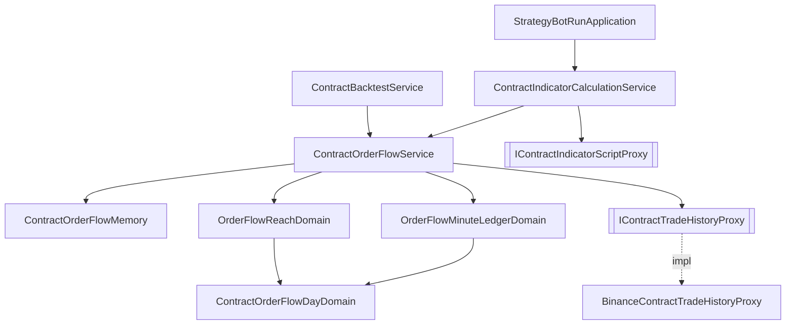

# 合約訂單流（足跡）— Architecture Design

**Status:** Confirmed（autonomous run — decisions recorded below）
**Source PRD:** `.sdd/2026-10-14-contract-order-flow-footprint/PRD.md`
**Tech context:** Go · Gin · GORM（AutoMigrate, code-first）· PostgreSQL · Clean/Onion（`internal/{controller,application,domain,infrastructure}`）· yaegi 算式隔間（子行程、gob 傳輸、記憶體上限）

---

## 1. Design Goal & Guiding Principle

- **In one sentence:** 合約行情格多一個 `Footprint`；它在格子對齊好之後、交給算式之前，由一個 domain service
  `ContractOrderFlowService` 依策略腳本宣告的 `orderFlowPriceStep` 參數「現拿、現整理、暫留在記憶中」附上去——
  合約指標計算、合約回測、合約交易策略回測、合約機器人四條路都只多呼叫它一次。
- **Guiding principle — 一個深模組藏住「訂單流從哪來」。** 呼叫端只交出「這些格子 + 這組參數 + （可選）備齊時間」，
  拿回帶好足跡的格子；「要哪幾天、哪天走歷史檔哪天走即時查詢、記憶中有沒有、今天補到哪一分鐘、同一天別下載兩次、
  一格與一次的價位上限、31 天上限」全部在它裡面。**價位規則（往下取整、買賣方、平手取低、時間歸屬）住在 domain model**，
  proxy 只負責把交易所的兩種來源正規化成同一種逐筆成交 VO、依時間順序一筆一筆交出來（不在記憶中堆整天）。

---

## 2. Change Scope

| Area | Action | What / Why |
| :--- | :--- | :--- |
| `vo.StrategyScriptParameterKindVo` | **Modify** | 加 `orderFlowPriceStep` |
| `domains.StrategyScriptParameterKindDomain` | **Modify** | 可宣告種類加入它 |
| `domains.StrategyScriptParametersDomain` | **Modify** | 驗證：值必須 > 0；一組至多一個；`OrderFlowPriceStep() (OrderFlowPriceStepDomain, bool)`；`RequireMarketDataKind(MarketDataKindDomain) error`（K 線種類宣告了即拒絕） |
| `domains.StrategyScriptDomain` | **Modify** | 建構時呼叫 `parameters.RequireMarketDataKind(marketDataKind)` |
| `service.IndicatorCalculationService`、`service.BacktestService`（現貨） | **Modify** | 自帶算式走現貨時同一個檢查（宣告了訂單流即拒絕）——現貨沒有足跡可以給，安靜忽略會讓人以為有用 |
| `vo.ContractKCandleVo` | **Modify** | 加 `Footprint OrderFlowFootprintVo`（沒宣告時為零值） |
| `dto.IndicatorCalculationRequestDto` | **Modify** | 加 `OrderFlowPreparationAllowance time.Duration`（零＝不限；只有機器人給） |
| `domains.ContractKCandleAlignmentDomain` | **Modify** | 加 `OrderFlowReach(OrderFlowPriceStepDomain) (OrderFlowReachDomain, error)`：由格子起訖推出要哪幾天，並守 31 天上限 |
| `service.ContractIndicatorCalculationService` | **Modify** | `Aligning` 之後呼叫 `contractOrderFlowService.AttachFootprints(...)` |
| `service.ContractBacktestService` | **Modify** | 單一腳本回測同上；交易策略回測**每個來源各自附**（不同來源可能不同價位寬度；同一寬度只拿一次） |
| `application.StrategyBotRunApplication.readSignals` | **Modify** | 合約機器人送出的請求帶 `OrderFlowPreparationAllowance`（設定值，預設 40 秒） |
| `domains.StrategyBotRoundFailureDomain` + `vo.StrategyBotHaltReasonVo` | **Modify** | `ErrContractOrderFlowRefused` → 停下（新原因 `orderFlowRefused`）；`NotReady`／`Unavailable` 走既有 default＝跳過 |
| `controller.IndicatorCalculationController`、`BacktestController`、`TradingStrategyBacktestController` | **Modify** | `ErrContractOrderFlowRefused` → 400；`Unavailable` 落入既有 502；`NotReady` → 503（只有機器人會遇到，防禦用） |
| `infrastructure/script` 合約輸入型別表 | **Modify** | 匯出 `Footprint`、`PriceLevel` 兩個名字給算式 |
| `config` / `cmd/server/dependencies.go` | **Modify** | 新設定區塊 `ContractOrderFlow`；組裝 proxy、pacer、service |
| 助手兩處說明（`assistantqueries` 參數 schema、`claude_assistant_proxy` system prompt） | **Not touched** | 助手只寫 K 線種類的策略腳本；教它一個只給合約的參數種類只會寫出存不進去的腳本 |
| `postman/` | **Modify** | 建立策略腳本範例加一個 `orderFlowPriceStep` 參數 |
| 資料庫 schema | **Not touched** | 參數種類是字串欄；訂單流不落地 |
| 現貨 K 線格、現貨回測、合約 K 線蒐集、歷史同步 | **Not touched** | 與訂單流無關 |
| 合約即時跟盤 | **Not touched** | 跟盤送的是 K 線，不是算式輸入 |

---

## 3. New Classes / Modules

| Name | Kind | Responsibility (purpose) | Collaborators | Satisfies (PRD scenario) |
| :--- | :--- | :--- | :--- | :--- |
| `vo.OrderFlowFootprintVo` | VO（算式可見，名 `Footprint`） | 一格的足跡：`PriceStep`、`Levels []OrderFlowPriceLevelVo`（由低到高）、`Delta`、`PointOfControl` | — | US-02、US-03 |
| `vo.OrderFlowPriceLevelVo` | VO（算式可見，名 `PriceLevel`） | 一個價位：`Price`、`BuyVolume`、`SellVolume`、`TradeCount` | — | US-03 |
| `vo.ContractAggregatedTradeVo` | VO | proxy 正規化後的一筆逐筆成交：`Price decimal`、`Quantity float64`、`TradeTime`、`BuyerIsTaker` | — | US-03、US-04 |
| `domains.OrderFlowPriceStepDomain` | Domain Model | 價位寬度：建構時 > 0；`LevelOf(price decimal) int64`（往下取整，以 decimal 運算避免 0.3/0.1 這種浮點誤差）、`PriceOf(level) float64`、`Value() float64`、`Key() string`（記憶單位用的正規字串） | — | US-01、US-03 邊界 |
| `domains.OrderFlowMinuteLedgerDomain` | Domain Model（可變的累加器） | 把依時間順序到來的逐筆成交累加成「每分鐘 × 每價位 → 買、賣、筆數」；`Record(trade)`、`LatestTradeTime()`；`ToDay(...)` 交出不可變的一天 | `OrderFlowPriceStepDomain` | US-03 |
| `domains.ContractOrderFlowDayDomain` | Domain Model（不可變） | 一個「合約標的 + 日子 + 價位寬度」的整理結果：每分鐘的價位清單（緊湊排序後的切片）、`CoveredUntil`（整天歷史檔＝隔天 00:00；即時查詢＝最後一個完整分鐘的收盤）；`Extending(ledger, coveredUntil)` 接上新走完的分鐘、`Covers(end)`、`EstimatedBytes()` | — | US-04 暫留／接著補 |
| `domains.OrderFlowReachDomain` | Domain Model | 一次執行要的訂單流範圍：由格子起訖推出的日子清單（≤ 31 個 UTC 日曆日，否則 `ErrContractOrderFlowRefused`）；`Footprinting(bars, days)` 把每分鐘合併成每一格的足跡、算買賣差與最密集價位（平手取低）、守「一格 ≤ 1,000」「一次 ≤ 2,000,000」 | `ContractOrderFlowDayDomain` | US-03、US-04 上限 |
| `domains` 錯誤：`ErrContractOrderFlowRefused`、`ErrContractOrderFlowUnavailable`、`ErrContractOrderFlowNotReady` | 哨兵錯誤 | 拒絕（不會自己好）、來源不答話、備齊時間到 | — | US-04、US-06 |
| `IContractTradeHistoryProxy` | 介面（能力：合約逐筆成交歷史） | `VisitDailyTrades(ctx, symbol, day, visit) (found bool, err)`：串流一天的歷史檔；`VisitTradesBetween(ctx, symbol, start, end, visit) error`：即時查詢一段。**兩者都依成交時間由早到晚呼叫 visit** | — | US-04 |
| `marketdata.BinanceContractTradeHistoryProxy` | Proxy | 歷史檔：`data.binance.vision` 的 `aggTrades` 日檔 zip，**以 local file header 直接串流解壓**（不整份讀進記憶、不寫硬碟），CSV 有無表頭都讀得懂；同時下載數由 semaphore 限制。即時：`/fapi/v1/aggTrades`，一小時一窗、`fromId` 續頁、自己的 pacer | `RequestPacer` | US-04 |
| `service.ContractOrderFlowService` | Domain Service | `AttachFootprints(ctx, alignment, bars, parameters, preparationAllowance) ([]vo.ContractKCandleVo, error)`：沒宣告即原樣回傳；否則推出範圍 → 逐日決定來源 → 記憶中有就用、沒有就拿（同一單位同時只拿一次）→ 交 `OrderFlowReachDomain` 合併 | `IContractTradeHistoryProxy`、`IClockProxy`、`ContractOrderFlowMemory` | US-02、US-04、US-05、US-06 |
| `service.ContractOrderFlowMemory` | 執行機制物件（住在 service 旁，不加後綴） | 記憶中暫留：以「標的 + 日子 + 價位寬度」為鍵的 LRU，總量以 `EstimatedBytes` 計、超過預算先丟最久沒用的；`Recall`、`Keep`；加上 singleflight 讓同一單位不同時拿兩次 | `ContractOrderFlowDayDomain` | US-04 暫留 |

> 每日歷史檔的「來源規則」（過完而且有檔→檔；沒檔而且是昨天→即時查詢；沒檔而且更早→Unavailable；今天→即時查詢）只在 `ContractOrderFlowService` 一處判斷。

---

## 4. Modified Components

| Component | Current role | Change needed |
| :--- | :--- | :--- |
| `StrategyScriptParametersDomain` | 參數組驗證、取值 | `validateStrategyScriptParameterValue` 對 `orderFlowPriceStep` 要求 > 0（建立與 `Applying` 共用，所以這次執行給 -5 也被擋）；建構時數到第二個即拒絕；新方法 `OrderFlowPriceStep`、`RequireMarketDataKind` |
| `ContractKCandleAlignmentDomain` | 對齊資金費率與持倉統計 | `OrderFlowReach(step)` 以 `buckets` 起訖與 `interval` 建立 `OrderFlowReachDomain` |
| `ContractIndicatorCalculationService.CalculateContractIndicator` | 讀四份資料、對齊、執行 | 對齊後 `AttachFootprints(ctx, alignment, bars, calculationDomain.Parameters(), requestDto.OrderFlowPreparationAllowance)` |
| `ContractBacktestService` | 讀格子、逐格執行 | `RunContractBacktest`：同上；`RunContractTradingStrategyBacktest`：每個來源以自己的參數各呼叫一次（記憶讓同寬度不重拿） |
| `StrategyBotRunApplication` | 合約來源呼叫合約指標計算 | 合約請求帶 `OrderFlowPreparationAllowance` |
| `StrategyBotRoundFailureDomain` | 停下或跳過 | `ErrContractOrderFlowRefused` → 停下 |
| `indicatorScriptInput`（合約） | 匯出型別名 | 加 `Footprint`、`PriceLevel` |
| `config.ApplicationConfig` | 環境變數 | `ContractOrderFlow`：`CONTRACT_ORDER_FLOW_ARCHIVE_BASE_URL`（預設 `https://data.binance.vision/data/futures/um/daily/aggTrades`）、`CONTRACT_ORDER_FLOW_TRADES_URL`（`https://fapi.binance.com/fapi/v1/aggTrades`）、`CONTRACT_ORDER_FLOW_REQUESTS_PER_MINUTE`（40）、`CONTRACT_ORDER_FLOW_MEMORY_MEGABYTES`（256）、`CONTRACT_ORDER_FLOW_CONCURRENT_ARCHIVE_DOWNLOADS`（2）、`CONTRACT_ORDER_FLOW_BOT_PREPARATION_SECONDS`（40）、`CONTRACT_ORDER_FLOW_ARCHIVE_TIMEOUT_SECONDS`（180） |

---

## 5. Component Relationships

---

## 6. Extensibility & Handoff Notes

- **Most likely next requirement:** 把訂單流落地（為了回測速度），或給現貨也來一份。
- **Where it lands:**
  - **落地**：`ContractOrderFlowMemory` 換成（或前面加一層）讀寫資料表的 repository——`ContractOrderFlowDayDomain` 已是一天一單位、帶 `CoveredUntil`，正好是一列的形狀；整理規則一行不用改。
  - **現貨**：再實作一支 `I…TradeHistoryProxy`（現貨歷史檔路徑不同），`OrderFlowReachDomain`／ledger／day 全部可重用；`RequireMarketDataKind` 放寬即可。
  - **衍生指標**（失衡、吸收）：維持由算式算；若要系統代算，掛在 `OrderFlowReachDomain.Footprinting` 產出的 VO 上新增欄位。
- **Patterns applied & why:** 一個深 service（Facade）藏住來源選擇與暫留；proxy 以 visitor 串流（避免整天幾百萬筆堆在記憶中）；不可變的一天 + 可變的 ledger（暫留可安全共用、補分鐘時換新值）。
- **Do not hardcode:** 來源網址、速度上限、記憶預算、同時下載數、機器人備齊時間——全部是設定。一格 1,000、一次 2,000,000、31 天是業務規則，放 domain 常數。
- **Known debt / deferred:** 多台分身各自暫留不共享；歷史檔不驗 checksum（交易所的檔案是公開資料，內容讀不懂會整次失敗）。

---

## 7. Traceability

| PRD Scenario | Fulfilled by |
| :--- | :--- |
| US-01 合約策略腳本宣告／K 線不得宣告／至多一個／預設 0／0.5 小數 | `StrategyScriptParametersDomain` + `StrategyScriptParameterKindDomain` + `StrategyScriptDomain` |
| US-01 這次執行給 -5 | `StrategyScriptParametersDomain.Applying`（共用值驗證） |
| US-02 宣告了就帶／沒宣告就沒有（不要任何成交）／換寬度 | `ContractOrderFlowService.AttachFootprints` |
| US-03 依價位整理／邊界／收盤那一刻／粗格加總／沒成交 | `OrderFlowPriceStepDomain` + `OrderFlowMinuteLedgerDomain` + `OrderFlowReachDomain.Footprinting` |
| US-03 一格 1,000／1,001、一次 2,000,000／2,000,001 | `OrderFlowReachDomain.Footprinting` |
| US-04 歷史檔／昨天沒檔／今天／來源不答話 | `ContractOrderFlowService`（來源規則）+ `BinanceContractTradeHistoryProxy` |
| US-04 31／32 天 | `ContractKCandleAlignmentDomain.OrderFlowReach` |
| US-04 剛算過不重拿／換寬度重整理 | `ContractOrderFlowMemory` |
| US-05 合約回測逐格／兩個來源各自寬度 | `ContractBacktestService` |
| US-06 備齊／來不及跳過／不答話跳過／超過 31 天停下 | `ContractOrderFlowService`（備齊時間）+ `StrategyBotRoundFailureDomain` |
| US-07 外掛說明 | 外掛與畫面在各自 repo |

---

## 8. Risks & Open Decisions

- **Risks / trade-offs:**
  - 1 分鐘格 31 天、細寬度時資料量大：由「一次 2,000,000 價位」擋在隔間記憶體上限之內（約 2M × 40B ≈ 80MB gob）。
  - 熱門標的今天的即時成交很多：機器人第一次可能跳過幾輪；即時查詢有自己的 pacer，不擠掉 K 線蒐集。
  - 服務記憶體：暫留預算 256MB + 兩份串流中的歷史檔整理（每份數十 MB 的 ledger）——部署的記憶體上限跟著調高。
- **Open decisions (for implementation):** 無。
