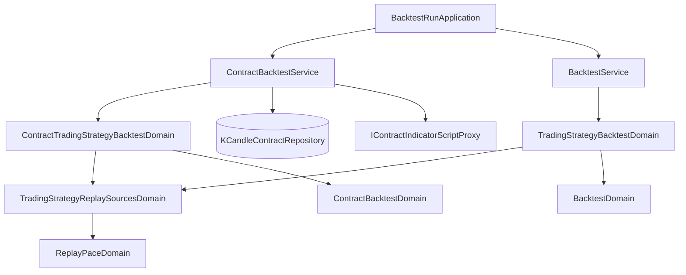

# 一份交易策略看多種粗細的 K 線 — Architecture Design

**Status:** Confirmed
**Source PRD:** `.sdd/2026-10-18-multi-interval-trading-strategy/PRD.md`
**Tech context:** Go · Clean / Onion Architecture（domain/models/domains 充血模型、domain/service 編排）

---

## 1. Design Goal & Guiding Principle

- **In one sentence:** 讓交易策略的信號來源各帶自己的彙總刻度存下去；重演時以最細刻度（重演步調）逐根前進，比步調粗的來源從**同一批一分鐘 K 線**合併出自己刻度的 K 線、在自己的刻度上執行算式，再把它的意見**以「已走完的最後一根」對齊回步調**，交給既有的條件樹與帳戶重演。
- **Guiding principle:** 「哪一根粗 K 線在步調上的哪一格才算數」這件會偷看未來的事，只住在一個 Domain Model（`ReplayPaceDomain`）裡；帳戶重演、條件樹、成績單完全不知道有多種刻度——它們收到的仍是「每一個步調格子一個信號」。

---

## 2. Change Scope

| Area | Action | What / Why |
| :--- | :--- | :--- |
| `TradingStrategySignalSourcesDomain`（存檔驗證） | **Modify** | 拿掉「彙總刻度一致」檢查，各來源的刻度照舊逐一驗證是六種之一 |
| `SharedAggregationIntervalDomain` | **Remove** | 規則作廢（UL-MAP 已刪除該詞），兩個呼叫端都改用重演步調 |
| `ReplayPaceDomain` | **Add** | 重演步調：最細刻度、各來源換算後的暖機根數、讀取起點對齊最粗刻度、粗刻度意見對齊回步調 |
| `TradingStrategyReplaySourcesDomain` | **Modify** | 以 `ReplayPaceDomain` 取代 sharedInterval；每個來源記住自己的刻度；暖機改為換算到步調後的最大值 |
| `TradingStrategyBacktestDomain` / `ContractTradingStrategyBacktestDomain` | **Modify** | 以步調建 `BacktestDomain`／`ContractBacktestDomain`；提供「某來源自己的 K 線」與「把它的信號對齊回步調」 |
| `BacktestDomain` | **Modify** | 讀取起點可再往前對齊到指定刻度的格子起點（粗刻度第一根才完整） |
| `BacktestService.RunTradingStrategyBacktest` / `ContractBacktestService.RunContractTradingStrategyBacktest` | **Modify** | 每個來源在自己的 K 線上執行算式，再請 domain 對齊回步調 |
| 策略機器人（`StrategyBotRunApplication`） | **Not touched** | 現在就讓每個來源各讀自己刻度的已走完 K 線 |
| 策略腳本單獨重演、指標計算 | **Not touched** | PRD 範圍外 |
| 回測輪次、成績單 DTO | **Not touched** | 輪次記的刻度就是重演步調，沿用現有欄位 |

---

## 3. New Classes / Modules

| Name | Kind | Responsibility (purpose) | Collaborators | Satisfies (PRD scenario) |
| :--- | :--- | :--- | :--- | :--- |
| `ReplayPaceDomain`（`domains/replay_pace_domain.go`） | Domain Model | 由一組來源刻度與回看根數決定重演步調；換算暖機根數；決定讀取起點要對齊的最粗刻度；把某來源在自己刻度上的逐根信號，對齊成步調上每一格「收盤當下已走完的最後一根」的信號，還沒有任何一根走完時給持平 | `AggregationIntervalDomain`、`SignalDomain` | US-02、US-03、US-04 全部情境 |

公開介面（深模組：呼叫端只問三件事，換算與邊界全在裡面）：

```go
func NewReplayPaceDomain(sourceIntervals []AggregationIntervalDomain, sourceLookbackCounts []int) ReplayPaceDomain
func (ReplayPaceDomain) Interval() AggregationIntervalDomain            // 最細刻度
func (ReplayPaceDomain) CoarsestInterval() AggregationIntervalDomain    // 讀取起點對齊用
func (ReplayPaceDomain) WarmupBarCount() int                            // 換算成步調根數後的最大回看
func (ReplayPaceDomain) SignalsAtPace(
    sourceInterval AggregationIntervalDomain,
    sourceBarOpenTimes []time.Time, sourceSignals []SignalDomain,
    paceBarOpenTimes []time.Time,
) []SignalDomain
```

- 暖機換算：`ceil(回看根數 × 來源刻度長度 ÷ 步調長度)`，取各來源最大值。
- 已走完判定：粗刻度那一根的收盤時刻（開盤 + 刻度長度）≤ 步調那一格的收盤時刻（開盤 + 步調長度）。兩者等長時退化為同一根，與現行逐根對應完全相同。

---

## 4. Modified Components

| Component | Current role | Change needed |
| :--- | :--- | :--- |
| `TradingStrategySignalSourcesDomain` | 驗證存檔的信號來源，含刻度一致 | 刪掉刻度一致段落 |
| `TradingStrategyReplaySourcesDomain` | 解析重演來源、記 sharedInterval、合併條件樹 | 改持有 `ReplayPaceDomain`；`resolvedSignalSource` 加 `interval`；`SharedInterval()` → `Pace()`；`MaximumLookbackCount()` → 由 pace 給暖機；新增 `SourceInterval(index)` |
| `BacktestDomain` | 讀取起點 = 起點格子 − 暖機根數 × 刻度 | 新增 `readingAlignedTo(interval)`：讀取起點再往前取該刻度的格子起點 |
| `TradingStrategyBacktestDomain`（現貨） | 以 sharedInterval 建 BacktestDomain | 以 pace 建；新增 `SourceInputCandles(index, kCandles)`（以該來源刻度合併、只留已走完的格子）與 `SignalsAtPace(index, sourceCandles, signals, paceCandles)` |
| `ContractTradingStrategyBacktestDomain` | 以 sharedInterval 建 ContractBacktestDomain | 以 pace 建；新增 `SourceAlignment(index, kCandleContracts)`（以該來源刻度合併成 `ContractKCandleAlignmentDomain`，只留已走完的格子）與 `SignalsAtPace(index, sourceAlignment, signals, paceAlignment)` |
| `BacktestService.RunTradingStrategyBacktest` | 每來源在同一批 K 線上執行 | 來源刻度 = 步調時沿用步調 K 線；否則取該來源自己的 K 線執行，再 `SignalsAtPace` |
| `ContractBacktestService.RunContractTradingStrategyBacktest` | 同上（合約） | 同上；粗刻度來源以自己的 alignment `Aligning(settlements, statistics)` 取得含資金費率與持倉統計的 K 線，訂單流照它自己的 alignment 附上 |

---

## 5. Component Relationships



讀取只發生一次：一分鐘 K 線讀進記憶體後，步調與每個粗刻度來源都從同一批合併，所以每一路看到的是同一段行情。

---

## 6. Extensibility & Handoff Notes

- **Most likely next requirement:** 回測輪次／成績單列出每個來源的刻度；或策略機器人以步調刻度決定觸發時機。
- **Where it lands:** 步調與各來源刻度都已由 `TradingStrategyReplaySourcesDomain` 持有，往 DTO 加欄位即可；對齊規則不必動。
- **How to add it:** 從 `ReplayPaceDomain` / `SourceInterval(index)` 讀出，轉進結果 DTO。
- **Patterns applied & why:** 單一 Domain Model 封裝「時間對齊」這個容易偷看未來的規則，所有重演路徑共用，現貨與合約不會各自寫一套。
- **Do not hardcode:** 刻度之間的倍數關係——一律由刻度長度與格子起點計算，不假設「一天 = 96 根十五分鐘」。
- **Known debt / deferred:** 粗刻度來源宣告訂單流時，訂單流 31 天上限仍以整段讀取範圍判斷（讀取範圍因粗刻度暖機變長時更容易碰到）；真的常用再拆開判斷。

---

## 7. Traceability

| PRD Scenario | Fulfilled by |
| :--- | :--- |
| US-01 三種刻度的交易策略存得下去 | `TradingStrategySignalSourcesDomain`（移除刻度一致檢查） |
| US-01 刻度相同時照舊存得下去 | `TradingStrategySignalSourcesDomain` |
| US-01 只有一個信號來源時照舊存得下去 | `TradingStrategySignalSourcesDomain` |
| US-01 刻度不在六種之內時拒絕 | `TradingStrategySignalSourcesDomain`（既有逐一驗證） |
| US-02 日線＋四小時＋十五分鐘以十五分鐘為步調 | `ReplayPaceDomain.Interval`、`ContractTradingStrategyBacktestDomain` |
| US-02 日線＋四小時以四小時為步調 | `ReplayPaceDomain.Interval` |
| US-02 全部同一種刻度時步調就是那一種 | `ReplayPaceDomain.Interval` |
| US-03 新的一天第一格用前一天的日線 | `ReplayPaceDomain.SignalsAtPace` |
| US-03 一天的最後一格收盤時，那一天的日線剛好走完 | `ReplayPaceDomain.SignalsAtPace` |
| US-03 一天還沒走完時仍用前一天的日線 | `ReplayPaceDomain.SignalsAtPace` |
| US-03 粗的那一路還沒有任何一根走完時是持平 | `ReplayPaceDomain.SignalsAtPace` |
| US-04 日線要回看的根數由日線來數 | `ReplayPaceDomain.WarmupBarCount`、`BacktestDomain.readingAlignedTo` |
| US-04 同一種刻度時讀進的行情與現在相同 | `ReplayPaceDomain.WarmupBarCount` |
| US-04 要讀進的行情超過一次重演的上限時拒絕 | `BacktestDomain`（既有上限檢查，以換算後的讀取範圍判斷） |
| US-05 同一種刻度的交易策略重演結果與改版前相同 | `ReplayPaceDomain.SignalsAtPace`（等長時逐根對應）、兩個 Service 的步調路徑 |
| US-06 機器人一輪讓每個來源各讀自己刻度的已走完 K 線 | `StrategyBotRunApplication`（既有行為）＋存檔不再拒絕 |
| US-06 當天的日線還在走時，機器人用前一天的日線 | 指標計算只用已走完的格子（既有行為） |
| US-06 有一個來源算不出意見時與現在相同 | `StrategyBotRunApplication`（既有行為） |
| US-07 刻度不同時存得下去並看到步調說明 | 前端（見前端 ARCH） |
| US-07 刻度都相同時不出現步調說明 | 前端（見前端 ARCH） |
