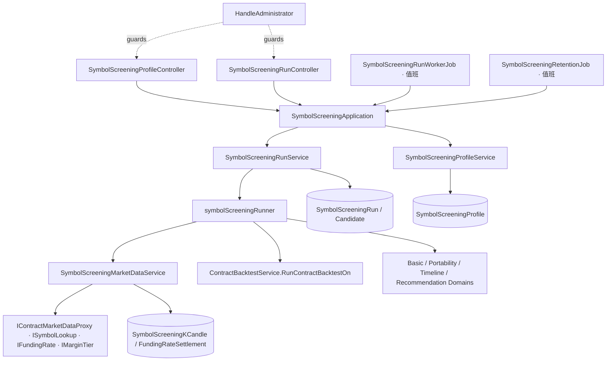

# 管理員標的篩選 — Architecture Design

**Status:** Confirmed
**Source PRD:** `.sdd/2026-10-19-admin-symbol-screening/PRD.md`
**Tech context:** Go · Gin · GORM（Postgres）· Clean / Onion（`domain/models/{entities,domains,dto,vo}`、`domain/service`、`domain/interface`）· mockgen · 腳本在獨立 worker 行程（yaegi）跑 · 多台分身（值班租約、心跳、清掃）

---

## 1. Design Goal & Guiding Principle

- **In one sentence:** 加一個只給管理員的篩選區：`User.IsAdmin` 擋路由；管理員管理 `SymbolScreeningProfile`、送出 `SymbolScreeningRun`（附快照與候選標的）；**值班分身**上的 `SymbolScreeningRunWorkerJob` 一次認領一筆，由 `symbolScreeningRunner` 逐一候選標的：向幣安取得篩選刻度的 K 線與資金費率存進篩選專用的表 → 基本條件 → 以既有合約重演引擎切段重演 → 策略移植判斷；全部處理完再算組合貢獻與推薦順序。
- **Guiding principle:** **合約重演引擎不知道資料從哪裡來。** `ContractBacktestService` 多一個公開方法 `RunContractBacktestOn(ctx, request, replayInput, progress)`：吃一份「已備好的重演輸入」（交易規格、保證金分級、K 線、資金費率結算），與既有的 `RunContractBacktest` 共用同一個私有重演核心。篩選只負責備資料與判斷；判斷規則全部住在篩選的 Domain Model（關卡、區段、組合貢獻、推薦順序），之後加關卡或改門檻只動篩選區，不碰引擎、不碰盯盤。

---

## 2. Change Scope

| Area | Action | What / Why |
| :--- | :--- | :--- |
| `entities.User` / `dto.UserDto` | **Modify** | 加 `IsAdmin bool`（`not null default false`）；`UserDto.IsAdmin`（json `isAdmin`）讓 `/users/me` 說出來 |
| `UserService` / `UserApplication` / `AuthenticationMiddleware` | **Modify** | 新 `IdentifyActivatedAdministrator`：先走既有的「已開通」判斷，再看 `IsAdmin`，不是就 `ErrAdministratorRequired`；中介層新 `HandleAdministrator`（403「這是管理員功能」）。外掛權杖與網頁權杖一視同仁 |
| `domain/models/entities` | **Add** 5 個 entity | `SymbolScreeningProfile`、`SymbolScreeningRun`、`SymbolScreeningCandidate`、`SymbolScreeningKCandle`、`SymbolScreeningFundingRateSettlement` |
| `domain/models/vo` | **Add** | 狀態／關卡列舉、設定快照、候選結果數字（jsonb） |
| `domain/models/domains` | **Add** | 設定驗證、標的清單整理、輪次狀態機、篩選期間與區段、基本條件、策略移植、組合貢獻、推薦順序、重演輸入篩選 |
| `domain/models/dto` | **Add** | 設定、輪次、候選、送出、重演輸入 |
| `domain/interface` | **Add** 5 個 repository 介面；**Modify** `IContractMarketDataProxy` | 加 `FetchAggregatedKCandles`（一個外部資源一個 proxy，沿用同一個幣安合約行情 proxy） |
| `vo.ContractSymbolListingVo` / `BinanceContractSymbolLookupProxy` | **Modify** | 加 `IsKnownToVenue`：幣安有這個永續合約但不在交易中時為 true、`IsListed` 為 false，基本條件才分得出「沒有」與「停止交易」 |
| `ContractBacktestService` | **Modify** | 抽出私有重演核心；加 `RunContractBacktestOn` |
| `domain/service` | **Add** `SymbolScreeningProfileService`、`SymbolScreeningRunService`、`symbolScreeningRunner`、`SymbolScreeningMarketDataService` | 設定 CRUD；輪次送出／列／看／取消／認領／清掃／清理；一筆輪次的執行；篩選行情的取得與沿用 |
| `application` | **Add** `SymbolScreeningApplication`；**Modify** `InterruptedWorkApplication`、`UserApplication` | 用例編排；重啟清掃多一項 |
| `controller` | **Add** `SymbolScreeningProfileController`、`SymbolScreeningRunController` | 9 個路由 |
| `job` | **Add** `SymbolScreeningRunWorkerJob`、`SymbolScreeningRetentionJob` | 值班分身認領並跑；值班分身清理到期輪次與行情 |
| `infrastructure/persistence` | **Add** 5 個 repository；**Modify** `SchemaMigrator` | 認領用 `FOR UPDATE SKIP LOCKED`；條件更新守門 |
| `infrastructure/marketdata` | **Modify** `BinanceContractMarketDataProxy` | `FetchAggregatedKCandles`：同一套分頁與節奏，`interval` 參數化，只合併成交價與標記價格 |
| `config` / `cmd/server` | **Modify** | `SymbolScreeningConfig`、DI、路由 |
| UL-MAP / Postman / README | **Modify** | 詞彙已更新；補 9 個路由；環境變數表 |
| 每分鐘合約 K 線、合約追蹤名單、歷史同步、機器人、交易策略 | **Not touched** | PRD：篩選不碰盯盤 |
| 回測輪次（`BacktestRun*`）與每人上限 | **Not touched** | 篩選的重演不算進回測額度、不出現在回測清單 |
| 腳本沙箱與同時隔間上限 | **Not touched** | 篩選照常佔一個隔間；一次只跑一筆、逐格順序執行 |

---

## 3. New Classes / Modules

### Entities（`domain/models/entities`）

| Name | Fields（GORM 預設 snake_case） | Satisfies |
| :--- | :--- | :--- |
| `SymbolScreeningProfile` | `ID`、`OwnerID`（FK Users cascade；`(owner_id, name)` unique）、`Name`、`StrategyScriptID`（無 FK cascade；刪腳本不連帶刪設定，送出時再解析）、`AggregationInterval`、`ParameterValues`（jsonb `[]dto.StrategyScriptParameterValueDto`）、`TradingMode`、`Leverage`、`EntryCostPercentage`、`SlippagePercentage`（decimal）、`HistoryDays`、`SegmentCount`、`MinimumTradeCount`、`MinimumAverageDailyQuoteVolume`（decimal）、`BaselineSymbols`（jsonb `[]string`）、`CreatedAt`、`UpdatedAt` | US-02 |
| `SymbolScreeningRun` | `ID`、`OwnerID`（FK cascade）、`ProfileID *uint`（設定刪除後 set null）、`ProfileName`、`Snapshot`（jsonb `vo.SymbolScreeningSnapshotVo`）、`Status`、`ProcessedCandidateCount`、`CandidateCount`、`ReplicaName`、`FailureReason`、`ContributionFailureReason`、`SubmittedAt`、`StartedAt*`、`FinishedAt*`；index `(owner_id, id desc)`、`(status, id)`、`(finished_at)` | US-03、04 |
| `SymbolScreeningCandidate` | `ID`、`RunID`（FK cascade）、`Position`（送出順序）、`Symbol`、`Status`、`Stage`、`Reason`、`Findings`（jsonb `vo.SymbolScreeningFindingsVo`）、`RecommendationRank *int`；index `(run_id, position)` | US-04～07 |
| `SymbolScreeningKCandle` | `ID`、`Symbol`、`Interval`、`OpenTime`（`(symbol, interval, open_time)` unique）、OHLC、`Volume`、`QuoteVolume`、`TakerBuyBaseVolume`、`TakerBuyQuoteVolume`、`TradeCount`、`MarkOpen/High/Low/Close`、`FetchedAt`（index）；`ToKCandleContract()` 形狀轉換 | US-08 |
| `SymbolScreeningFundingRateSettlement` | `ID`、`Symbol`、`SettlementTime`（`(symbol, settlement_time)` unique）、`FundingRate`、`MarkPrice NullDecimal`、`FetchedAt`；`ToContractFundingRateSettlement()` | US-08 |

### VO / DTO

| Name | Kind | Responsibility |
| :--- | :--- | :--- |
| `SymbolScreeningRunStatusVo` | VO | `queued`/`running`/`succeeded`/`failed`/`cancelled`；看不懂的讀成 `failed` |
| `SymbolScreeningCandidateStatusVo` | VO | `waiting`/`processing`/`passed`/`rejected`/`unfinished`/`cancelled` |
| `SymbolScreeningStageVo` | VO | `basicCondition`/`portability`（淘汰卡在哪一關；組合貢獻不淘汰所以不在其中） |
| `SymbolScreeningSnapshotVo` | VO（jsonb） | 送出當下的設定全部欄位＋解析好的腳本（`Script`、`ResultType`、`Parameters` 宣告、`ParameterValues`） |
| `SymbolScreeningFindingsVo` | VO（jsonb） | `HistoryDays`、`AverageDailyQuoteVolume`、`Segments []SymbolScreeningSegmentFindingVo{StartTime, EndTime, ReturnRate, MaximumDrawdown, ClosedTradeCount, LiquidationCount}`、`ReturnWithoutBestSegment`、`Contribution *SymbolScreeningContributionVo{InMarketShare, OverlapShare, BaselineLongestGapDays, CombinedLongestGapDays, GapReductionDays}` |
| `SymbolScreeningProfileDto` / `…WriteDto` | DTO | 設定讀／寫形狀（寫入時沒給的欄位為零值，由 Domain Model 套預設） |
| `SymbolScreeningRunDto` / `…DetailDto` / `…PageDto` / `…ListQueryDto` / `…SubmissionDto` | DTO | 列表、明細（含依推薦順序排好的候選）、送出（`ProfileID`、`SymbolList string`） |
| `SymbolScreeningCandidateDto` | DTO | 候選標的一列 |
| `ContractReplayInputDto` | DTO（domain 內部，不出 domain） | `Specification vo.ContractTradingSpecificationVo`、`MarginLadder []vo.ContractMaintenanceMarginTierVo`、`KCandles []entities.KCandleContract`、`Settlements []entities.ContractFundingRateSettlement` |

### Domain Models（`domain/models/domains`）

| Name | Responsibility | Satisfies |
| :--- | :--- | :--- |
| `SymbolScreeningProfileDomain` | 建構子套預設（730／3／6／20,000,000／1x／0.05／0.05／longOnly）並驗證範圍（歷史 180–1825、區段 2–6、最少筆數 1–200、成交額 ≥0、槓桿 ≥1、成本 0–100、名稱 1–128、刻度只 `4h`/`1d`、交易模式三選一、現有組合 ≤10 且照清單規則整理）；`AcceptScript(resolvedScript)`：必須吃合約行情、resultType signal、不宣告 orderFlowPriceStep；`ToEntity`、`ToSnapshot(resolvedScript)` | US-02、03 |
| `SymbolScreeningSymbolListDomain` | 清單整理：全形逗號、trim、大寫、去空、去重保序；空、超過上限、非 `[A-Z0-9]` 回具名錯誤（帶出是哪一個） | US-03 |
| `SymbolScreeningRunDomain` | 狀態機（`Claim`、`Advance`、`Succeed`、`Fail`、`Cancel`、`IsActive`、`ProgressPercent`）；同 `BacktestRunDomain` 形狀 | US-04 |
| `SymbolScreeningAdmissionDomain` | `Admit(activeCountOfOwner)`：≥1 即 `ErrSymbolScreeningRunAlreadyActive` | US-03 |
| `SymbolScreeningPeriodDomain` | 由 `now`、歷史天數、區段數、刻度、暖機根數算出：期間終點＝最近一個走完的 UTC 日結束、起點、各區段 `[start,end)`、要取得的行情起點（起點 − 暖機）；`HistoryDaysOf(firstBarOpen)` | US-05、06 |
| `SymbolScreeningBasicConditionDomain` | 依序判斷 listing → 歷史天數 → 最近 30 個走完的日子日均成交額（由篩選刻度 K 線依 UTC 日加總 quote volume）；回 `(passed, reason, findings)` | US-05 |
| `SymbolScreeningPortabilityDomain` | 吃各區段 `ContractBacktestResultDto`：交易太少 → 多數區段虧損（報酬 > 0 的段數 ×2 > 段數）→ 去掉最好一段後連乘報酬 ≤ 0；回判斷與區段數字 | US-06 |
| `SymbolScreeningHoldingTimelineDomain` | 由各區段平倉交易（＋區段結束時仍持有的部位）組出持倉時段（`SymbolScreeningHoldingVo`），合併重疊；`ContributionAgainst(baseline)` 算出在場比例、重疊比例與空窗縮短天數 | US-07 |
| `SymbolScreeningBaselineDomain` | 現有組合標的的持倉彙總：`Including(segmentResults)` 累積、`Unavailable(symbol, cause)` 記下無法比較的原因、`Compared(candidates, tradesBySymbol)` 為通過的候選標的填入組合貢獻；無法比較時候選標的原樣返回 | US-07 |
| `SymbolScreeningRecommendationDomain` | 依 PRD 規則排序候選、填 `RecommendationRank` | US-07 |
| `ContractReplayInputDomain` | 包 `ContractReplayInputDto`：`CandlesIn(query)`、`SettlementsIn(query)`、`LatestSettlementBefore(cutoff)`、`TradingRules()`（以規格 VO 轉 `ContractTradingSymbol` 形狀＋分級 → `NewContractTradingRulesDomain`；分級空時引擎既有的退回規則生效） | US-06、08 |

### Interfaces / Repositories / Proxies

| Name | Responsibility |
| :--- | :--- |
| `ISymbolScreeningProfileRepository` / `SymbolScreeningProfileRepository` | `Save`、`FindOneOwned(ownerID, id)`、`FindAllByOwner`、`ExistsName(ownerID, name, exceptID)`、`Delete(ownerID, id)` |
| `ISymbolScreeningRunRepository` / `SymbolScreeningRunRepository` | `Save`（連同候選）、`FindOneOwned`、`FindPageByOwner`、`CountActiveByOwner`、`CountActiveByProfile`、`ClaimOldestQueued(replica, now)`（`SKIP LOCKED`）、`AdvanceIfRunning`、`FinishIfRunning`、`CancelIfActive`、`FailRunningOutside(live, reason, now)`、`FailRunningOn(replica, reason, now)`、`DeleteFinishedBefore(cutoff)` |
| `ISymbolScreeningCandidateRepository` / `SymbolScreeningCandidateRepository` | `FindByRun(runID)`、`Save(candidate)`、`CancelWaiting(runID)` |
| `ISymbolScreeningKCandleRepository` / `SymbolScreeningKCandleRepository` | `FindInRange(symbol, interval, start, end)`、`SaveAll`（upsert on unique）、`DeleteFetchedBefore(cutoff)` |
| `ISymbolScreeningFundingRateSettlementRepository` / `SymbolScreeningFundingRateSettlementRepository` | `FindInRange(symbol, start, end)`、`FindLatestBefore`、`SaveAll`（upsert）、`DeleteFetchedBefore(cutoff)` |
| `IContractMarketDataProxy.FetchAggregatedKCandles(ctx, vo.AggregatedKCandleFetchWindowVo{Symbol, Interval, StartTime, EndTime}) ([]vo.ContractMarketKCandleVo, error)` | 既有幣安合約行情 proxy 加方法；`interval` 用 Binance 的 `4h`/`1d`；只合併成交價與標記價格（指數、溢價留空）；同一個 `cryptoContract` 請求節奏 |

### Services / Runner / Application / Controllers / Jobs

| Name | Kind | Responsibility | Collaborators | Satisfies |
| :--- | :--- | :--- | :--- | :--- |
| `SymbolScreeningProfileService` | Domain Service | `List`、`Get`、`Create`、`Update`、`Delete`（`CountActiveByProfile > 0` → `ErrSymbolScreeningProfileInUse`）；建立／修改時以 `StrategyScriptService` 的既有解析確認腳本歸屬再交 `AcceptScript` | profile repo、run repo、`IStrategyScriptRepository` | US-02 |
| `SymbolScreeningMarketDataService` | Domain Service | `Prepare(ctx, symbol, interval, fetchStart, periodEnd) (ContractReplayInputDto, vo.ContractSymbolListingVo, error)`：`LookUpSymbol`；保留期限內且根數齊全就沿用，否則 `FetchAggregatedKCandles` ＋ `FetchFundingRateSettlements(after = fetchStart−1 結算間隔)` 後 upsert；分級來自一次性的 `FetchMaintenanceMarginLadders`（拿不到金鑰時為空、不算錯） | 兩個篩選行情 repo、三個合約 proxy、clock | US-05、08 |
| `SymbolScreeningRunService` | Domain Service | `Submit`（`Atomically{ CountActiveByOwner → Admit → Save(run＋候選) }`）、`List`、`Get(wait≤60s)`、`Cancel`（`CancelIfActive` ＋ `CancelWaiting`）、`ClaimAndRun`（`ClaimOldestQueued` 成功 `go runner.run()`；同時只持有一個 runner）、`StopRunner`、`FailInterruptedRuns`、`DeleteExpired(runCutoff, marketDataCutoff)` | run／candidate repo、`SymbolScreeningMarketDataService`、`ContractBacktestService`、transaction、clock | US-03、04 |
| `symbolScreeningRunner` | goroutine 生命週期物件（service 旁） | 一筆輪次：`context.WithTimeoutCause(allowance)`；逐一候選：標 processing → `Prepare` → 基本條件 → 各區段 `RunContractBacktestOn` → 移植判斷 → 存候選、`AdvanceIfRunning`（回 false＝已取消就停）；全部完成後現有組合標的同樣備資料與重演、算組合貢獻（失敗記 `ContributionFailureReason`）、排推薦順序、`FinishIfRunning(succeeded)`；逾時 → `failed「超過時間上限」`；單一候選錯誤 → 該候選 `unfinished`＋原句；recover panic → `failed「篩選服務壞掉」` | 上列 | US-04～08 |
| `SymbolScreeningApplication` | Application | `ListProfiles`、`GetProfile`、`CreateProfile`、`UpdateProfile`、`DeleteProfile`、`SubmitRun`（取設定 → 解析腳本 → `ToSnapshot` → 清單整理 → Submit）、`ListRuns`、`GetRun`、`CancelRun`、`RunClaimedScreening`、`StopRunner`、`DeleteExpired` | 兩個 service、`StrategyScriptService` | 全部 |
| `SymbolScreeningProfileController` | Controller | `GET/POST /symbol-screening-profiles`、`GET/PUT/DELETE /symbol-screening-profiles/:id`；404／409 在用中／400 帶 `field` | application | US-02 |
| `SymbolScreeningRunController` | Controller | `POST /symbol-screening-runs`（202）、`GET /symbol-screening-runs`、`GET /symbol-screening-runs/:id?waitSeconds=`、`POST /symbol-screening-runs/:id/cancel`；已有進行中 → 429；已結束 → 409 | application | US-03、04 |
| `SymbolScreeningRunWorkerJob` | Job | 每 `PollInterval` 在**值班分身**上 `RunClaimedScreening`（值班只有一台 → 全系統一次一筆）；失去值班或 Stop 時 `StopRunner`（手上的輪次收成 failed「被重新啟動打斷」） | application、`JobLeadershipApplication` | US-04 |
| `SymbolScreeningRetentionJob` | Job | 值班分身每小時刪 90 天前結束的輪次與 30 天前取得的篩選行情 | application、leadership | US-04、08 |
| `SymbolScreeningConfig` | Config | `SYMBOL_SCREENING_MAX_CANDIDATES_PER_RUN`=20、`SYMBOL_SCREENING_RUN_TIME_ALLOWANCE_MINUTES`=120、`SYMBOL_SCREENING_RUN_POLL_INTERVAL_SECONDS`=5（不是正數時退回預設，與回測輪次相同；停用靠背景工作總開關）、`SYMBOL_SCREENING_RUN_RETENTION_DAYS`=90、`SYMBOL_SCREENING_MARKET_DATA_RETENTION_DAYS`=30 | — | NFR |

---

## 4. Modified Components

| Component | Current role | Change needed |
| :--- | :--- | :--- |
| `ContractBacktestService` | 從 DB 讀行情、重演合約腳本 | `RunContractBacktest` 讀完行情後交給私有 `replayContractScript(ctx, allowance, domain, alignment, bars, settlements, request, progress)`；新公開 `RunContractBacktestOn(ctx, request, input ContractReplayInputDto, progress)`：`ContractReplayInputDomain.TradingRules()` → `NewContractBacktestDomain` → `CandlesIn(domain.KCandleQuery())` → `SelectInput` → `SettlementsIn`＋`LatestSettlementBefore` → `Aligning(settlements, nil)` → 同一個私有核心。兩個公開方法都用到核心（符合 private 門檻），互不呼叫 |
| `IContractMarketDataProxy` / `BinanceContractMarketDataProxy` | 每分鐘 K 線（固定 `1m`） | 加 `FetchAggregatedKCandles`；`fetchPage`/`fetchRows` 收 interval 與步長參數，既有 `FetchKCandles` 傳 `1m` |
| `ContractSymbolListingVo` / `BinanceContractSymbolLookupProxy` | 只說 `IsListed` | 加 `IsKnownToVenue`；`LookUpSymbol` 找到同名永續合約但非 TRADING 時 `IsKnownToVenue=true, IsListed=false` |
| `User` / `UserDto` | 帳號 | `IsAdmin`；`ToDto` 帶出 |
| `UserService` / `UserApplication` | 身分判斷 | `IdentifyActivatedAdministrator(ctx, token)`；`ErrAdministratorRequired` |
| `AuthenticationMiddleware` | 驗證登入 | `HandleAdministrator`：403 `{"message":"這是管理員功能"}`；待開通照既有 403＋開通指示 |
| `InterruptedWorkApplication` | 重啟清掃 | 多呼叫 `SymbolScreeningRunService.FailInterruptedRuns` |
| `SchemaMigrator` | AutoMigrate | 加 5 個 entity；`Users.is_admin` 由 AutoMigrate 加欄（default false） |
| `cmd/server/dependencies.go` | DI、路由、jobs | 組裝上述；`requiresAdministrator := authenticationMiddleware.HandleAdministrator` |

---

## 5. Component Relationships

---

## 6. Extensibility & Handoff Notes

- **Most likely next requirement:** 加「趨勢性格」關卡（日線統計）、或定期自動重跑、或通過後一鍵加入合約追蹤名單。
- **Where it lands:**
  - 新關卡：`SymbolScreeningStageVo` 加一個值、新增一個 `SymbolScreening{Stage}Domain`（吃已備好的行情回 `(passed, reason, findings)`），在 runner 的關卡順序插一行；`SymbolScreeningFindingsVo` 加欄位。行情、輪次、排序都不動。
  - 定期重跑：新 job 呼叫 `SubmitRun`（快照機制已讓重跑可比較）。
  - 一鍵加入追蹤：新 application 方法呼叫既有合約追蹤名單用例，篩選區不動。
- **Patterns applied & why:** 重演輸入抽成 DTO＋共用私有核心（引擎與資料來源解耦，第二種資料來源不必再改引擎）；快照（設定與腳本之後改動不影響過去結果）；runner 與 job 沿用回測輪次的生命週期形狀（維運一致）。
- **Do not hardcode:** 門檻全在設定（篩選設定或環境變數）；10,000 起始資金是 PRD 定值，集中在 `SymbolScreeningPeriodDomain` 一處。
- **Known debt / deferred:** 粗刻度重演的止損與強平只看該格高低點；持倉時段由平倉交易加上合約重演回報的 `OpenPositionEntryTime`（區段結束仍持有的部位以區段終點收尾，`SymbolScreeningPeriodDomain.ClosedTradesOf`）；組合貢獻的空窗以日曆天取整。

---

## 7. Traceability

| PRD Scenario | Fulfilled by |
| :--- | :--- |
| US-01 已開通的管理員可以送出篩選 | `HandleAdministrator` + `SymbolScreeningRunController.Submit` |
| US-01 不是管理員一律拒絕 | `UserService.IdentifyActivatedAdministrator` → `ErrAdministratorRequired` → 403 |
| US-01 待開通的管理員照既有開通關卡被擋 | `IdentifyActivatedAdministrator`（先走已開通判斷） |
| US-01 管理員透過外掛也能用 | `HandleAdministrator` 不檢查 audience |
| US-01 新帳號不是管理員 / 管理員查看目前登入者 | `User.IsAdmin` default false；`UserDto.IsAdmin` |
| US-02 只填必要項目即可建立，其餘用預設值 | `SymbolScreeningProfileDomain` 建構子 |
| US-02 看盤間隔只能是每 4 小時或每天 / 數值超出合理範圍即拒絕 / 名稱不可重複 | `SymbolScreeningProfileDomain`、`ExistsName` |
| US-02 策略必須是給合約用的 / 需要逐筆成交明細的策略不能拿來篩選 / 策略必須會說出買賣信號 | `SymbolScreeningProfileDomain.AcceptScript` |
| US-02 不能用別人的策略腳本 / 別人的設定看不到 | `SymbolScreeningProfileService`（`FindOneOwned`、腳本歸屬） |
| US-02 修改設定 | `SymbolScreeningProfileService.Update` |
| US-02 有篩選輪次正在使用的設定不能刪除 / 用過的輪次都結束了就能刪除 | `CountActiveByProfile`、`ProfileID` set null＋`Snapshot` |
| US-03 大小寫與全形逗號 / 重複與空項 / 沒有任何標的 / 正好達到上限 / 超過上限 / 含不允許字元 | `SymbolScreeningSymbolListDomain` |
| US-03 同時只能有一筆自己的篩選 | `SymbolScreeningAdmissionDomain` + 429 |
| US-03 指名別人的篩選設定 | `FindOneOwned` → not found |
| US-03 送出後修改設定／策略腳本不影響這筆輪次 | `SymbolScreeningSnapshotVo` |
| US-04 全部被淘汰也算完成 / 進度 / 單一標的取不到行情 / 策略出錯 | `symbolScreeningRunner` |
| US-04 取消進行中的篩選 / 已結束的篩選不能取消 | `SymbolScreeningRunDomain.Cancel`、`CancelWaiting` |
| US-04 超過時間上限 / 服務重新啟動 | runner allowance、`StopRunner`、`FailInterruptedRuns` |
| US-04 全系統一次只跑一筆 | `SymbolScreeningRunWorkerJob` 只在值班分身、一次一個 runner |
| US-04 列出由新到舊 / 別人的看不到 / 順便等一下 | `SymbolScreeningRunService.List/Get` |
| US-04 結束的篩選保留 90 天 | `SymbolScreeningRetentionJob` |
| US-05 全部 7 個情境 | `SymbolScreeningBasicConditionDomain` + `SymbolScreeningPeriodDomain` |
| US-06 全部 9 個情境 | `SymbolScreeningPortabilityDomain` + `SymbolScreeningPeriodDomain` + `RunContractBacktestOn` |
| US-07 算出縮短的空窗 | `SymbolScreeningBaselineDomain`、`SymbolScreeningHoldingTimelineDomain` |
| US-07 排序 4 個情境 | `SymbolScreeningRecommendationDomain` |
| US-07 現有組合標的取不到行情 | runner → `ContributionFailureReason` |
| US-08 篩選不碰盯盤 / 保留期限內沿用 / 過期重新取得 | `SymbolScreeningMarketDataService` + 篩選行情 repo + retention job |
| US-08 沒有分級保證金規定時退回最基本的一級 | `ContractReplayInputDomain.TradingRules()` → 既有 `NewContractTradingRulesDomain` |
| US-08 篩選用行情沒有持倉統計 | `Aligning(settlements, nil)` |

---

## 8. Risks & Open Decisions

- **Risks / trade-offs:**
  - 值班分身同時跑抓取與篩選；篩選逐格順序、一次一筆，負載與一筆 4h 回測相當。
  - 幣安請求節奏與盯盤共用 `cryptoContract` pacer；一個候選約 10 次請求，不會擠壓每分鐘抓取。
  - 分級保證金需帳戶金鑰；沒有時以最基本一級計，強平價對大部位偏遠（篩選用 10,000 起始資金，影響可忽略）。
- **Open decisions (resolved for implementation):**
  - 原先建議的 `SYMBOL_SCREENING_MARKET_DATA_FETCH_CONCURRENCY` 不需要：候選依序處理，共用既有請求節奏即可。
  - 暖機根數：腳本宣告的最大回看根數，沒宣告用 `BACKTEST_DEFAULT_WARMUP_BAR_COUNT`（與回測一致）。
