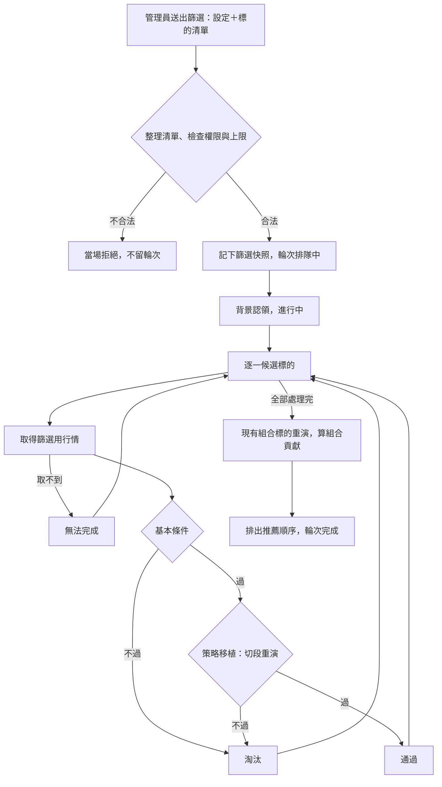

# Product Requirements Document (PRD) — 管理員標的篩選

**Status:** Finalized
**Version:** v1.0
**Owner:** James Hsueh
**Stakeholders:** Engineering

---

## 1. Background & Goal (Why & Goal)

- **Problem Statement:** 管理員的趨勢策略只在少數標的上驗證過，單一標的空窗很長（BTC 只做多時最長 95 天沒有部位）。要加標的，關鍵是「策略原封不動能不能移植過去」與「能不能錯開現有部位」；今天只能一個一個標的手動同步數年的每分鐘行情、手動切段回測、自己算空窗，一個標的就要一兩個小時。
- **Expected Outcome:**
  - 管理員一次丟進最多 20 個永續合約標的，系統在背後依序檢查，每個標的幾分鐘內有結論：**通過、淘汰（卡在哪一關、為什麼）或無法完成（原因）**，並附判斷用的數字。
  - 通過的標的依「能把現有組合的最長空窗縮短多少」排出推薦順序。
  - 篩選需要的設定、紀錄、結果與行情全部集中在篩選這一區；盯盤用的交易策略、機器人、合約追蹤名單與每分鐘行情完全不受影響。
  - 帳號多一個「管理員」身分，只有管理員看得到、用得到篩選。
- **Out of Scope:**
  - 「趨勢性格」統計篩選（需要先用已知結果校準）。
  - 定期自動重跑篩選、優勢消退提醒。
  - 由多個策略腳本組合而成的交易策略、現貨標的、台股標的。
  - 通過後自動加入合約追蹤名單或建立機器人。
  - 篩選結束時的 Telegram 通知。
  - 透過系統設定或取消管理員。

---

## 2. User Personas

- **Primary Role(s):** 管理員（在操作台或透過外掛管理篩選設定、送出篩選、回來看結果）；營運者（在系統外開通管理員、調整篩選的上限與保留期限）。
- **Usage Context:** 研究要不要加標的時，一次丟進一串候選，離開去做別的事，之後回來看推薦順序與每個標的被淘汰的原因。

---

## 3. User Stories & Acceptance Criteria

### US-01 — [priority: P0] 只有管理員能用篩選
**As a** 營運者, **I want** 篩選只開放給我指定的管理員, **so that** 一般使用者看不到、也用不到這個還在研究階段的功能。

```gherkin
Scenario: 已開通的管理員可以送出篩選
  Given 我是已開通的管理員
  And 篩選設定「趨勢 V3」是我的
  When 我用「趨勢 V3」送出篩選「XRPUSDT」
  Then 立刻回覆一筆排隊中的篩選輪次

Scenario: 不是管理員一律拒絕
  Given 我是已開通、但不是管理員的使用者
  When 我查看自己的篩選設定清單
  Then 被拒絕，說明「這是管理員功能」

Scenario: 待開通的管理員照既有開通關卡被擋
  Given 我是管理員，但帳號還是待開通
  When 我送出篩選
  Then 被拒絕，並附上開通指示

Scenario: 管理員透過外掛也能用
  Given 我是已開通的管理員，並透過外掛授權操作
  When 我查看自己的篩選輪次
  Then 正常回覆我的篩選輪次清單

Scenario: 新帳號不是管理員
  Given 一個剛註冊的帳號
  When 他查看目前登入者
  Then 回覆說他不是管理員

Scenario: 管理員查看目前登入者
  Given 我是已開通的管理員
  When 我查看目前登入者
  Then 回覆說我是管理員
```

### US-02 — [priority: P0] 管理篩選設定
**As a** 管理員, **I want** 把「用哪支策略、什麼條件來篩」存成幾份有名字的設定, **so that** 每次篩選不必重新填一遍，也能比較不同篩法。

```gherkin
Scenario: 只填必要項目即可建立，其餘用預設值
  Given 合約信號策略腳本 #108 是我的
  When 我用腳本 #108、看盤間隔每 4 小時，建立篩選設定「趨勢 V3」
  Then 建立成功
  And 歷史天數 730、區段數 3、最少交易筆數 6、最低日均成交額 20,000,000、槓桿 1 倍、手續費 0.05%、滑價 0.05%、交易模式只做多、沒有現有組合標的

Scenario: 看盤間隔只能是每 4 小時或每天
  When 我用看盤間隔每 15 分鐘建立篩選設定
  Then 被拒絕，說明看盤間隔只能是每 4 小時或每天

Scenario: 策略必須是給合約用的
  Given 策略腳本 #20 是我的、給現貨用
  When 我用腳本 #20 建立篩選設定
  Then 被拒絕，說明策略腳本必須吃合約行情

Scenario: 需要逐筆成交明細的策略不能拿來篩選
  Given 策略腳本 #30 是我的、需要逐筆成交明細
  When 我用腳本 #30 建立篩選設定
  Then 被拒絕，說明篩選用行情沒有逐筆成交明細

Scenario: 策略必須會說出買賣信號
  Given 策略腳本 #31 是我的、只算出數字不說出買賣信號
  When 我用腳本 #31 建立篩選設定
  Then 被拒絕，說明策略腳本必須產出買賣信號

Scenario: 不能用別人的策略腳本
  Given 策略腳本 #40 是別人的
  When 我用腳本 #40 建立篩選設定
  Then 被拒絕，說明找不到這支策略腳本

Scenario: 名稱不可與自己另一份設定重複
  Given 我已經有篩選設定「趨勢 V3」
  When 我再建立一份也叫「趨勢 V3」的篩選設定
  Then 被拒絕，說明名稱重複

Scenario: 別人的設定看不到
  Given 篩選設定 #5 是另一位管理員的
  When 我查看篩選設定 #5
  Then 回覆找不到

Scenario: 修改設定
  Given 篩選設定「趨勢 V3」是我的、歷史天數 730
  When 我把它的歷史天數改成 365
  Then 修改成功，之後查看到的歷史天數是 365

Scenario: 數值超出合理範圍即拒絕
  When 我建立一份區段數為 1 的篩選設定
  Then 被拒絕，說明區段數至少要 2

Scenario: 有篩選輪次正在使用的設定不能刪除
  Given 篩選設定「趨勢 V3」有一筆排隊中的篩選輪次在用
  When 我刪除「趨勢 V3」
  Then 被拒絕，說明有篩選輪次正在使用

Scenario: 用過的輪次都結束了就能刪除
  Given 用過篩選設定「趨勢 V3」的輪次都已結束
  When 我刪除「趨勢 V3」
  Then 刪除成功
  And 那些已結束的輪次仍看得到當時的設定內容
```

### US-03 — [priority: P0] 送出篩選
**As a** 管理員, **I want** 貼上一串用逗號分隔的標的就能送出篩選, **so that** 我可以直接從別處複製候選清單。

```gherkin
Scenario: 大小寫與全形逗號都能整理
  When 我送出「xrpusdt, DOGEUSDT，linkusdt」
  Then 篩選輪次的候選標的依序是 XRPUSDT、DOGEUSDT、LINKUSDT

Scenario: 重複與空項會被拿掉
  When 我送出「ADAUSDT,adausdt,,」
  Then 篩選輪次只有一個候選標的 ADAUSDT

Scenario: 整理後沒有任何標的
  When 我送出「 , ，」
  Then 被拒絕，說明沒有任何標的
  And 我的篩選輪次清單沒有多任何一筆

Scenario: 正好達到單次上限可以送出
  Given 單次篩選標的上限是 20
  When 我送出 20 個不重複的標的
  Then 立刻回覆一筆排隊中的篩選輪次

Scenario: 超過單次上限
  Given 單次篩選標的上限是 20
  When 我送出 21 個不重複的標的
  Then 被拒絕，說明一次最多 20 個標的

Scenario: 含不允許的字元
  When 我送出「BTC-USDT」
  Then 被拒絕，說明 BTC-USDT 含字母與數字以外的字元

Scenario: 同時只能有一筆自己的篩選
  Given 我已有一筆排隊中的篩選輪次
  When 我再送出一筆
  Then 被拒絕，說明同時只能有一筆篩選

Scenario: 指名別人的篩選設定
  Given 篩選設定 #5 是另一位管理員的
  When 我用篩選設定 #5 送出篩選
  Then 被拒絕，說明找不到這份篩選設定

Scenario: 送出後修改設定不影響這筆輪次
  Given 我用歷史天數 730 的「趨勢 V3」送出篩選
  When 送出後我把「趨勢 V3」的歷史天數改成 365，然後輪次開始跑
  Then 這筆輪次照 730 天篩選

Scenario: 送出後修改策略腳本不影響這筆輪次
  Given 我用「趨勢 V3」送出篩選
  When 送出後我修改了它引用的策略腳本算式，然後輪次開始跑
  Then 這筆輪次照送出當下的算式篩選
```

### US-04 — [priority: P0] 篩選在背後進行並可查看、取消
**As a** 管理員, **I want** 篩選在背後跑完、我隨時回來看進度與結果, **so that** 我不必守著畫面。

```gherkin
Scenario: 全部被淘汰也算完成
  Given 一筆篩選輪次有三個候選標的
  When 三個都處理完、全部被淘汰
  Then 篩選輪次狀態是完成

Scenario: 進度以處理了幾個標的表示
  Given 一筆篩選輪次有四個候選標的
  When 第二個標的處理完
  Then 進度是 2 / 4

Scenario: 單一標的取不到行情只影響它自己
  Given 一筆篩選輪次有三個候選標的
  When 第二個標的取行情時幣安一直沒有回應
  Then 第二個候選標的是無法完成，並說明行情取不到
  And 第一、第三個照常處理
  And 篩選輪次狀態是完成

Scenario: 策略在某個標的上出錯
  When 策略腳本在某個候選標的上執行出錯
  Then 那個候選標的是無法完成，原因是那一句錯誤

Scenario: 取消進行中的篩選
  Given 一筆篩選輪次有五個候選標的，已處理完兩個
  When 我取消它
  Then 篩選輪次狀態是已取消
  And 前兩個候選標的保留結果
  And 其餘三個候選標的是已取消

Scenario: 已結束的篩選不能取消
  Given 一筆已完成的篩選輪次
  When 我取消它
  Then 被拒絕，說明它已經結束

Scenario: 超過時間上限
  Given 篩選時間上限是 120 分鐘
  When 一筆篩選輪次跑超過 120 分鐘
  Then 篩選輪次狀態是失敗，原因「超過時間上限」
  And 已處理完的候選標的保留結果

Scenario: 服務重新啟動
  Given 一筆進行中的篩選輪次
  When 服務重新啟動
  Then 篩選輪次狀態是失敗，原因「被重新啟動打斷」

Scenario: 全系統一次只跑一筆
  Given 另一位管理員的篩選輪次正在進行
  When 我送出篩選
  Then 我的篩選輪次是排隊中，等前一筆結束才開始

Scenario: 列出自己的篩選輪次由新到舊
  Given 我送出過兩筆篩選，第二筆較晚
  When 我列出自己的篩選輪次
  Then 第二筆排在第一筆前面

Scenario: 別人的篩選輪次看不到
  Given 篩選輪次 #7 是另一位管理員的
  When 我查看篩選輪次 #7
  Then 回覆找不到

Scenario: 查看時可以順便等一下
  Given 我的篩選輪次正在進行，30 秒內會結束
  When 我查看它並表示最多等 60 秒
  Then 它一結束就立刻回覆完成的結果

Scenario: 結束的篩選保留 90 天
  Given 一筆篩選輪次在 91 天前結束
  When 清理篩選紀錄
  Then 這筆篩選輪次與它的候選標的結果都不在了
```

### US-05 — [priority: P0] 第一關：基本條件
**As a** 管理員, **I want** 明顯做不了的標的先被刷掉, **so that** 不浪費時間重演它們。

```gherkin
Scenario: 條件都符合就過第一關
  Given 幣安有這個 USDT 永續合約、目前在交易中
  And 最早一根行情在 4 年前
  And 最近 30 天日均成交額 3 億
  And 歷史天數要求 730 天
  When 篩選這個標的
  Then 它通過基本條件，進入策略移植

Scenario: 幣安沒有這個永續合約
  Given 幣安沒有 FOOUSDT 永續合約
  When 篩選 FOOUSDT
  Then 淘汰，卡在基本條件，原因是幣安沒有這個永續合約

Scenario: 已停止交易
  Given 幣安有這個永續合約，但已停止交易
  When 篩選這個標的
  Then 淘汰，卡在基本條件，原因是目前沒有在交易

Scenario: 歷史差一天不夠
  Given 最早一根行情在 729 天前
  And 歷史天數要求 730 天
  When 篩選這個標的
  Then 淘汰，卡在基本條件，原因是歷史只有 729 天

Scenario: 歷史剛好夠
  Given 最早一根行情正好在 730 天前
  And 歷史天數要求 730 天
  When 篩選這個標的
  Then 它通過基本條件

Scenario: 成交額差一點不夠
  Given 最近 30 天日均成交額 19,990,000
  And 最低日均成交額 20,000,000
  When 篩選這個標的
  Then 淘汰，卡在基本條件，原因是成交額不足

Scenario: 成交額剛好達標
  Given 最近 30 天日均成交額正好 20,000,000
  And 最低日均成交額 20,000,000
  When 篩選這個標的
  Then 它通過基本條件
```

### US-06 — [priority: P0] 第二關：策略移植
**As a** 管理員, **I want** 策略原封不動在每個區段都經得起考驗才算通過, **so that** 不會被一段狂熱行情騙到。

```gherkin
Scenario: 多數區段賺錢、去掉最好一段仍賺錢
  Given 區段數 3、最少交易筆數 6
  And 三段報酬 +20%、+5%、+12%，共 9 筆平倉
  When 判斷策略移植
  Then 通過，去掉最好一段後的報酬是 +17.6%

Scenario: 多數區段虧損
  Given 區段數 3、最少交易筆數 6
  And 三段報酬 +40%、-10%、-5%，共 9 筆平倉
  When 判斷策略移植
  Then 淘汰，卡在策略移植，原因是多數區段虧損

Scenario: 只靠一段大賺
  Given 區段數 3、最少交易筆數 6
  And 三段報酬 +300%、+1%、-8%，共 9 筆平倉
  When 判斷策略移植
  Then 淘汰，卡在策略移植，原因是去掉最好的一段就虧損（-7.08%）

Scenario: 交易太少
  Given 區段數 3、最少交易筆數 6
  And 三段都賺錢，共 5 筆平倉
  When 判斷策略移植
  Then 淘汰，卡在策略移植，原因是交易太少，無法判斷

Scenario: 交易筆數剛好達標
  Given 區段數 3、最少交易筆數 6
  And 三段都賺錢，共正好 6 筆平倉
  When 判斷策略移植
  Then 通過

Scenario: 賺錢的區段正好一半不算多數
  Given 區段數 4
  And 四段報酬 +10%、+10%、-5%、-5%
  When 判斷策略移植
  Then 淘汰，卡在策略移植，原因是多數區段虧損

Scenario: 持平的區段不算賺錢
  Given 區段數 3
  And 三段報酬 +10%、0%、+5%，交易筆數足夠
  When 判斷策略移植
  Then 2 段賺錢已超過半數，繼續判斷去掉最好的一段

Scenario: 去掉最好一段後些微虧損
  Given 區段數 3、最少交易筆數 6
  And 三段報酬 +50%、+2%、-2%，共 9 筆平倉
  When 判斷策略移植
  Then 淘汰，卡在策略移植，原因是去掉最好的一段就虧損（-0.04%）

Scenario: 區段的切法
  Given 歷史天數 730、區段數 3
  And 今天是 2026-10-19
  When 篩選這個標的
  Then 篩選期間是 2024-10-19 到 2026-10-19（最近一個走完的日子為止）
  And 平均切成三段，每段各自從 10,000 USDT 空手開始重演
```

### US-07 — [priority: P1] 第三關：組合貢獻與推薦順序
**As a** 管理員, **I want** 通過的標的依「能縮短多少空窗」排序, **so that** 我先看到最能補上現有部位空窗的標的。

```gherkin
Scenario: 算出縮短的空窗
  Given 現有組合標的是 BTCUSDT，單獨的最長空窗是 95 天
  And LINKUSDT 通過策略移植，加上它之後最長空窗是 60 天
  When 篩選完成
  Then LINKUSDT 的組合貢獻是最長空窗縮短 35 天

Scenario: 縮短越多排越前面
  Given A 與 B 都通過，A 縮短 35 天、B 縮短 10 天
  When 篩選完成
  Then 推薦順序 A 在 B 前面

Scenario: 縮短天數相同時看去掉最好一段後的報酬
  Given A 與 B 都通過、都縮短 20 天
  And 去掉最好一段後 A 是 +5%、B 是 +12%
  When 篩選完成
  Then 推薦順序 B 在 A 前面

Scenario: 沒有現有組合標的
  Given 篩選設定沒有填現有組合標的
  And A（去掉最好一段後 +5%）與 B（+12%）都通過
  When 篩選完成
  Then 沒有組合貢獻
  And 推薦順序 B 在 A 前面

Scenario: 現有組合標的取不到行情
  Given 現有組合標的的行情取不到
  When 篩選完成
  Then 組合貢獻是無法計算，並說明原因
  And 通過的候選標的仍是通過

Scenario: 沒通過的排在後面並維持送出順序
  Given 依送出順序 X 被淘汰、Y 通過、Z 被淘汰
  When 篩選完成
  Then 推薦順序是 Y、X、Z
```

### US-08 — [priority: P1] 篩選用行情與盯盤分開
**As a** 管理員, **I want** 篩選直接取得粗刻度行情、而且不影響盯盤, **so that** 每個標的幾秒就備齊資料，也不會把候選標的混進正式追蹤。

```gherkin
Scenario: 篩選不碰盯盤用的行情與名單
  Given LINKUSDT 不在合約追蹤名單
  When 篩選 LINKUSDT
  Then 系統向幣安取得 LINKUSDT 每 4 小時的行情
  And 合約追蹤名單仍沒有 LINKUSDT
  And 盯盤用的每分鐘合約行情沒有 LINKUSDT

Scenario: 保留期限內的行情直接沿用
  Given 3 天前已取得 LINKUSDT 同一種間隔、同一段期間的行情
  When 再篩選 LINKUSDT
  Then 直接沿用，不重新向幣安取得

Scenario: 過了保留期限要重新取得
  Given 篩選用行情保留 30 天
  And 31 天前取得過 LINKUSDT 的行情
  When 再篩選 LINKUSDT
  Then 重新向幣安取得

Scenario: 沒有分級保證金規定時退回最基本的一級
  Given 幣安沒有提供這個標的依部位大小分級的保證金規定
  When 重演這個標的
  Then 一律套用它最基本的那一級保證金規定

Scenario: 篩選用行情沒有持倉統計
  Given 策略腳本讀了持倉量
  When 在篩選裡重演
  Then 它讀到的持倉量一律是零
```

---

## 4. Business Flow & Logic

- **Flow Diagram:**

- **Core Business Rules:**
  - **權限**：篩選的每一件事都要已開通的管理員；不是管理員一律拒絕「這是管理員功能」。管理員由營運者在系統外開通；新帳號一律不是管理員。外掛代為操作時以授權的那位使用者判斷。
  - **篩選設定的範圍**：歷史天數 180–1825 天；區段數 2–6 段；最少交易筆數 1–200；最低日均成交額不小於 0；槓桿 1 倍以上；超過該標的分級允許的上限時，照合約回測既有規則整次拒絕，該候選標的為無法完成並說出最高能開幾倍；手續費與滑價 0–100%；現有組合標的最多 10 個、照送出篩選的清單整理規則；名稱 1–128 字。
  - **快照**：送出當下記下設定與策略腳本的完整內容；輪次一律照快照跑。
  - **同時上限**：每位管理員同時只能有一筆排隊中或進行中；全系統一次只跑一筆。篩選的重演**不算進**一般回測的每人同時上限，也不出現在回測輪次清單。
  - **基本條件**（依序，第一個不過即淘汰）：幣安有這個 USDT 永續合約且在交易中 → 最早一根行情不晚於篩選期間起點 → 最近 30 個走完的日子日均成交額不低於門檻。
  - **策略移植**：篩選期間＝以最近一個走完的世界標準時間日結束為終點，往前歷史天數；平均切成區段數段；每段之前的歷史只暖機。每段從 10,000 USDT 空手開始重演，下一格開盤成交、每次押全部，手續費、滑價、槓桿照設定，資金費率照實收付。判斷依序：全部區段平倉筆數合計少於最少交易筆數 → 交易太少；報酬大於 0 的區段數沒有超過半數 → 多數區段虧損；去掉報酬最高的一段後其餘連乘報酬不大於 0 → 去掉最好的一段就虧損。
  - **組合貢獻**：只對通過的候選標的、且設定有現有組合標的時計算。現有組合標的照同一套快照、同樣區段重演；以每段的持倉時段合併。最長空窗＝篩選期間內沒有任何一個標的持有部位的最長連續天數（以日曆天計、取整）。重疊度＝候選持倉時間中現有組合也持倉的比例。
  - **推薦順序**：通過的在前（有組合貢獻依縮短天數由多到少、同樣再依去掉最好一段後的報酬由高到低；沒有組合貢獻直接依後者），其餘依送出順序。
  - **篩選用行情**：直接向幣安取得篩選刻度的 K 線、標記價格與資金費率結算，分開存放；同一標的、同一刻度、涵蓋所需期間且未過保留期限即沿用；保留 30 天。沒有持倉統計與訂單流。下單規則照幣安現在公布的那一份；沒有分級保證金規定時退回最基本的一級。
  - **持倉時段**：區段結束時仍持有的部位，算到該區段終點為止，不當成空手。
  - **送出時再驗一次**：送出篩選時依當下的規則重新檢查設定與策略腳本（腳本可能已被改成不適合篩選），不合格即整次拒絕。
  - **交易規格**：幣安沒有提供交易規格時，該候選標的為無法完成，原因「幣安沒有提供這個合約的交易規格」；沒有標記價格的那一根行情不採用。
  - **篩選設定的其他檢查**：合約交易模式只能是多空反手、只做多、只做空；策略腳本旋鈕值必須是那支腳本宣告過的，且符合其規則。
  - **列出篩選**：可只看某一種狀態，筆數預設 20、最多 200。
  - **服務自身出錯**：篩選中途程式出錯時，輪次失敗，原因「篩選服務壞掉了，這筆沒有跑完」。
- **Edge Cases:**
  - 管理員中途取消：已處理完的保留，其餘標為已取消。
  - 幣安一直沒回應或回錯：只讓那個候選標的無法完成；現有組合標的出錯只讓組合貢獻無法計算。
  - 服務重啟：進行中的輪次收成失敗「被重新啟動打斷」，排隊中的不受影響。
  - 同一個標的同時在現有組合與候選清單：照常篩選；它的組合貢獻縮短天數為 0。
  - 候選清單裡某個標的在篩選期間有一段停止交易的空檔：照取得到的行情重演，不另行判斷。

---

## 5. UI/UX Design & Interaction

- **Prototype Link:** N/A（後端；畫面另由前端功能處理）
- **Key Interactions:** 後端需讓畫面拿得到：目前登入者是不是管理員；篩選設定清單與內容；篩選輪次清單（狀態、進度、送出時間）；單一輪次的候選標的結果（依推薦順序、附關卡、原因與數字）。

---

## 6. Non-Functional Requirements

- **Performance:** 一個候選標的的行情取得與三段重演在數分鐘內完成；一筆 20 個標的的輪次在篩選時間上限（預設 120 分鐘）內完成。
- **Security:** 篩選每一件事都要已開通的管理員；管理員只能由營運者在系統外開通；只看得到自己的篩選設定與輪次。
- **Operability:** 單次篩選標的上限、篩選時間上限、篩選保留期限、篩選用行情保留期限、背景認領間隔，皆由營運者設定並有預設值（不是正數時退回預設值；要停用篩選，關掉背景工作總開關）。候選標的依序處理，不另設向幣安取得行情的同時數量。向幣安取得行情要遵守既有的請求節奏，不可擠壓盯盤用的自動抓取。
- **Compatibility:** 多台分身時一筆篩選輪次只由一台分身跑；分身倒下時進行中的收成失敗。
- **Analytics / Tracking:** N/A

---

## 7. Dependencies & Risks

- **External Dependencies:** 幣安永續合約公開行情（K 線、標記價格、資金費率、交易規格）；分級保證金規定需要帳戶金鑰，沒有時退回最基本的一級。
- **Known Risks:**
  - 粗刻度重演的止損、強平只能看該格的高低點，比每分鐘重演粗糙；篩選只做初篩，正式上線前仍以每分鐘資料終審。
  - 掃很多標的時總會有幾個靠運氣通過；以固定參數、去掉最好一段、最少交易筆數三道條件降低這個風險。
  - 幣安請求頻率限制：篩選與盯盤共用請求節奏。

---

## 8. Appendix

- BRIEF：`.sdd/2026-10-19-admin-symbol-screening/BRIEF.md`
- 相關功能：回測改為背景工作（`2026-10-10-background-backtest-runs`）、合約回測（`2026-09-23-contract-backtest`）、帳號開通關卡（`2026-09-19-account-activation-gate`）、外掛授權（`2026-09-27-connector-authorization`）、多台分身背景工作（`2026-10-02-multi-replica-background-work`）。
