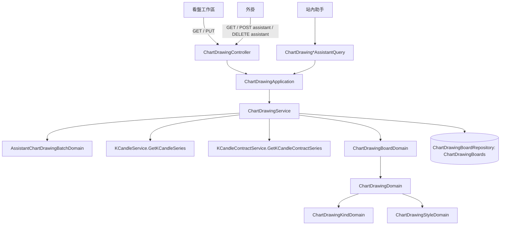

# 看盤繪圖存到系統裡，並讓助手能在 K 線圖上畫線 — Architecture Design

**Status:** Confirmed（autonomous run — decisions recorded below）
**Source PRD:** `.sdd/2026-10-20-chart-drawing-storage-and-assistant-drawing/PRD.md`
**Tech context:** Go · Gin · GORM · PostgreSQL · Clean/Onion（`internal/{controller,application,domain,infrastructure}`）

---

## 1. Design Goal & Guiding Principle

- **In one sentence:** 新增一個聚合 `ChartDrawingBoard`（一位擁有者 × 市場 × 交易標的一列，繪圖以 jsonb 整份存在列上、帶 `Revision` 與 `LastDrawingID`），
  三種寫入（整份存回、助手新增、助手移除）都是「讀出整份 → `ChartDrawingBoardDomain` 套規則 → 以版本為條件寫回」；
  助手新增前由 `ChartDrawingService` 借用既有的 `KCandleService` / `KCandleContractService` 彙總序列查出錨點那一根，再交給 domain 吸附與比對。
- **Guiding principle — 規則一處、型錄一處：**
  1. **繪圖種類型錄只有一份**：`ChartDrawingKindDomain` 的表（種類 → 錨點數、預設線色、預設線寬）。加一種繪圖＝加一列。
  2. **誰能動哪一個繪圖只在 `ChartDrawingBoardDomain` 決定**：整份存回保留既有編號的來源與問答；助手移除拒絕手畫的。外掛與站內助手共用同一條 service 路徑，不可能各寫一套。
  3. **版本是唯一的並行控制**：所有寫入都經過 `IChartDrawingBoardRepository.Save(board, expectedRevision)` 的條件寫入；整份存回衝突就拒絕（附現在那一份），助手的相對操作衝突時重讀重試（最多 3 次）。

---

## 2. Change Scope

| Area | Action | What / Why |
| :--- | :--- | :--- |
| `entities.ChartDrawingBoard` | **Add** | `ID`、`OwnerID`（FK users、cascade）、`Market`、`Symbol`（unique owner+market+symbol）、`Revision int64`、`LastDrawingID uint`、`Drawings []dto.ChartDrawingDto`（`serializer:json;type:jsonb`）、`UpdatedAt`；`TableName()="ChartDrawingBoards"` |
| `vo.ChartDrawingKindVo`／`ChartDrawingSourceVo`／`ChartDrawingLineStyleVo`／`ChartDrawingColorVo`／`ChartDrawingAnchorSnapVo`／`ChartDrawingLimitsVo` | **Add** | 列舉值與上限（`BoardCapacity`、`AssistantBatchCapacity`） |
| `vo.TradableMarketVo` | **Reuse** | 繪圖板的市場就是 `spot`／`contract`，不另開同義型別；註解擴寫為「現貨或合約」通用 |
| `dto.ChartDrawing*Dto` | **Add** | 讀出、整份存回、助手新增、助手移除各自的輸入輸出形狀（§7） |
| `dto.KCandleDto`／`dto.KCandleContractDto` | **Modify** | 各加 `ToChartDrawingAnchorCandleDto()`（開高低收＋起始時間；合約用成交價那一組） |
| `domains.ChartDrawingKindDomain`、`ChartDrawingStyleDomain`、`ChartDrawingDomain`、`ChartDrawingBoardDomain`、`AssistantChartDrawingBatchDomain`、`ChartDrawingPlaceDomain` | **Add** | 見 §3 |
| `domains.AggregationIntervalDomain` | **Modify** | 加 `BucketEnd(bucketStart)`：那一格最後一刻（含），讓錨點查詢剛好圈住一格 |
| `domains/chart_drawing_errors.go` | **Add** | `ErrChartDrawingValidation`、`ErrChartDrawingNotFound`、`ErrChartDrawingHandDrawn`、`ErrChartDrawingBoardRevisionConflict` + `ChartDrawingBoardRevisionConflictError{CurrentBoard}` |
| `interface.IChartDrawingBoardRepository` + mock | **Add** | `FindOne(owner, market, symbol) (board, found, error)`、`Save(board, expectedRevision) (board, error)` |
| `persistence.ChartDrawingBoardRepository` | **Add** | 條件寫入：`expectedRevision==0` → insert（唯一索引衝突→版本衝突）；否則 `UPDATE … WHERE id=? AND revision=?`，0 列→版本衝突 |
| `persistence.SchemaMigrator` | **Modify** | 註冊 `ChartDrawingBoard` |
| `service.ChartDrawingService` | **Add** | `GetBoard`、`ReplaceBoard`、`AddAssistantDrawings`、`RemoveAssistantDrawings` |
| `application.ChartDrawingApplication` | **Add** | 四個用例直通 service |
| `controller.ChartDrawingController` + `controller/models/chart_drawing_request.go` | **Add** | 四條路由、binding、錯誤對映 |
| `assistantqueries.ChartDrawingCreate/List/RemoveAssistantQuery` | **Add** | 站內助手三件能力 |
| `config.ApplicationConfig.ChartDrawing` | **Add** | `CHART_DRAWING_BOARD_CAPACITY`（200）、`CHART_DRAWING_ASSISTANT_BATCH_CAPACITY`（20） |
| `cmd/server/dependencies.go` | **Modify** | 組裝、路由（整份存回用 `requiresWebSignIn`）、`assistantQueriesFor` 多三件 |
| `README.md`、`postman/` | **Modify** | 路由表、環境變數、助手能力、集合 |
| 既有 K 線查詢、助手待確認修改、`AssistantRevisionApplication` | **Not touched** | 繪圖不走待確認修改；`RecordCreation` 只認策略腳本與交易策略，繪圖自帶來源與問答 |
| 繪圖子表／錨點子表 | **Not added** | 一份繪圖板最多 200 個、永遠整份讀寫，沒有任何查詢需要跨繪圖板篩選繪圖；jsonb 讓條件寫入一列即原子 |

---

## 3. New Classes / Modules

| Name | Kind | Responsibility (purpose) | Collaborators | Satisfies (PRD scenario) |
| :--- | :--- | :--- | :--- | :--- |
| `ChartDrawingPlaceDomain` | Domain Model | 市場（`spot`／`contract`）與交易標的的驗證與正規化（大寫）；`IsContract()` | `NewTradingSymbolDomain` | US-01 市場只有現貨與合約 |
| `ChartDrawingKindDomain` | Domain Model（型錄） | 八種繪圖的表：錨點數、預設線色、預設線寬；不認得的拒絕並列出八種 | — | US-02 種類、點數；US-05 預設樣式 |
| `ChartDrawingStyleDomain` | Domain Model | 線色（十二色）、線寬（1–4）、線型（三種）、鎖定、顯示；沒給的取種類預設（鎖定 false、顯示 true、實線） | `ChartDrawingKindDomain` | US-02 樣式；US-05 預設樣式 |
| `ChartDrawingDomain` | Domain Model | 一個合法繪圖：種類、錨點（數量對、價格>0）、樣式、來源、問答；`ToDto(id)` | Kind、Style | US-02 全部 |
| `ChartDrawingBoardDomain` | Domain Model | 一份繪圖板：`Replace(revision, drawings)`（版本比對、保留既有編號的來源與問答、新編號、容量）、`AppendAssistantDrawings`（容量、空位）、`RemoveAssistantDrawings(ids)`（手畫的／不存在的拒絕；沒有可移除時不加版本）、`ToEntity`、`ToDto`、`Revision` | `ChartDrawingDomain`、`ChartDrawingLimitsVo` | US-03、US-05、US-06 |
| `AssistantChartDrawingBatchDomain` | Domain Model | 助手一批的形狀檢查（1–上限個、刻度六選一、每個錨點價格與吸附恰好一種、樣式）、`AnchorCandleQueries()`（每個不重複起始時間一個剛好一格的序列查詢）、`ToDrawings(candles, origin)`（起始時間必須等於找到那一格的起始時間、吸附或照給的價格） | `AggregationIntervalDomain`、`ChartDrawingDomain` | US-04 全部、US-05 一批 |
| `ChartDrawingService` | Domain Service | 四個用例：讀出、整份存回、助手新增（先查錨點那一根，再套 board domain）、助手移除；衝突時整份存回附上現在那一份、助手操作重讀重試 | `IChartDrawingBoardRepository`、`KCandleService`、`KCandleContractService` | 全部 |
| `ChartDrawingBoardRepository` | Repository | 一列一份繪圖板的讀取與以版本為條件的寫入 | GORM | US-03 繪圖板已經變了（並行） |
| `ChartDrawingController` | Controller | 路由 binding、錯誤對映（§7） | `ChartDrawingApplication` | 全部 |
| `ChartDrawingCreate/List/RemoveAssistantQuery` | Assistant capability | 站內助手的三件能力，以 `origin.ViewerID` 為擁有者、`origin.ConversationID/TurnID` 為問答 | `ChartDrawingApplication` | US-05 站內助手記下問答、US-06、US-07 |

---

## 4. Modified Components

| Component | Current role | Change needed |
| :--- | :--- | :--- |
| `AggregationIntervalDomain` | 刻度的切格 | `BucketEnd(bucketStart time.Time) time.Time`＝`bucketStart + duration − 1ns` |
| `KCandleDto`／`KCandleContractDto` | 序列的一根 | `ToChartDrawingAnchorCandleDto()` |
| `SchemaMigrator.Migrate` | 註冊實體 | 加 `&entities.ChartDrawingBoard{}` |
| `ApplicationConfig` | 環境變數 | `ChartDrawing ChartDrawingConfig{BoardCapacity, AssistantBatchCapacity}` |
| `assistantQueriesFor` | 助手能力清單 | 加三件，傳入 `chartDrawingApplication` 與上限（寫在說明裡） |
| `vo.TradableMarketVo` | 幣安交易金鑰的可交易市場 | 只改註解為「現貨或合約」通用 |

---

## 5. Component Relationships



---

## 6. Concurrency & Identity

- **編號**：每份繪圖板自己的流水號（`LastDrawingID` 往上加、不重複使用）。編號只在同一份繪圖板內有意義。
- **版本**：`Revision` 每次寫入加一；沒有列＝版本 0。
- **整份存回**：`expectedRevision` 由使用者給；domain 先比對，`Save` 再以條件寫入守住同時發生的寫入。任何一處不符 → `ChartDrawingBoardRevisionConflictError{CurrentBoard}`（service 重讀一次填入）。
- **助手新增／移除**：讀出 → 套規則 → `Save(board, readRevision)`；衝突重來，最多 3 次，仍衝突回衝突錯誤（極少見）。
- 錨點 K 線查詢在重試迴圈之外只做一次（行情不因繪圖板改變而改變）。

---

## 7. API Contract（給看盤工作區與外掛）

全部需要 `Authorization: Bearer`；`:market` 為 `spot` 或 `contract`；`:symbol` 不分大小寫（存成大寫）。錯誤一律 `{"message": "..."}`。

| Method | Path | 登入 | 說明 |
| :--- | :--- | :--- | :--- |
| `GET` | `/users/me/chart-drawings/:market/:symbol` | 網頁或外掛 | 讀出整份繪圖板 → `200 ChartDrawingBoardDto` |
| `PUT` | `/users/me/chart-drawings/:market/:symbol` | **只限網頁** | 整份存回 → `200 ChartDrawingBoardDto` |
| `POST` | `/users/me/chart-drawings/:market/:symbol/assistant-drawings` | 網頁或外掛 | 新增一批助手繪圖 → `201 AssistantChartDrawingAdditionDto` |
| `DELETE` | `/users/me/chart-drawings/:market/:symbol/assistant-drawings[?ids=1,2]` | 網頁或外掛 | 移除助手繪圖 → `200 AssistantChartDrawingRemovalDto` |

`ChartDrawingBoardDto`：
```json
{"market":"spot","symbol":"BTCUSDT","revision":3,"drawings":[
  {"id":7,"kind":"trendLine","anchors":[{"openTime":"2026-10-19T08:00:00Z","price":"61200"},{"openTime":"2026-10-20T00:00:00Z","price":"63000"}],
   "color":"blue","lineWidth":2,"lineStyle":"solid","locked":false,"visible":true,
   "source":"assistant","assistantConversationId":12,"assistantTurnId":34}]}
```

PUT body：`{"revision":3,"drawings":[{"id":7,"kind":"…","anchors":[{"openTime":"RFC3339","price":"60000"}],"color":"blue","lineWidth":2,"lineStyle":"solid","locked":false,"visible":true}]}`
— `revision` 必填（從沒存過給 0）；`id` 省略或 0＝新畫；樣式欄位省略取種類預設、`locked` 省略 false、`visible` 省略 true；`source`、`assistant*` 若送來一律忽略。

POST body：`{"interval":"1h","drawings":[{"kind":"horizontalLine","anchors":[{"openTime":"2026-10-19T08:00:00Z","snapTo":"low"}],"color":"red","lineWidth":2,"lineStyle":"dashed"}]}`
— 每個錨點 `price`（字串或數字）與 `snapTo`（`open`／`high`／`low`／`close`）恰好一個；樣式可省略。
回應：`{"revision":4,"addedDrawings":[ChartDrawingDto…]}`

DELETE 回應：`{"revision":5,"removedCount":2,"removedDrawingIds":[7,8]}`

| 狀態碼 | 何時 |
| :--- | :--- |
| `400` | 驗證失敗（市場、標的、種類、錨點數、價格、樣式、刻度、價格與吸附、批量、繪圖板容量、錨點對不到 K 線、`ids` 不是正整數、缺 `revision`） |
| `404` | 指名移除的編號不在這份繪圖板上 |
| `409` | 版本衝突（body 另含 `"board": ChartDrawingBoardDto` 現在那一份）；指名移除手畫的 |
| `401`／`403` | 既有登入規則；外掛呼叫 PUT 得 401（網頁限定） |
| `502` | 讀寫失敗 |

---

## 8. Extensibility & Handoff Notes

- **Most likely next requirement:** 文字標註等新種類；助手「修改自己畫的」；看盤工作區標示助手畫的。
- **Where it lands:** 新種類 → `ChartDrawingKindDomain` 表加一列（若需要文字欄位，`ChartDrawingDto` 加選填欄、`ChartDrawingDomain` 驗證）。助手修改 → `ChartDrawingBoardDomain` 加一個與 `RemoveAssistantDrawings` 同樣「只准助手畫的」守門的方法。
- **Patterns applied & why:** 樂觀並行（版本）因為前端整份快照存回、助手同時寫；型錄表因為種類是最常變的軸。
- **Do not hardcode:** 上限只從 `ChartDrawingLimitsVo`（設定）來；調色盤、線寬範圍只在 `ChartDrawingStyleDomain`。
- **Known debt / deferred:** jsonb 的形狀就是 `ChartDrawingDto`，改 API 形狀時要顧及已存資料（加選填欄位無痛）。若之後要跨繪圖板查詢繪圖，改成子表。

---

## 9. Traceability

| PRD Scenario | Fulfilled by |
| :--- | :--- |
| US-01 從沒畫過的繪圖板是空的一份 | `ChartDrawingService.GetBoard`（`found=false` → 空板、版本 0） |
| US-01 現貨與合約各是一份 | 唯一索引 owner+market+symbol；`ChartDrawingPlaceDomain` |
| US-01 別人看不到我的繪圖板 | 一律以登入者 `OwnerID` 查詢 |
| US-01 市場只有現貨與合約 | `ChartDrawingPlaceDomain` → 400 |
| US-02 合法的趨勢線／價格極小但大於零／線寬上限 | `ChartDrawingDomain` + `ChartDrawingStyleDomain` |
| US-02 水平線給了兩個點／矩形只給一個點 | `ChartDrawingKindDomain.AnchorCount` 於 `ChartDrawingDomain` |
| US-02 價格為零 | `ChartDrawingDomain` |
| US-02 線寬超過上限／調色盤外的顏色／不認得的線型 | `ChartDrawingStyleDomain` |
| US-02 不認得的繪圖種類 | `ChartDrawingKindDomain` |
| US-03 取代原本那一份／不認得的編號當成新畫的／交回空的一份 | `ChartDrawingBoardDomain.Replace` |
| US-03 助手畫的被使用者拖過仍是助手畫的 | `ChartDrawingBoardDomain.Replace`（依編號沿用來源與問答） |
| US-03 手畫不比對 K 線 | `ReplaceBoard` 不呼叫行情 |
| US-03 繪圖板已經變了 | `ChartDrawingBoardDomain.Replace` 版本比對 + `Repository.Save` 條件寫入 → 409 附 board |
| US-03 剛好兩百個／超過兩百個 | `ChartDrawingBoardDomain.Replace` 容量 |
| US-03 外掛不能整份存回 | 路由用 `requiresWebSignIn` |
| US-04 吸附到那一根的最低價／照給的價格畫／合約繪圖板吸附合約 K 線 | `AssistantChartDrawingBatchDomain.ToDrawings` + `ChartDrawingService`（spot／contract 序列） |
| US-04 時間不在刻度上／那個時間還沒有 K 線／休市那一天沒有 K 線 | `AssistantChartDrawingBatchDomain.ToDrawings`（找不到那一格或起始時間不等） |
| US-04 價格與吸附同時給／都沒給／刻度不在六種之內 | `AssistantChartDrawingBatchDomain` 建構子 |
| US-05 沒給樣式用預設樣式 | `ChartDrawingStyleDomain` + `ChartDrawingBoardDomain.AppendAssistantDrawings` |
| US-05 一次二十個／二十一個／一個都沒有 | `AssistantChartDrawingBatchDomain`（`AssistantBatchCapacity`） |
| US-05 剛好填滿／超過繪圖板上限 | `ChartDrawingBoardDomain.AppendAssistantDrawings` |
| US-05 一個不合規則整批不畫 | `AssistantChartDrawingBatchDomain`（整批檢查後才寫） |
| US-05 站內助手記下問答／外掛畫的沒有問答 | `ChartDrawingCreateAssistantQuery`（origin）／controller（無問答） |
| US-06 移除全部助手繪圖／指名移除一個／沒有助手繪圖可移除 | `ChartDrawingBoardDomain.RemoveAssistantDrawings` |
| US-06 指名裡有手畫的 | `ChartDrawingBoardDomain.RemoveAssistantDrawings` → `ErrChartDrawingHandDrawn` → 409 |
| US-06 指名不存在的繪圖 | `ChartDrawingBoardDomain.RemoveAssistantDrawings` → `ErrChartDrawingNotFound` → 404 |
| US-07 列出兩種來源 | `ChartDrawingListAssistantQuery` → `GetBoard` |

---

## 10. Risks & Open Decisions

- **Risks / trade-offs:** 助手一批最多 40 個錨點各查一次序列——上限 20 已壓住；同一時間點會去重。
- **Open decisions:** 無。
