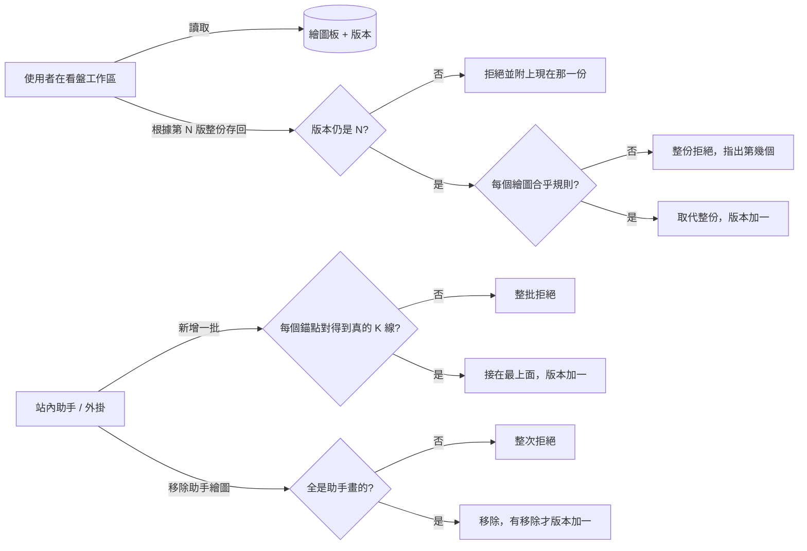

# Product Requirements Document (PRD) — 看盤繪圖存到系統裡，並讓助手能在 K 線圖上畫線

**Status:** Finalized
**Version:** v1.0
**Owner:** James Hsueh
**Stakeholders:** Engineering（後端先上線；看盤工作區與外掛之後照本文件的約定跟上）

---

## 1. Background & Goal (Why & Goal)

- **Problem Statement:** 看盤工作區的繪圖只記在使用者的瀏覽器裡：換電腦就不見；行情對話助手與外掛都碰不到，
  使用者請助手「把支撐壓力畫出來」，助手讀得懂行情卻沒有筆。
- **Expected Outcome:**
  - 每一位使用者、每一個市場（現貨／合約）、每一個交易標的各有一份**繪圖板**，由系統保存；瀏覽器整份讀出、整份存回。
  - 助手（站內助手與外掛）能**新增一批助手繪圖、列出繪圖、移除助手繪圖**；**永遠改不到、刪不到手畫的**。
  - 助手畫的每一個錨點都**釘在一根真的彙總 K 線上**，可以吸附到那一根的開高低收。
  - 整份存回**不會默默蓋掉**助手同時畫上的線（版本檢查）。
- **Out of Scope:**
  - 文字標註等新的繪圖種類；即時推播（瀏覽器回到頁面時重讀）；跨使用者分享。
  - 助手修改（移動、改色、鎖定）任何繪圖。
  - 助手讀取合約 K 線的新能力。
  - 把瀏覽器裡既有的繪圖搬上來（屬於看盤工作區：第一次存回時自然當成新的手畫繪圖）。

---

## 2. User Personas

- **Primary Role(s):**
  - **使用者**（看盤工作區）：自己畫線、上一步／下一步、換電腦後要看到同一份。
  - **站內助手**：以委託它的那位使用者的身分，在對話中替他畫線。
  - **外掛**：使用者授權的外部助手，以使用者的身分畫線；只能動助手那一份。
- **Usage Context:** 盯盤時一邊畫一邊問助手；助手畫完，使用者回到看盤工作區時重新讀取就看得到。

---

## 3. User Stories & Acceptance Criteria

### US-01 — [priority: P0] 繪圖板存在系統裡
**As a** 使用者, **I want** 我在每個市場每個交易標的上的繪圖由系統保存, **so that** 換電腦、重新整理後都還在，助手也看得到。

```gherkin
Scenario: 從沒畫過的繪圖板是空的一份
  Given 使用者在現貨 BTCUSDT 有繪圖、在合約 BTCUSDT 沒有
  When 他讀取合約 BTCUSDT 的繪圖板
  Then 得到空的一份，版本 0

Scenario: 現貨與合約各是一份
  Given 使用者在現貨 BTCUSDT 有 2 個繪圖
  When 他讀取現貨 BTCUSDT 的繪圖板
  Then 得到那 2 個繪圖，順序與存進去時相同

Scenario: 別人看不到我的繪圖板
  Given 甲在現貨 BTCUSDT 有 3 個繪圖
  When 乙讀取現貨 BTCUSDT 的繪圖板
  Then 乙得到空的一份，看不到甲的任何繪圖

Scenario: 市場只有現貨與合約
  When 使用者讀取市場「期權」的繪圖板
  Then 被拒絕，說明市場只能是現貨或合約
```

### US-02 — [priority: P0] 繪圖的內容合乎規則
**As a** 使用者, **I want** 存進去的每一個繪圖都是畫得出來的, **so that** 讀出來不會有一筆壞掉的繪圖。

```gherkin
Scenario: 合法的趨勢線
  Given 一個趨勢線，2 個錨點，價格 60000 與 62000，藍色、線寬 2、實線
  When 使用者整份存回
  Then 存回成功，讀出來是同一個趨勢線

Scenario: 價格極小但大於零
  Given 一個水平線，1 個錨點，價格 0.0001
  When 使用者整份存回
  Then 存回成功，價格一字不差是 0.0001

Scenario: 水平線給了兩個點
  Given 第 1 個繪圖是水平線，帶 2 個錨點
  When 使用者整份存回
  Then 整份被拒絕，說明「第 1 個繪圖：水平線要 1 個錨點，收到 2 個」
  And 繪圖板維持原狀

Scenario: 矩形只給一個點
  Given 第 1 個繪圖是矩形，帶 1 個錨點
  When 使用者整份存回
  Then 整份被拒絕，說明矩形要 2 個錨點

Scenario: 價格為零
  Given 某個錨點價格是 0
  When 使用者整份存回
  Then 整份被拒絕，說明錨點價格必須大於零

Scenario: 線寬上限
  Given 一個繪圖線寬 4
  When 使用者整份存回
  Then 存回成功

Scenario: 線寬超過上限
  Given 一個繪圖線寬 5
  When 使用者整份存回
  Then 整份被拒絕，說明線寬只能是 1 到 4

Scenario: 調色盤外的顏色
  Given 一個繪圖線色是「金」
  When 使用者整份存回
  Then 整份被拒絕，說明線色只能是調色盤上的十二色之一

Scenario: 不認得的繪圖種類
  Given 一個繪圖種類是「文字標註」
  When 使用者整份存回
  Then 整份被拒絕，說明不認得這種繪圖並列出八種

Scenario: 不認得的線型
  Given 一個繪圖線型是「波浪」
  When 使用者整份存回
  Then 整份被拒絕，說明線型只能是實線、虛線、點線
```

### US-03 — [priority: P0] 整份存回取代原本那一份
**As a** 使用者, **I want** 把整份繪圖板交回去就取代原本那一份, **so that** 看盤工作區的上一步／下一步（整份快照）可以直接存。

```gherkin
Scenario: 取代原本那一份
  Given 繪圖板第 3 版有 A（手畫）與 B（助手畫）
  When 使用者根據第 3 版交回 A 與一個沒有編號的新水平線
  Then 繪圖板變成 A 與新水平線，新水平線來源是手畫、拿到新編號
  And B 不在了，版本變成 4

Scenario: 助手畫的被使用者拖過仍是助手畫的
  Given B 是助手在某次問答畫的
  When 使用者交回的一份裡 B 被移到新價格
  Then B 留在新價格，來源仍是助手、問答不變

Scenario: 不認得的編號當成新畫的
  Given 交回的一個繪圖帶著這份繪圖板上沒有的編號
  When 使用者整份存回
  Then 它被當成新的手畫繪圖，拿到一個新編號

Scenario: 交回空的一份
  Given 繪圖板有手畫與助手畫的繪圖
  When 使用者根據目前的版本交回空的一份
  Then 所有繪圖都被移除，版本加一

Scenario: 手畫不比對 K 線
  Given 一個繪圖的錨點在明天
  When 使用者整份存回
  Then 存回成功

Scenario: 繪圖板已經變了
  Given 繪圖板已經是第 4 版（助手剛畫了線）
  When 使用者根據第 3 版整份存回
  Then 整份被拒絕，說明繪圖板在你讀取之後已經變了、請重新讀取
  And 回覆附上第 4 版那一份，什麼都沒被蓋掉

Scenario: 剛好兩百個
  Given 交回 200 個繪圖
  When 使用者整份存回
  Then 存回成功

Scenario: 超過兩百個
  Given 交回 201 個繪圖
  When 使用者整份存回
  Then 整份被拒絕，說明一份繪圖板最多 200 個

Scenario: 外掛不能整份存回
  When 外掛以使用者身分整份存回
  Then 被拒絕，得到與沒有登入時相同的「請重新登入」回覆（與其他只限網頁的事一致，不透露帳號狀態）
  And 繪圖板維持原狀
```

### US-04 — [priority: P0] 助手畫的錨點釘在真的 K 線上
**As a** 使用者, **I want** 助手畫的每一個點都對得到一根真的彙總 K 線, **so that** 它不會把線畫在自己編造的時間或價位。

```gherkin
Scenario: 吸附到那一根的最低價
  Given 現貨 BTCUSDT 一小時 K 線 10/19 08:00 那一根最低價 61200
  When 助手以一小時刻度畫水平線，錨點 10/19 08:00、吸附最低價
  Then 畫成功，那一點的價格是 61200

Scenario: 照給的價格畫
  Given 四小時 K 線 10/18 00:00 與 10/19 04:00 都存在
  When 助手以四小時刻度畫趨勢線，兩點各給 60000 與 63000
  Then 畫成功，兩點價格是 60000 與 63000

Scenario: 時間不在刻度上
  When 助手以一小時刻度畫，錨點在 10/19 08:30
  Then 整批被拒絕，說明「第 1 個繪圖第 1 個錨點：10/19 08:30 不是一小時 K 線的起始時間」

Scenario: 那個時間還沒有 K 線
  Given 10/25 還沒到
  When 助手以一天刻度畫，錨點在 10/25 00:00
  Then 整批被拒絕，說明那個時間沒有一天 K 線

Scenario: 休市那一天沒有 K 線
  Given 台股 10/18 週六沒有交易
  When 助手以一天刻度畫，錨點在 10/18 00:00
  Then 整批被拒絕，說明那個時間沒有一天 K 線

Scenario: 價格與吸附同時給
  When 助手的某個錨點同時給了價格又要求吸附
  Then 整批被拒絕，說明價格與吸附只能挑一種

Scenario: 價格與吸附都沒給
  When 助手的某個錨點既沒給價格也沒要求吸附
  Then 整批被拒絕，說明每個錨點要給價格或要求吸附其中一種

Scenario: 刻度不在六種之內
  When 助手以「2 小時」刻度新增
  Then 整批被拒絕，說明彙總刻度只能是六種之一

Scenario: 合約繪圖板吸附合約 K 線
  Given 合約 BTCUSDT 一小時合約 K 線 10/19 08:00 收盤價 61850、現貨同一根收盤價 61800
  When 助手在合約 BTCUSDT 繪圖板吸附那一根的收盤價
  Then 那一點的價格是 61850
```

### US-05 — [priority: P0] 助手一次新增一批
**As a** 站內助手或外掛, **I want** 一次畫好幾個繪圖, **so that** 一句「畫出支撐壓力」就畫得完。

```gherkin
Scenario: 沒給樣式用預設樣式
  Given 繪圖板有 5 個繪圖、第 2 版
  When 助手新增 3 個水平線，沒給樣式
  Then 繪圖板有 8 個，新的 3 個在最上面
  And 新的 3 個來源是助手，藍色、線寬 1、實線、不鎖定、顯示
  And 版本變成 3

Scenario: 一次二十個
  When 助手一次新增 20 個
  Then 全部畫上

Scenario: 一次二十一個
  When 助手一次新增 21 個
  Then 整批被拒絕，說明一次最多 20 個

Scenario: 一個都沒有
  When 助手新增 0 個
  Then 被拒絕，說明至少要一個繪圖

Scenario: 剛好填滿
  Given 繪圖板有 190 個
  When 助手新增 10 個
  Then 全部畫上，繪圖板剛好 200 個

Scenario: 超過繪圖板上限
  Given 繪圖板有 190 個
  When 助手新增 11 個
  Then 整批被拒絕，說明這份繪圖板只剩 10 個空位

Scenario: 一個不合規則整批不畫
  Given 助手要新增 3 個，第 2 個點數不對
  When 助手新增
  Then 整批被拒絕並指出第 2 個，繪圖板一個都沒多

Scenario: 站內助手記下問答
  Given 站內助手在某一次問答裡
  When 它新增繪圖
  Then 每一個新繪圖都記著那一次問答

Scenario: 外掛畫的沒有問答
  When 外掛新增繪圖
  Then 新繪圖來源是助手、沒有問答
```

### US-06 — [priority: P0] 助手只移除自己畫的
**As a** 使用者, **I want** 助手只能移除它自己畫的, **so that** 它被誤導也刪不到我手畫的線。

```gherkin
Scenario: 移除全部助手繪圖
  Given 繪圖板有 A（手畫）、B 與 C（助手畫）
  When 助手移除全部助手繪圖
  Then 繪圖板剩 A，回覆說移除了 2 個，版本加一

Scenario: 指名移除一個
  Given 繪圖板有 A（手畫）、B 與 C（助手畫）
  When 助手指名移除 B
  Then 繪圖板剩 A 與 C

Scenario: 指名裡有手畫的
  Given 繪圖板有 A（手畫）、B 與 C（助手畫）
  When 助手指名移除 A 與 B
  Then 整次被拒絕，說明 A 是手畫的、助手不能移除
  And A、B、C 都還在

Scenario: 指名不存在的繪圖
  When 助手指名移除這份繪圖板上沒有的編號
  Then 整次被拒絕，說明這份繪圖板上沒有那個繪圖

Scenario: 沒有助手繪圖可移除
  Given 繪圖板只有 A（手畫）
  When 助手移除全部助手繪圖
  Then 回覆說移除了 0 個，A 還在，版本不變
```

### US-07 — [priority: P1] 助手看得到整份繪圖板
**As a** 助手, **I want** 列出繪圖板上的每一個繪圖與它的來源, **so that** 我知道哪些是自己畫的、不要重複畫。

```gherkin
Scenario: 列出兩種來源
  Given 繪圖板有 A（手畫）與 B（助手畫）
  When 助手列出繪圖
  Then 看到 A 標示手畫、B 標示助手，以及繪圖板版本
```

---

## 4. Business Flow & Logic

- **Flow Diagram:**



- **Core Business Rules:**
  - **繪圖種類與錨點數**：趨勢線、射線、斐波那契回撤、矩形、日期與價格範圍 2 個；水平線、水平射線、垂直線 1 個。
  - **錨點**＝起始時間＋價格；價格大於零、精確數字。起始時間以世界標準時間表示。
  - **線色**十二色；**線寬** 1–4；**線型**實線／虛線／點線；**鎖定**、**顯示**是非。
  - **來源**：手畫／助手；**問答**只有站內助手畫的才有。來源與問答**由系統記**，整份存回改不動它們。
  - **版本**：從沒畫過是 0；整份存回、助手新增、真的移除了東西時加一。
  - **上限**：每份繪圖板 200 個、助手一次 20 個，由系統統一決定一次。
  - **預設樣式**（助手沒給時）：趨勢線、射線藍色線寬 2；水平線、水平射線、垂直線藍色線寬 1；矩形紫色線寬 1；斐波那契回撤灰色線寬 1；日期與價格範圍藍色線寬 1；實線、不鎖定、顯示。
  - **助手錨點**：起始時間必須是指定彙總刻度上一根存在的彙總 K 線（現貨繪圖板看 K 線、合約繪圖板看合約 K 線）的起始時間；價格「直接給」與「吸附開／高／低／收」恰好一種。
  - **歸屬**：每份繪圖板只屬於一位使用者；助手一律以委託它的那位使用者身分做事，沒有欄位可以指定別人。
  - **誰能做什麼**：讀取、助手新增、助手移除——網頁與外掛皆可；整份存回——只有網頁。
- **Edge Cases:**
  - 同時有兩個整份存回：後到的那一個版本已對不上，被拒絕，不會互蓋。
  - 助手新增與使用者整份存回同時發生：版本檢查讓使用者那一份被拒絕，不會蓋掉助手的線。
  - 讀取行情失敗時助手新增整批失敗，一個都不畫。
  - 交易標的的寫法大小寫不同視為同一個（一律轉成大寫）。

---

## 5. UI/UX Design & Interaction

- 本切片只做後端。看盤工作區之後改為：開圖時讀繪圖板、每一步整份存回、版本衝突時重讀並重新套用；
  可以標示「助手畫的」。外掛之後只對應讀取、助手新增、助手移除三件。

---

## 6. Non-Functional Requirements

- **Performance:** 讀一份繪圖板、整份存回各在一般網路下即時完成（最多 200 個繪圖）；助手新增一批最多對 40 個錨點各查一次行情。
- **Security:** 需登入；整份存回只接受網頁登入；資料只對擁有者可見。
- **Compatibility:** N/A
- **Analytics / Tracking:** N/A

---

## 7. Dependencies & Risks

- **External Dependencies:** 依賴既有的彙總 K 線序列查詢（現貨與合約）。
- **Known Risks:**
  - 錨點吸附依賴系統已存的行情；某段時間沒有存下 K 線時，助手畫不到那裡（會被明確拒絕）。
  - 看盤工作區必須照版本規則存回，否則每一次存回都會被拒絕。

---

## 8. Appendix

- `BRIEF.md`（同資料夾）
- go-trading-frontend `.sdd/2026-10-16-supercharts-chart-workspace/`（繪圖模型）
- `.sdd/2026-09-26-assistant-injection-hardening/`（助手只能動自己做的）
