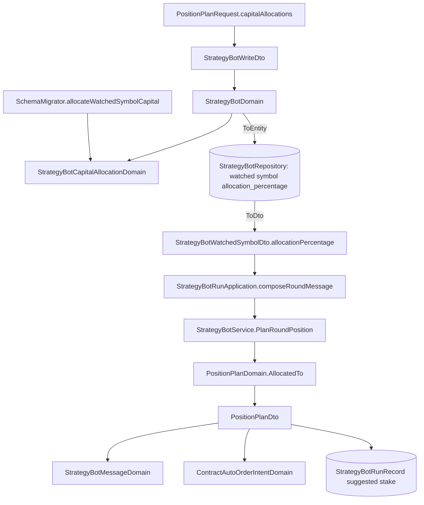

# 多標的機器人的資金分配 — Architecture Design

**Status:** Confirmed（autonomous run — decisions recorded below）
**Source PRD:** `.sdd/2026-10-20-multi-symbol-capital-allocation/PRD.md`
**Tech context:** Go · Gin · GORM · PostgreSQL · Clean/Onion（`internal/{controller,application,domain,infrastructure,job}`）

---

## 1. Design Goal & Guiding Principle

- **In one sentence:** 每個監聽標的存一個 `AllocationPercentage`；一輪計算建議部位時，`PositionPlanDomain.AllocatedTo(percentage)` 把部位資金換成那個標的分到的資金，之後的倉位大小、合約開倉模型、自動下單數量全都沿用既有算法——所以訊息、執行紀錄與自動下單自然是同一個數字。
- **Guiding principle — 規則一處、數字一處：**
  1. **資金分配的所有規則（檢查、平均分配、修改時保留）只住在 `StrategyBotCapitalAllocationDomain`。** 建立／修改機器人與升級舊資料都呼叫同一個 domain，升級不另寫一套「合計」判斷。
  2. **分到的資金只在 `PositionPlanDomain` 算一次。** 自動下單意圖（`ContractAutoOrderIntentDomain`）讀的是 `PlanRoundPosition` 算出的那份 `PositionPlanDto`，不另外乘分配比例。
  3. **向下相容的請求形狀**：分配比例放在 `positionPlan.capitalAllocations`（部位規劃裡），選填；回應放在 `watchedSymbols[].allocationPercentage`（各標的身上，與它的其他狀態並列）。

---

## 2. Change Scope

| Area | Action | What / Why |
| :--- | :--- | :--- |
| `entities.StrategyBotWatchedSymbol` | **Modify** | 加 `AllocationPercentage decimal`（`numeric(38,18);not null;default:100`）。DB 預設 100＝「用滿整份」＝升級前語意，所以 AutoMigrate 加欄時單一標的機器人自動正確；`ToDto` 帶出 |
| `dto.StrategyBotCapitalAllocationDto` | **Add** | `{Symbol, AllocationPercentage}`：application → domain 的輸入，也是 domain 讀回已存分配的形狀 |
| `dto.StrategyBotWriteDto` | **Modify** | 加 `CapitalAllocations`（擁有者給的，空＝沒給）與 `RetainedCapitalAllocations`（修改時 service 從已存的機器人帶入） |
| `dto.StrategyBotWatchedSymbolDto` | **Modify** | 加 `AllocationPercentage`（`json:"allocationPercentage"`） |
| `dto.StrategyBotRoundDto` | **Modify** | 加 `AllocationPercentage`（application 從監聽標的帶入） |
| `dto.PositionPlanDto` | **Modify** | 加 `TotalCapital`、`AllocationPercentage`、`AllocatedCapital`、`PartiallyAllocated`（訊息與自動下單措辭用） |
| `domains.StrategyBotCapitalAllocationDomain` | **Add** | 見 §3 |
| `domains.StrategyBotDomain` | **Modify** | 建構時建 `StrategyBotCapitalAllocationDomain`；`ToEntity` 每個監聽標的帶分配比例 |
| `domains.PositionPlanDomain` | **Modify** | 新 `AllocatedTo(percentage)`；`PlanFor`／`PlanOnContractVenue` 在回傳的 `PositionPlanDto` 標上分配（私有 `allocated(dto)`，兩個公開方法共用） |
| `domains.StrategyBotMessageDomain` | **Modify** | `PartiallyAllocated` 時多一行「資金分配 X%：總金額 T 中的 A」，押不下時說「這個標的分到的資金不足」 |
| `domains.ContractAutoOrderIntentDomain` | **Modify** | 押不下的不下單理由跟訊息同措辭 |
| `service.StrategyBotService` | **Modify** | `UpdateStrategyBot` 把已存分配帶進 `RetainedCapitalAllocations`；`PlanRoundPosition` 呼叫 `AllocatedTo(round.AllocationPercentage)` |
| `application.StrategyBotRunApplication.composeRoundMessage` | **Modify** | `round.AllocationPercentage = watchedSymbolDto.AllocationPercentage` |
| `persistence.StrategyBotRepository.Save` | **Modify** | 監聽標的 upsert：衝突時只更新 `allocation_percentage`（留下的標的其他狀態不動） |
| `persistence.SchemaMigrator` | **Modify** | 新步驟 `allocateWatchedSymbolCapital`（見 §6） |
| `controller/models.PositionPlanRequest` | **Modify** | 加 `CapitalAllocations []CapitalAllocationRequest`（`symbol`、`allocationPercentage`） |
| `postman/` | **Modify** | 建立／修改範例帶 `capitalAllocations`；說明 |
| 執行紀錄、待送訊息、自動下單委託的資料表 | **Not touched** | 執行紀錄記的建議開倉金額本來就是 `PositionPlanDto.Stake`，自動變成分到那一份裡的數字 |
| `ContractAutoOrderService`（平倉數量） | **Not touched** | 平倉照舊以機器人持倉為準，分配只影響開倉 |
| 回測／重演的 `PositionPlanDomain` 用法 | **Not touched** | 不呼叫 `AllocatedTo`，零值分配＝不標記，行為不變 |
| 幣安餘額檢查 | **Not touched** | PRD 範圍外 |

---

## 3. New Classes / Modules

| Name | Kind | Responsibility (purpose) | Collaborators | Satisfies (PRD scenario) |
| :--- | :--- | :--- | :--- | :--- |
| `domains.StrategyBotCapitalAllocationDomain` | Domain Model | 決定一台機器人每個監聽標的的分配比例：擁有者有給 → 全套檢查（指名清單內、不重複、每個都有、0<x≤100、兩位小數、合計≤100）；沒給 → 保留的分配若恰好覆蓋同一組標的且合法就沿用，否則平均分配（100÷N 捨去到兩位）。`PercentageOf(symbol)`、`ToDtos()` | `NewTradingSymbolDomain`（標的正規化） | US-02 全部、US-03 全部、US-05 全部 |
| `dto.StrategyBotCapitalAllocationDto` | DTO | 一個標的與它的分配比例 | — | US-02、US-03 |

> 建構子介面只有一個：`NewStrategyBotCapitalAllocationDomain(symbols, requested, retained)`。沒給分配時永不報錯，所以升級（`requested` 空、`retained` 是 DB 現值）與修改共用同一條路。

---

## 4. Modified Components

| Component | Current role | Change needed |
| :--- | :--- | :--- |
| `PositionPlanDomain` | 用部位資金算一輪的建議部位 | `AllocatedTo(p)`：p>0 時 capital ← capital×p/100，記住 totalCapital 與 p；回傳的 dto 帶 `AllocatedCapital` 等欄。p≤0（回測、舊測試）不改 capital、不標記 |
| `StrategyBotService.UpdateStrategyBot` | 停止中的機器人整份改寫 | `writeDto.RetainedCapitalAllocations ← storedBot` 每個監聽標的的分配比例 |
| `StrategyBotService.PlanRoundPosition` | 算一次建議部位 | `positionPlan = positionPlan.AllocatedTo(round.AllocationPercentage)` |
| `StrategyBotRepository.Save` | 同步監聽標的（只插新的） | `OnConflict{DoUpdates: AssignmentColumns(["allocation_percentage"])}`；建立的列帶分配比例 |
| `StrategyBotMessageDomain.positionPlanLines` | 印建議部位 | 部分分配時加一行分配、押不下改措辭 |
| `ContractAutoOrderIntentDomain.openQuantity` | 不下單理由 | 部分分配時「這個標的分到的資金不足，押不下 X，不下單」 |

---

## 5. Component Relationships



---

## 6. Migration

- AutoMigrate 加 `allocation_percentage`（預設 100）。既有列全部讀成 100。
- `allocateWatchedSymbolCapital`（在 `moveBotSymbolsOntoWatchedSymbols` 之後、同一個 `Migrate`）：一個交易內讀出所有監聽標的（`id`、`strategy_bot_id`、`symbol`、`allocation_percentage`，依 id），依機器人分組，以 `NewStrategyBotCapitalAllocationDomain(symbols, nil, stored)` 求出應有的分配：已合法（單一標的 100、或合計 ≤100 的擁有者設定）就是原值；不合法（升級前多標的機器人合計 N×100）→ 平均分配。只寫與現值不同的列 → 第二次執行什麼都不寫（冪等）。
- 滾動部署時舊版程式新建的監聽標的拿到 DB 預設 100：仍是舊語意，下一次啟動的升級步驟修正。

---

## 7. API Contract（給操作台與外掛）

**建立 `POST /strategy-bots`、修改 `PUT /strategy-bots/:id`** — `positionPlan` 多一個選填欄位：

```json
"positionPlan": {
  "capital": "1000",
  "sizingMode": "allIn",
  "capitalAllocations": [
    { "symbol": "BTCUSDT", "allocationPercentage": "60" },
    { "symbol": "ETHUSDT", "allocationPercentage": "40" }
  ]
}
```

- `capitalAllocations` 省略、`null` 或 `[]` ＝沒給：建立時平均分配；修改時監聽標的集合不變即保留原分配，否則平均分配。
- `allocationPercentage` 為十進位數（字串或數字皆可），單位 %。
- 拒絕（400，`reason` 照既有機器人驗證錯誤）措辭見 PRD US-02。

**回應**：`watchedSymbols[].allocationPercentage`（十進位，例如 `"33.33"`）。分到的資金＝`positionPlan.capital × allocationPercentage ÷ 100`（不取整），由畫面自行顯示。

---

## 8. Extensibility & Handoff Notes

- **Most likely next requirement:** 沒用到的份額可借用／依信號動態分配，或「最多同時 N 個標的有倉」。
- **Where it lands:** `PlanRoundPosition` 前決定這一輪這個標的可用的百分比——今天直接讀監聽標的的固定比例；動態分配時換成一個由整台狀態算出的比例，`PositionPlanDomain.AllocatedTo` 與下游都不用改。
- **Do not hardcode:** 兩位小數 `strategyBotAllocationDecimalPlaces`、100% 上限沿用 `oneHundredPercent`。
- **Known debt / deferred:** 回應不另給「分到的資金」欄位——計算屬業務規則，不放在 entity 的 `ToDto`；畫面自行乘。若外掛之後需要，改由 domain 組 DTO 時再加。

---

## 9. Traceability

| PRD Scenario | Fulfilled by |
| :--- | :--- |
| US-01 全押／百分比／固定金額超過分到的那一份／不借用 | `PositionPlanDomain.AllocatedTo` + 既有 `PositionSizingDomain.StakeFor` |
| US-01 只盯一個標的與從前一字不差 | `AllocatedTo(100)` 不標記 `PartiallyAllocated`；`StrategyBotMessageDomain` 不加行 |
| US-01 合約總金額是保證金、自動下單同一個數量 | `PlanOnContractVenue`（allocated capital）→ `ContractAutoOrderIntentDomain` 讀同一份 `PositionPlanDto.Quantity` |
| US-01 訊息說出分配 | `StrategyBotMessageDomain.positionPlanLines` |
| US-02 全部（給、合計、零、超過、兩位小數、缺、不在清單、重複） | `StrategyBotCapitalAllocationDomain`（經 `StrategyBotDomain`）→ `ErrStrategyBotValidation` → 400 |
| US-02 執行中不能修改 | `StrategyBotRunStateDomain.RequireEditable`（不變） |
| US-03 一／三／七個標的平均分配 | `StrategyBotCapitalAllocationDomain`（平均分配） |
| US-03 修改時保留／順序不論／標的變了重新平均 | `StrategyBotService.UpdateStrategyBot`（RetainedCapitalAllocations）+ `StrategyBotCapitalAllocationDomain` + `StrategyBotRepository.Save` upsert |
| US-04 查機器人看得到 | `StrategyBotWatchedSymbol.ToDto` → `allocationPercentage` |
| US-05 升級（單一、三個、重複不改） | AutoMigrate 預設 100 + `SchemaMigrator.allocateWatchedSymbolCapital` |
