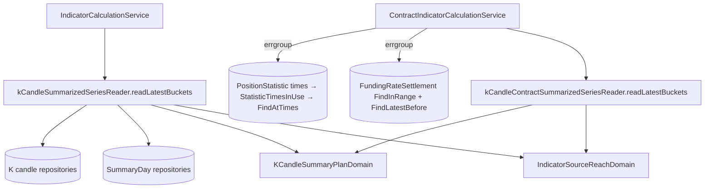

# 指標計算改取留存彙總 — Architecture Design

**Status:** Confirmed
**Source PRD:** `.sdd/2026-10-21-indicator-calculation-reads-summaries/PRD.md`
**Tech context:** Go · Clean/Onion · GORM（PostgreSQL）· gomock · `golang.org/x/sync/errgroup`

---

## 1. Design Goal & Guiding Principle

- **In one sentence:** `IndicatorCalculationService.CalculateIndicator` 與 `ContractIndicatorCalculationService.CalculateContractIndicator`
  在 1h／4h／1d 改由既有 `kCandleSummarizedSeriesReader`／`kCandleContractSummarizedSeriesReader` 取來源 K 線（留存彙總＋今天的一分鐘），
  以「往前找到湊滿」取代「依根數上限讀最近 N 根一分鐘」；合約持倉統計改為「先取統計時間、挑出每格用得到的那一筆、再只取那幾筆」；
  資金費率結算、期初結算、持倉統計三者以 errgroup 併發；**餵給算式的輸入逐值不變**。
- **Guiding principle:** 「往前要找多遠」是一個領域規則，收進一個 Domain Model（`IndicatorSourceReachDomain`），
  讀取迴圈收在既有 summarized series reader 上（看圖與指標共用同一條讀取路徑），兩個指標 service 只換一行呼叫。

### 為什麼結果一字不差（等價論證）

現行讀法：`FindLatestBefore(symbol, cutoff, L)`，`L = (計算根數 + 1) × 每格分鐘數`，再合成格子取最新的「計算根數」格。
- 一分鐘 K 線起始時間必落在分鐘刻度、以（標的, 起始時間）唯一，所以一格至多「每格分鐘數」根；讀滿 L 根時至少涵蓋「計算根數 + 1」格，
  只有最早那一格可能被根數上限切半，而它不在最新的「計算根數」格之內。
- 讀不滿 L 根時即是整段歷史全讀，最早那一格可能因歷史起點而不完整，照舊採用。
- 因此現行結果＝「計算截止時間之前、最新的『計算根數』個有行情的格子，每格完整」；不足時＝全部有行情的格子。
  新讀法以「往前一段、不夠就跳到更早一筆行情所在的格子再往前一段，直到湊滿或歷史到底」得到同一組格子；
  每一段都對齊格子邊界，格子不會被兩段切開；留存彙總與當場合併一字不差（前一刀保證，一分鐘一變即作廢）。
- 拒絕訊息中的可用根數只在「歷史到底」時出現，此時兩種讀法都讀完整段歷史，數字相同。

持倉統計：`Aligning` 對每格取「收盤前最近一筆」且須 ≥ `min(格起點, 收盤−5分)`，否則為零。
若只餵「每格依此規則選中的那一筆」構成的子集：有選中者，子集中收盤前最近的就是它；沒選中者，子集中收盤前的都比全集中的更舊、同樣不夠新 → 零。結果相同。

---

## 2. Change Scope

| Area | Action | What / Why |
| :--- | :--- | :--- |
| `domains.IndicatorSourceReachDomain` | **Add** | 指標來源 K 線要往前讀哪一段、湊滿了沒、下一段從哪裡開始 |
| `domains.IndicatorCalculationDomain` | **Modify** | 新增 `SourceReach()`；`ReadCutoff()`／`SourceCandleLimit()` 保留（細刻度與等價測試的舊讀法仍用） |
| `domains.KCandleSummaryPlanDomain` | **Modify** | 區間終點落在格子最後一刻（終點＋1µs 是格子邊界）時，那一格也取留存彙總；尾端一分鐘段為空時不再查詢 |
| `domains.ContractKCandleAlignmentDomain` | **Modify** | 新增 `StatisticTimesInUse(statisticTimes)`：每格挑出用得到的那一個統計時間 |
| `service.kCandleSummarizedSeriesReader`／`kCandleContractSummarizedSeriesReader` | **Modify** | 新增 `readLatestBuckets(ctx, reach, now)`：細刻度走 `FindLatestBefore`；粗刻度迴圈 `read` → 計數 → 探更早一筆 → 下一段 |
| `IndicatorCalculationService`／`ContractIndicatorCalculationService` | **Modify** | 建構子多收留存彙總天數 repository；改呼叫 reader；合約版三種讀取 errgroup 併發、持倉統計兩步取 |
| `IContractPositionStatisticRepository` + 實作 | **Modify** | 新增 `FindStatisticTimesInRange(ctx, query, limit) ([]time.Time, error)`（只取統計時間欄）與 `FindAtTimes(ctx, symbol, statisticTimes) ([]ContractPositionStatistic, error)`（`clause.IN`，空清單不查） |
| `cmd/server/dependencies.go` 與各測試組裝 | **Modify** | 傳入既有 `KCandleSummaryDayRepository`／`KCandleContractSummaryDayRepository` |
| 回測（`BacktestService`／`ContractBacktestService`） | **Not touched** | 需要一分鐘 K 線本身做盤中判斷與跨刻度合併；延後另議 |
| API 契約、錯誤訊息、留存彙總寫入／作廢 | **Not touched** | 純內部效能 |

---

## 3. New Classes / Modules

| Name | Kind | Responsibility (purpose) | Collaborators | Satisfies |
| :--- | :--- | :--- | :--- | :--- |
| `IndicatorSourceReachDomain` | Domain Model（不可變） | 持有標的、刻度、計算根數、計算截止時間、目前這一段 `[stretchStart, stretchEnd)` 與已找到的格數；`ReadsSummaries()`、`SeriesQuery()`、`CountingKCandles`／`CountingKCandleContracts`、`IsCovered()`、`EarlierCutoff()`、`ReachingBackTo(earlierOpenTime)`、`Symbol()`／`Cutoff()`／`SourceCandleLimit()` | `AggregationIntervalDomain`、`KCandleSeriesQueryDomain` | US-01、US-02 全部 |

`ReachingBackTo` 的下一段：終點＝更早那一筆所在格子的終點；長度＝剩餘格數 × 上一段的密度（上一段長度 ÷ 上一段找到的格數，至少一格長），
台股夜間週末、停牌空檔因此一兩段就湊滿；長度只影響效能，不影響結果（多讀的格子由既有「取最新的計算根數格」丟掉）。
每一輪若沒湊滿，探到的更早一筆保證下一段至少多一格，因此迴圈必然終止。

---

## 4. Modified Components

| Component | Current role | Change needed |
| :--- | :--- | :--- |
| `KCandleSummaryPlanDomain` | 切出留存彙總段與兩端一分鐘段 | `summarizedEnd = interval.BucketStart(endTime + 1µs)`（仍不超過今天零點）；`MinuteStretches` 略過起點晚於終點的尾段 |
| `ContractKCandleAlignmentDomain` | 對齊資金費率與持倉統計 | `StatisticTimesInUse`：與 `Aligning` 同一把「收盤前、夠新」規則 |
| `ContractPositionStatisticRepository` | 統計存取 | 兩個新讀法；只用 `clause.*` 與 `Pluck`，無 SQL 字串 |
| 兩個 summarized series reader | 看圖讀取 | 加 `readLatestBuckets` |
| 兩個指標 service | 逐分鐘讀 | 改走 reader；合約版併發 |

---

## 5. Component Relationships

---

## 6. Extensibility & Handoff Notes

- **Most likely next requirement:** 回測也改取留存彙總；或新增更粗的刻度（如一週）。
- **Where it lands:** 回測可重用 `readLatestBuckets` 的同一套 reader（以區間取），但它還需要一分鐘 K 線做盤中判斷，需另立規則；新刻度只要在 `AggregationIntervalDomain.summaryInterval` 對應到既有留存彙總粒度，指標計算自動受益。
- **Do not hardcode:** 往前估算的長度一律由 `IndicatorSourceReachDomain` 依刻度與密度算，不寫死天數。
- **Known debt / deferred:** 回測讀取（含合約回測的持倉統計兩步取與併發）延後；指標計算會像看圖一樣替缺的日子補留存彙總（寫入）。

### 量測與驗收

- `internal/infrastructure/persistence/tests/indicator_calculation_reads_benchmark_test.go`（需 `TEST_POSTGRES_DSN`）：
  BTCUSDT 合約 100 天一分鐘 K 線＋每 5 分鐘持倉統計＋每 8 小時資金費率結算，一天刻度、95 格；
  `BenchmarkContractIndicatorCalculationReads/minutes`（舊讀法：FindLatestBefore＋整段持倉統計，依序）與 `/summaries`（新讀法，留存彙總已補好）；
  另報讀取列數。驗收：新讀法耗時 ≤ 舊讀法的 1/5。
- 等價測試（同檔，需 `TEST_POSTGRES_DSN`）：真資料庫上以舊讀法（`FindLatestBefore` → `SelectContractInput`／`SelectInputCandles` → `FindInRange` 全部統計 → `Aligning`）與新 service 算出的算式輸入逐值相同，涵蓋全天候、台股、停牌空檔、歷史不足、截止在邊界與格中、1h／4h／1d。

---

## 7. Traceability

| PRD Scenario | Fulfilled by |
| :--- | :--- |
| 走完的日子取留存彙總，算出的值與逐分鐘合併相同 | reader `readLatestBuckets` + `IndicatorSourceReachDomain`；等價測試、benchmark |
| 還沒彙總好的日子一天一天補好後照用 | 既有 reader `summaries`（一天一天補）；service 測試 |
| 截止時間落在格子中間，那一格不用 | `IndicatorSourceReachDomain`（段終點＝`ReadCutoff`） |
| 截止時間剛好落在格子邊界，邊界之前那一格採用 | 同上 + `KCandleSummaryPlanDomain` 終點＋1µs |
| 細刻度維持逐分鐘合併 | `ReadsSummaries()` 為 false → `FindLatestBefore` |
| 中間停牌十天，跳過空檔繼續往前湊滿 | `EarlierCutoff` 探更早一筆 + `ReachingBackTo` |
| 台股只算有行情的交易日 | 同上（密度估計）；等價測試 |
| 行情歷史不夠時以可用根數計算 | 探不到更早一筆即停 → `SelectInputCandles` 既有規則 |
| 可用根數低於最少可算根數照舊拒絕 | 同上 |
| 行情歷史最早那一天不完整照舊採用 | 整段讀完，最早一格照舊 |
| 每五分鐘都有統計，每一格只取收盤前最後一筆 | `StatisticTimesInUse` + `FindAtTimes` |
| 統計中途斷了，採用格子內最後一筆 | `StatisticTimesInUse` |
| 整格沒有統計，持倉數字是零 | `StatisticTimesInUse` 不選 → `Aligning` 給零 |
| 一分鐘刻度可採用前四分鐘內的那一筆 | `StatisticTimesInUse`（夠新下限＝收盤−5分） |
| 剛好落在收盤那一刻的統計屬於下一格 | `StatisticTimesInUse`（嚴格早於收盤） |
| 同時取得，結果與依序取得相同 | `ContractIndicatorCalculationService`（errgroup） |
| 任何一種取不到，整次計算失敗 | errgroup 第一個錯誤即回傳 |
