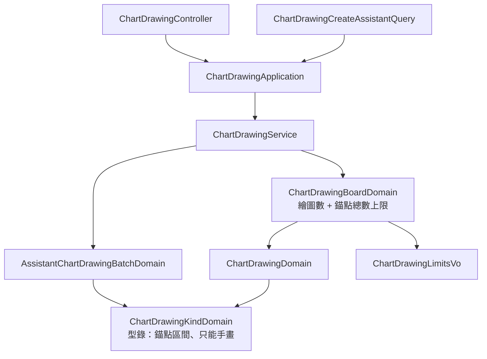

# 奇異筆：在 K 線圖上任意手繪 — Architecture Design

**Status:** Confirmed（autonomous run — decisions recorded below）
**Source PRD:** `.sdd/2026-10-22-chart-brush-drawing/PRD.md`
**Tech context:** Go · Gin · GORM · PostgreSQL · Clean/Onion（`internal/{controller,application,domain,infrastructure}`）

---

## 1. Design Goal & Guiding Principle

- **In one sentence:** 在繪圖種類型錄加一列 `brush`（錨點數 2–200、橙色線寬 2、**助手不能畫**），
  並讓 `ChartDrawingBoardDomain` 在整份存回與助手新增時多守一個上限：整份繪圖板錨點總數 ≤ `ChartDrawingLimitsVo.BoardAnchorCapacity`（預設 4000）。
- **Guiding principle — 種類的規則全部住在型錄那一列：** 錨點數從「固定一個數」改成「最少／最多」，「助手能不能畫」也是那一列的一個欄位；
  `ChartDrawingKindDomain` 對外只多一個 `RequireAssistantDrawable()`，呼叫端不需要知道是哪一種被擋。加下一種「只能手畫」或「點數可變」的種類＝加一列。

---

## 2. Change Scope

| Area | Action | What / Why |
| :--- | :--- | :--- |
| `vo.ChartDrawingKindVo` | **Modify** | 加 `ChartDrawingKindBrush = "brush"` |
| `domains.ChartDrawingKindDomain` | **Modify** | 型錄列 `anchorCount` → `minimumAnchorCount`／`maximumAnchorCount`，加 `drawnByHandOnly`；`RequireAnchorCount` 依區間說話（固定：「水平線要 1 個錨點，收到 2 個」；區間：「奇異筆要 2 到 200 個錨點，收到 1 個」）；新 `RequireAssistantDrawable()`：「奇異筆只能由使用者手畫，助手不能畫」 |
| `domains.AssistantChartDrawingBatchDomain` | **Modify** | 建構時認得種類後立即 `RequireAssistantDrawable()`，包成「第 N 個繪圖：…」的 `ErrChartDrawingValidation`——在讀 K 線之前拒絕 |
| `domains.ChartDrawingBoardDomain` | **Modify** | `Replace` 在逐一檢查繪圖之後檢查錨點總數；`AppendAssistantDrawings` 先檢查繪圖空位、再檢查錨點空間；兩者共用私有 `anchorCount()`（被兩個 public method 用，符合 private 門檻） |
| `vo.ChartDrawingLimitsVo` | **Modify** | 加 `BoardAnchorCapacity int` |
| `config.Load` | **Modify** | `CHART_DRAWING_BOARD_ANCHOR_CAPACITY`（`positiveIntWithDefault`，預設 4000） |
| `assistantqueries.ChartDrawingCreateAssistantQuery` | **Modify** | 說明補上「奇異筆只能由使用者手畫、你不能畫」與錨點總數上限；JSON schema `kind` enum **維持八種、不加 brush** |
| `assistantqueries.ChartDrawingListAssistantQuery` | **Modify** | 說明補上 `brush` 的錨點是一連串點、時間不一定是 K 線起始時間 |
| `README.md`、`postman/` | **Modify** | 環境變數表、繪圖種類說明；集合的整份存回範例加一筆奇異筆 |
| `ChartDrawingDomain`（錨點時間檢查） | **Not touched** | 手畫本來就不比對 K 線，只要求非零時間與正價格——奇異筆的「任何時刻」已成立 |
| 實體、資料表、repository | **Not touched** | 繪圖以 jsonb 整份存在繪圖板列上，不需要 schema 變更 |
| controller、錯誤對映 | **Not touched** | 新拒絕都是 `ErrChartDrawingValidation` → 400，沿用既有對映 |
| `REQUEST_BODY_LIMIT_KILOBYTES` | **Not touched** | 4000 錨點 × 約 70 bytes ≈ 280 KB + 200 個繪圖的樣式欄位，遠低於 1024 KB |

---

## 3. New Classes / Modules

無新類別。所有行為落在既有 Domain Model 的新欄位與新 method 上。

| Name | Kind | Responsibility (purpose) | Collaborators | Satisfies (PRD scenario) |
| :--- | :--- | :--- | :--- | :--- |
| `ChartDrawingKindDomain.RequireAssistantDrawable()` | Domain Model method | 依型錄列判斷助手能不能畫這一種，不能就以種類標籤說明 | — | US-05 助手送了奇異筆 |

---

## 4. Modified Components

| Component | Current role | Change needed |
| :--- | :--- | :--- |
| `chartDrawingKindEntry` | 種類 → 錨點數、預設樣式 | `minimumAnchorCount`、`maximumAnchorCount`、`drawnByHandOnly`；brush 列：`2, 200, true, orange, 2` |
| `ChartDrawingKindDomain.RequireAnchorCount` | 固定數比對 | 區間比對；最少＝最多時說「要 N 個」，否則「要 M 到 N 個」 |
| `ChartDrawingBoardDomain.Replace` | 繪圖數上限、逐一檢查 | 最後檢查 `replaced.anchorCount() > BoardAnchorCapacity` → `%w: 一份繪圖板的繪圖最多共 %d 個錨點，收到 %d 個` |
| `ChartDrawingBoardDomain.AppendAssistantDrawings` | 繪圖空位 | 再檢查錨點空間 → `%w: 一份繪圖板的繪圖最多共 %d 個錨點，這份只剩 %d 個錨點的空間，這一批有 %d 個` |
| `AssistantChartDrawingBatchDomain` 建構子 | 形狀檢查 | 認得種類後 `RequireAssistantDrawable()` |

---

## 5. Component Relationships

---

## 6. Extensibility & Handoff Notes

- **Most likely next requirement:** 再一種只能手畫或點數可變的種類（文字標註、多段折線、路徑）；或依種類調整錨點上限。
- **Where it lands:** `chartDrawingKinds` 型錄一列；助手能不能畫、點數區間、預設樣式都在那一列。
- **How to add it:** 在 `vo` 加常數、在型錄加一列；若助手可以畫，再把它加進 create 能力的 JSON schema enum 與說明。
- **Patterns applied & why:** Table-driven catalogue——種類的差異是資料不是行為，加種類不加分支。
- **Do not hardcode:** 4000 錨點上限在 `ChartDrawingLimitsVo`，由組態決定；200 的筆內上限是種類規則（跨三個 repo 的約定），留在型錄。
- **Known debt / deferred:** schema enum 與型錄的「助手可畫」欄位是兩處；目前 9 種、只有一種例外，靠測試釘住 enum 不含 brush。種類再增加時可改由型錄產生 enum。

---

## 7. Traceability

| PRD Scenario | Fulfilled by |
| :--- | :--- |
| US-01 一般長度的奇異筆 / 最短 / 最長 | `ChartDrawingKindDomain.RequireAnchorCount`（brush 2–200）、`ChartDrawingDomain` |
| US-01 只有一個錨點 / 超過 200 個 | `RequireAnchorCount` 區間訊息，經 `ChartDrawingBoardDomain.Replace` 包成「第 N 個繪圖」 |
| US-01 其他種類的錨點數不變 | 型錄其他八列 min＝max |
| US-02 錨點不在 K 線起始時間 | `ChartDrawingDomain` 不比對 K 線（不變），保留原時間（UTC） |
| US-02 錨點沒有時間 / 價格為零 | `ChartDrawingDomain` 既有檢查 |
| US-03 預設 / 改過 / 線寬超出 | 型錄 brush 列預設 orange、2；`ChartDrawingStyleDomain` |
| US-04 剛好到上限 / 超過上限 | `ChartDrawingBoardDomain.Replace` + `anchorCount()`、`ChartDrawingLimitsVo.BoardAnchorCapacity`、`config.Load` |
| US-04 助手新增剛好填滿 / 會超過 | `ChartDrawingBoardDomain.AppendAssistantDrawings` |
| US-04 原本的繪圖數上限照舊 | `Replace` 既有繪圖數檢查（先於錨點總數） |
| US-05 助手送了奇異筆 | `ChartDrawingKindDomain.RequireAssistantDrawable` 於 `AssistantChartDrawingBatchDomain`；schema enum 不含 brush |
| US-05 助手讀到奇異筆 | `ChartDrawingListAssistantQuery`（不變的讀取路徑） |
| US-05 助手移除不了奇異筆 | `ChartDrawingBoardDomain.RemoveAssistantDrawings`（不變：手畫不能移除） |
| US-05 助手畫其他種類照舊 | 型錄其他八列 `drawnByHandOnly=false` |
