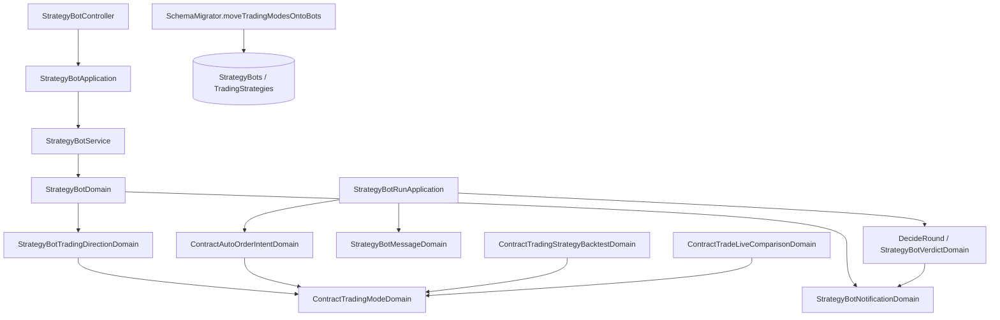

# 交易方向從交易策略搬到機器人與回測 — Architecture Design

**Status:** Confirmed
**Source PRD:** `.sdd/2026-11-11-bot-trading-direction/PRD.md`
**Tech context:** Go · Gin · GORM（PostgreSQL）· controller → application → domain service → domains / entities → persistence

---

## 1. Design Goal & Guiding Principle

- **In one sentence:** 把「合約交易模式」的來源從 `TradingStrategy` 移到三個使用者身上——`StrategyBot`（新的交易方向設定）、交易策略回測請求（`tradingMode` 參數）、實盤比對（由交易方向推得）——同時讓機器人依結論種類決定寄不寄輪次訊息，並把「決定了信號」與「寄出訊息」拆開。
- **Guiding principle:** **方向 → 交易模式的翻譯只有一個地方**（`ContractTradingModeDomain`），機器人、回測、比對都只負責「說出要面對哪些方向」；**通知是一個獨立的決策**（`StrategyBotNotificationDomain`），不再寄生在「決定要送信號」上。下一個「某種結論要做某件事」的需求就加在通知決策旁，不必再碰去重或下單。

---

## 2. Change Scope

| Area | Action | What / Why |
| :--- | :--- | :--- |
| `entities.TradingStrategy` / `TradingStrategyDto` / `TradingStrategyDomain` / repository | **Modify** | 移除 `TradingMode`；寫入時送來交易模式一律以 `ErrTradingStrategyValidation` 拒絕（不默默忽略）。 |
| `entities.StrategyBot` / `StrategyBotDto` / `StrategyBotWriteDto` / `StrategyBotDomain` | **Modify** | 新增交易方向（存成 `ContractTradingModeVo` 值）與三個通知開關。 |
| `entities.StrategyBotWatchedSymbol` | **Modify** | 新增 `LastOpinion`（前一個有意見的結論），啟動時清空。 |
| `StrategyBotService.UpdateStrategyBot` | **Modify** | 交易方向改變時，在鎖內檢查自動下單關著、每個監聽標的空手且無未完成委託。 |
| `StrategyBotVerdictDomain` / `DecideRound` / `StrategyBotRunApplication` / `RecordRound` | **Modify** | 判斷「回到持有」；訊息只在該結論的通知開著時排入；自動下單排入不再要求「有訊息」。 |
| `StrategyBotMessageDomain` / `StrategyBotRoundDto` | **Modify** | 新增「回到持有」那一則的文字；合約動作讀機器人的交易模式。 |
| `ContractTradingStrategyBacktestDomain` + 請求 DTO | **Modify** | 不再拒絕 `tradingMode`，改為採用它（空白＝多空反手）。 |
| `ContractTradeLiveComparisonDomain` | **Modify** | 由那一組交易的多空推得交易模式。 |
| `SchemaMigrator` | **Modify** | 新增 `moveTradingModesOntoBots`，並把 `TradingStrategies.contract_trading_mode` 加入退休欄位。 |
| `StrategyBotController` / request models / 錯誤對照 | **Modify** | 收發 `tradingDirections`、`notifications`；新增兩個拒絕原因代碼。 |
| 助手查詢描述（交易策略清單） | **Modify** | 描述不再提交易模式。 |
| 標的篩選、直接回測策略腳本 | **Not touched** | 本來就由自己說交易模式，不讀交易策略。 |
| 自動下單執行（`ContractAutoOrderService`、`ContractAutoOrderIntentDomain` 本體） | **Not touched** | 目標部位推得方式不變，只是 round 上的交易模式來源換了。 |
| 送達期限 / 待寄訊息派送 | **Not touched** | 「回到持有」的待寄訊息帶 `SignalHold`；作廢時只清掉 `LastSentRoundDueAt` 等於該輪的信號，持有那輪不會是信號那輪，因此不會誤清。實作時以測試釘住。 |

---

## 3. New Classes / Modules

| Name | Kind | Responsibility (purpose) | Collaborators | Satisfies (PRD scenario) |
| :--- | :--- | :--- | :--- | :--- |
| `vo.TradingDirectionVo` (`long` / `short`) | Value object | 交易方向在 API 上的拼法。 | — | US-03 |
| `StrategyBotTradingDirectionDomain` | Domain | 依行情種類把宣告的方向清單（nil＝沒說）定案：合約至少一個、沒說即兩者；現貨送來即拒絕；轉成 `ContractTradingModeDomain`、轉回方向清單；判斷與另一個是否相同。 | `ContractTradingModeDomain` | US-02、US-03、US-07 |
| `StrategyBotNotificationDomain` | Domain | 三個通知開關（買入、賣出、持有）與它們的預設；回答「這個信號要不要寄」「回到持有要不要寄」。 | — | US-04 |
| `ContractTradingModeDomain.Facing(long, short bool)` | Constructor | 方向 → 交易模式的唯一翻譯；機器人方向與實盤比對都用它。 | — | US-02、US-06 |
| `SchemaMigrator.moveTradingModesOntoBots` | Migration step | 合約機器人交易方向為空者，取它的交易策略原本的交易模式（空白或找不到 → 多空反手）；欄位已退休即跳過。 | GORM | US-07 |

> 通知與方向各自是一個 domain，`StrategyBotDomain` 持有它們；呼叫端不需要依序呼叫多個方法來完成一件事。

---

## 4. Modified Components

| Component | Current role | Change needed |
| :--- | :--- | :--- |
| `TradingStrategyWriteDto.TradingMode` | 合約策略的交易模式 | 改名 `DeclaredTradingMode`，只為拒絕而攜帶：非空白即 `ErrTradingStrategyValidation`「交易方向已改由機器人與回測決定」。 |
| `TradingStrategyDomain` | 驗證並記交易模式 | 移除交易模式欄位；拒絕宣告。 |
| `entities.TradingStrategy` | 有 `contract_trading_mode` 欄位 | 移除欄位（由遷移退休）。repository 的 select 清單跟著拿掉。 |
| `entities.StrategyBot` | — | 新增 `ContractTradingMode`（`column:contract_trading_mode`，size 32，default ''；現貨永遠空白）、`NotifyBuy`（default true）、`NotifySell`（default true）、`NotifyHold`（default false）。**注意 GORM 布林預設陷阱**：寫入必須明確列出欄位，避免 false 被當零值省略而吃到資料庫預設 true。 |
| `StrategyBotDto` | — | 新增 `TradingDirections []string`（`json:"tradingDirections,omitempty"`，現貨省略）、`Notifications StrategyBotNotificationsDto`（`buy`、`sell`、`hold`）；內部另帶 `ContractTradingMode` 給輪次使用（不輸出 JSON）。 |
| `StrategyBotWriteDto` | — | 新增 `TradingDirections *[]string`（nil＝沒說）、`Notifications *StrategyBotNotificationsWriteDto`（三個 `*bool`，nil＝沒說）；改寫時由 service 以儲存值補上沒說的部分。 |
| `StrategyBotDomain` | 驗證機器人 | 持有方向與通知 domain；`ChangesTradingDirectionOf(stored entities.StrategyBot) bool`。 |
| `StrategyBotWatchedSymbolDomain` | 移除前檢查 | 新增 `RequireFlatForDirectionChange(hasUnsettledAutoOrder bool) error`（與 `RequireRemovable` 同一套判斷，訊息改說「改交易方向」）；`ClearedForStart` 一併清 `LastOpinion`；`Concluded` 接收 opinion 並在非空時寫入。 |
| `StrategyBotService.UpdateStrategyBot` | 鎖內檢查移除的標的 | 方向改變時：`lockedBot.AutoOrderEnabled` → `ErrStrategyBotTradingDirectionAutoOrderOn`；每個監聽標的跑 `RequireFlatForDirectionChange`。 |
| `StrategyBotVerdictDomain` | buy/sell/none/conflict、ShouldSend | 新增 `lastOpinion` 輸入；`Opinion()`（buy/sell/hold，衝突為空）；`ReturnsToHold()`＝結論 none 且 lastOpinion ≠ hold。 |
| `DecideRound` / `StrategyBotRoundDecisionDto` | — | 決策多帶 `Opinion`、`ReturnsToHold`、`NotifiesSignal`、`NotifiesHold`（由通知 domain 算出）。 |
| `StrategyBotRunApplication.playWatchedSymbolRound` | ShouldSend 才組訊息與下單意圖 | ShouldSend：照舊組 round 與下單意圖，`SentSignal` 照舊設定，`HasMessage = NotifiesSignal`。否則若 `ReturnsToHold && NotifiesHold`：組一則「回到持有」round，`HasMessage = true`，無下單意圖。所有 concluded 結果都帶 `Opinion`。round 的 `ContractTradingMode` 改取自機器人。 |
| `RecordRound` | 有訊息且有意圖才排下單 | 下單排入條件改為 `HasAutoOrderIntent`（意圖只在決定送出信號時存在）；待寄訊息照舊只在 `HasMessage` 時排入，持有那則帶 `SignalHold`。 |
| `StrategyBotMessageDomain` | 輪次訊息 | `round.ReturnsToHold` 時寫「回到持有」：開頭括號同輪次訊息、寫出機器人與標的、說明買入與賣出條件都不成立，無建議部位。 |
| `ContractTradingStrategyBacktestDomain` | 拒絕 `TradingMode` | 採用 `TradingMode`（經 `NewContractTradingModeDomain`，空白＝多空反手）；`TradingStrategyTradingMode` 欄位移除。 |
| `ContractTradeLiveComparisonDomain` | 組回測請求 | `BacktestRequest.TradingMode` ＝ `ContractTradingModeDomain.Facing(該組有多單, 該組有空單)`。 |
| `StrategyBotController` | — | 請求 `tradingDirections`（`*[]string`）、`notifications`（`{buy,sell,hold}` 皆可省略）；拒絕原因對照新增 `tradingDirectionAutoOrderOn`、`watchedSymbolHoldsPosition` 已存在則沿用。 |
| `SchemaMigrator` | — | AutoMigrate 之後、`dropRetiredColumns` 之前呼叫 `moveTradingModesOntoBots`；`retiredColumns` 加 `{TradingStrategy, "contract_trading_mode"}`。通知與 `LastOpinion` 新欄位靠 AutoMigrate 的預設值補齊既有列（買入開、賣出開、持有關），天然可重做。 |

---

## 5. Component Relationships

---

## 6. Extensibility & Handoff Notes

- **Most likely next requirement:** 某種結論要做更多事（例如逐結論決定自動下單、另一種通知管道、持有時自動平倉）。
- **Where it lands:** `StrategyBotNotificationDomain` 旁——它是「結論 → 要不要寄」的決策點；新的「結論 → 動作」決策放成同層的 domain，由 `playWatchedSymbolRound` 讀決策結果，不要塞回 `StrategyBotVerdictDomain`（它只管「結論是什麼、是不是重複」）。
- **How to add it:** 在決策 DTO 加一個布林、在 domain 加一個方法、在 `RecordRound` 依它排入；去重與信號狀態不用動。
- **Patterns applied & why:** 方向 → 交易模式集中在 `ContractTradingModeDomain.Facing`，三個呼叫端只說「面對哪些方向」，未來若有第四種（例如「只在反手時」）只改一處。
- **Do not hardcode:** 方向預設（兩者）與通知預設（買入開、賣出開、持有關）只存在各自 domain 的建構子裡。
- **Known debt / deferred:** 機器人仍以 `ContractTradingModeVo` 存方向（`longOnly`…），API 才以方向清單呈現；若方向種類變多再考慮改存集合。

---

## 7. Traceability

| PRD Scenario | Fulfilled by |
| :--- | :--- |
| US-01 建立合約交易策略不提交易方向 | `TradingStrategyDomain`（無交易模式）、`TradingStrategyDto` |
| US-01 建立時送來交易方向被拒絕 | `TradingStrategyDomain` 拒絕 `DeclaredTradingMode` |
| US-01 修改時送來交易方向被拒絕 | 同上（create / update 共用 domain） |
| US-02 只做多的機器人結論買入 | `StrategyBotTradingDirectionDomain` → round `ContractTradingMode` → `StrategyBotMarketDomain` / `ContractAutoOrderIntentDomain` |
| US-02 只做多的機器人結論賣出 | 同上 |
| US-02 只做空的機器人結論賣出 | 同上 |
| US-02 只做空的機器人結論買入 | 同上 |
| US-02 兩個方向都選的機器人反手 | 同上 |
| US-02 同一份交易策略養兩個方向的機器人 | round 的交易模式取自各自機器人 |
| US-03 建立時選做多 | `StrategyBotTradingDirectionDomain` |
| US-03 建立時沒說交易方向 | `StrategyBotTradingDirectionDomain`（nil → 兩者） |
| US-03 一個方向都沒選 | `StrategyBotTradingDirectionDomain`（空清單拒絕） |
| US-03 現貨機器人送來交易方向 | `StrategyBotTradingDirectionDomain`（現貨拒絕） |
| US-03 安全時改方向 | `UpdateStrategyBot` 鎖內檢查通過 |
| US-03 自動下單開著時改方向 | `UpdateStrategyBot` → `ErrStrategyBotTradingDirectionAutoOrderOn` |
| US-03 還有機器人持倉時改方向 | `StrategyBotWatchedSymbolDomain.RequireFlatForDirectionChange` |
| US-03 自動下單開著但沒有改方向 | `StrategyBotDomain.ChangesTradingDirectionOf` 為 false 時略過 |
| US-03 執行中改方向 | `StrategyBotRunStateDomain.RequireEditable`（既有） |
| US-04 買入通知開著 | `StrategyBotNotificationDomain` → `HasMessage` |
| US-04 買入通知關掉時照樣決定與下單 | `playWatchedSymbolRound`（SentSignal 照設、HasMessage false）、`RecordRound`（下單只看意圖） |
| US-04 靜默決定的信號照樣擋掉重複 | `StrategyBotWatchedSymbolDomain.Concluded` 更新 `LastSentSignal`；`StrategyBotVerdictDomain.ShouldSend` |
| US-04 回到持有時通知一次 | `StrategyBotVerdictDomain.ReturnsToHold` + `StrategyBotMessageDomain` 持有文字 |
| US-04 連續持有不重複通知 | `LastOpinion` ＝ hold 時 `ReturnsToHold` 為 false |
| US-04 衝突不打斷連續的持有 | 衝突的 `Opinion` 為空，`Concluded` 不改 `LastOpinion` |
| US-04 剛啟動的第一個結論是持有 | `ClearedForStart` 清 `LastOpinion` |
| US-04 持有通知關著 | `StrategyBotNotificationDomain.NotifiesHold` 為 false |
| US-04 持有不改變上一次送出的信號 | 持有那輪 `SentSignal` 為空，`Concluded` 不動 `LastSentSignal` |
| US-04 三個通知都關 | 生命週期訊息不經通知 domain；輪次 `HasMessage` false |
| US-04 新機器人的預設通知 | `StrategyBotNotificationDomain` 預設 |
| US-04 執行中改通知 | `RequireEditable`（既有） |
| US-05 回測合約交易策略只做空 | `ContractTradingStrategyBacktestDomain` 採用 `tradingMode`；成績單帶交易模式（既有） |
| US-05 回測時沒說交易方向 | `NewContractTradingModeDomain`（空白 → 多空反手） |
| US-05 現貨交易策略回測送來交易方向 | 既有 `SpotOnlyReplayDomain` |
| US-06 比對的交易全是多單 | `ContractTradeLiveComparisonDomain` + `ContractTradingModeDomain.Facing` |
| US-06 比對的交易全是空單 | 同上 |
| US-06 比對的交易多空都有 | 同上 |
| US-07 用只做多交易策略的合約機器人 | `moveTradingModesOntoBots`；通知欄位預設 |
| US-07 用只做空交易策略的合約機器人 | `moveTradingModesOntoBots` |
| US-07 交易策略交易模式沒填 | `moveTradingModesOntoBots`（空白 → longShort） |
| US-07 現貨機器人 | 現貨不寫交易模式；通知欄位預設 |
| US-07 升級重做不覆蓋擁有者的修改 | 只更新交易模式為空的合約機器人；欄位退休後整步跳過 |
| US-07 已跑完的回測輪次保留歷史 | `BacktestRun` 不被遷移觸碰 |
