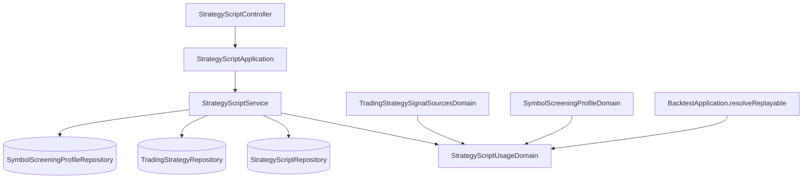

# 策略腳本的用途 — Architecture Design

**Status:** Confirmed
**Source PRD:** `.sdd/2026-11-11-strategy-script-usage/PRD.md`
**Tech context:** Go · Gin · GORM（PostgreSQL）· controller → application → domain service → domains / entities → persistence

---

## 1. Design Goal & Guiding Principle

- **In one sentence:** 策略腳本多一個 `Usage`（`chart` / `calculation`），隨 `RunnableStrategyScriptDto` 流到每個「需要計算」的消費端，由各消費端既有的驗證點多加一道檢查；另提供獨立的切換用途動作。
- **Guiding principle:** **用途的規則只住在 `StrategyScriptUsageDomain`**（解析、預設、`RequireCalculation(用在哪裡)`），消費端只說「我是哪一種用途的消費者」。新增一個只接受計算用的地方＝在它既有的驗證點呼叫一次 `RequireCalculation`。

---

## 2. Change Scope

| Area | Action | What / Why |
| :--- | :--- | :--- |
| `entities.StrategyScript` / `StrategyScriptDto` / `RunnableStrategyScriptDto` | **Modify** | 新增 `Usage`（欄位 `usage`，size 16，not null，default `calculation`——AutoMigrate 讓既有列成為計算用，天然可重做）。 |
| `StrategyScriptWriteDto` / `StrategyScriptDomain` | **Modify** | 建立時採用（空白＝計算用、未知拒絕）；改寫時送來即拒絕。 |
| `StrategyScriptApplication` + `StrategyScriptService` + repository | **Modify** | 新增 `SwitchStrategyScriptUsage`。 |
| `TradingStrategyRepository` / `SymbolScreeningProfileRepository` | **Modify** | 各加一個「指名某支腳本的名稱清單」查詢，供切換時列出引用者。 |
| `TradingStrategySignalSourcesDomain` | **Modify** | 信號來源帶 `DeclaredUsage`，在指標值種類檢查之後再檢查計算用。 |
| `SymbolScreeningProfileDomain.AcceptScript` | **Modify** | 加計算用檢查。 |
| `BacktestApplication.resolveReplayable` | **Modify** | 指名的腳本須為計算用（未存的算式不受影響）。 |
| 市集：`PublishedStrategyScript.ToDto`、`StrategyScriptMarketplaceCopyDomain` | **Modify** | 顯示目前用途；加入時複製用途。 |
| `StrategyScriptController` + 路由 | **Modify** | `usage` 進出；新增 `PUT /strategy-scripts/:id/usage`（網頁與外掛皆可）。 |
| 助手查詢（腳本清單） | **Modify** | 清單帶用途。 |
| 指標計算（單純算一次） | **Not touched** | 兩種用途都可以算；圖表只列圖表用是前端選單規則。 |
| 讀交易策略規則的每一條路（機器人輪次、交易策略回測、實盤比對） | **Modify**（合約稽核後） | 經 `StrategyScriptService.ResolveOwnedCalculationScript` 再檢查一次計算用：機器人遇到圖表用的來源即整台停擺（策略腳本找不到了那一種），回測與比對即拒絕。這是 PRD 業務規則「照舊經過信號來源的檢查」的落實，也兜住下述競態。 |

---

## 3. New Classes / Modules

| Name | Kind | Responsibility (purpose) | Collaborators | Satisfies (PRD scenario) |
| :--- | :--- | :--- | :--- | :--- |
| `vo.StrategyScriptUsageVo` (`chart` / `calculation`) | Value object | 用途的拼法。 | — | US-01 |
| `StrategyScriptUsageDomain` | Domain | 解析宣告（空白＝計算用、未知拒絕並列出兩種）；`IsChart()`；`RequireCalculation(consumer string) error` 產生「這支腳本是圖表用，不能用於 X」。 | — | US-01、US-03 |
| `StrategyScriptService.SwitchStrategyScriptUsage` | Service method | 擁有者驗證（陌生人同找不到）→ 切成圖表用而有引用者時拒絕 → 寫入用途；切成原用途不寫入。引用者名稱由呼叫端以 `StrategyScriptUsageSwitchDto` 帶入。 | `StrategyScriptRepository` | US-02 |
| `StrategyScriptApplication.SwitchStrategyScriptUsage` | Application method | 向 `TradingStrategyService`、`SymbolScreeningProfileService` 取得正在用這支腳本的名稱，交給腳本服務。（實作時的調整：腳本服務原本只認識腳本，跨服務的引用查詢放在應用層，與既有「改寫時查機器人引用」的做法一致，也避免改動腳本服務的建構子。） | `TradingStrategyService`、`SymbolScreeningProfileService` | US-02 |
| `ErrStrategyScriptUsageInUse`、`ErrStrategyScriptUsageNotRewritable`、`ErrStrategyScriptUsageNotCalculation` | Errors | 對應三種拒絕，controller 對照為原因代碼。 | — | US-02、US-03 |

---

## 4. Modified Components

| Component | Current role | Change needed |
| :--- | :--- | :--- |
| `StrategyScriptWriteDto` | 建立／改寫的輸入 | 新增 `Usage string`。 |
| `StrategyScriptDomain` | 驗證腳本 | 建立時以 `StrategyScriptUsageDomain` 定案；`ToEntity` 帶用途。 |
| `StrategyScriptService.preparedRewrite` | 改寫的規則 | `writeDto.Usage` 非空白 → `ErrStrategyScriptUsageNotRewritable`；改寫保留儲存的用途。 |
| `StrategyScriptRepository` | 讀寫腳本 | 新增 `UpdateUsage(ctx, id, usage)`；`Update` 的欄位清單不含 `usage`（改寫不會動它）。 |
| `TradingStrategyRepository` | — | 新增 `FindNamesByStrategyScript(ctx, strategyScriptID) ([]string, error)`（經信號來源表）。不另依擁有者過濾：信號來源只能指名自己的腳本，篩選設定屬於管理員，凡在用就該擋。 |
| `SymbolScreeningProfileRepository` | — | 新增 `FindNamesByStrategyScript(ctx, strategyScriptID) ([]string, error)`。 |
| `TradingStrategySignalSourceWriteDto` | 帶 `DeclaredResultType` | 新增 `DeclaredUsage`；`TradingStrategyApplication` 解析來源時一併填入。 |
| `TradingStrategySignalSourcesDomain` | 檢查信號種類 | 種類檢查之後呼叫 `RequireCalculation("當信號來源")`，包成 `ErrTradingStrategyValidation`。 |
| `SymbolScreeningProfileDomain.AcceptScript` | 檢查腳本可篩選 | 加 `RequireCalculation("用於篩選")`，包成 `ErrSymbolScreeningValidation`。 |
| `BacktestApplication.resolveReplayable` | 解析指名腳本 | 加 `RequireCalculation("回測")`，包成回測驗證失敗。 |
| `PublishedStrategyScript.ToDto` / `PublishedStrategyScriptDto` | 市集呈現 | 帶 `Usage`（讀腳本目前的值）。 |
| `StrategyScriptMarketplaceCopyDomain` | 加入時複製 | 複製 `Usage`。 |
| `StrategyScriptController` | 腳本 CRUD | request 加 `usage`；新增 `SwitchStrategyScriptUsage` handler；錯誤對照新增 `strategyScriptUsageInUse`（409）、`strategyScriptUsageNotRewritable`（400）。 |
| 助手腳本清單查詢 | 列腳本 | 輸出帶 `usage`。 |

---

## 5. Component Relationships

---

## 6. Extensibility & Handoff Notes

- **Most likely next requirement:** 第三種用途（例如「篩選用」），或「某處只接受圖表用」。
- **Where it lands:** `StrategyScriptUsageDomain`——加一個 vo 值與一個 `RequireX` 方法；消費端在既有驗證點呼叫。
- **How to add it:** 新增 vo 常數、在 declarable 清單加入、加 `RequireX`；切換時的引用檢查若要擴到別處，在 `SwitchStrategyScriptUsage` 加一個 repository 查詢。
- **Patterns applied & why:** 規則集中於 domain，消費端只表明身分，避免各處各寫一個字串比較。
- **Do not hardcode:** 預設用途只在 `StrategyScriptUsageDomain` 建構子。
- **Known debt / deferred:** 圖表選單過濾在前端；後端「算一次指標」刻意不檢查用途。**切換用途與存交易策略之間沒有共用鎖**：兩者同時發生時，交易策略可能存下指名一支剛切成圖表用的腳本；之後機器人輪次與回測會在讀規則時拒絕它（見上），所以不會拿圖表用腳本計算，只會留下一份需要擁有者處理的交易策略。若要徹底杜絕，下一步是讓兩邊在同一筆交易裡鎖住腳本列。

---

## 7. Traceability

| PRD Scenario | Fulfilled by |
| :--- | :--- |
| US-01 建立圖表用腳本 | `StrategyScriptDomain` + `StrategyScriptUsageDomain` |
| US-01 建立時沒說用途 | `StrategyScriptUsageDomain`（空白 → 計算用） |
| US-01 用途不在兩種之內 | `StrategyScriptUsageDomain`（未知拒絕） |
| US-02 沒人在用的腳本切成圖表用 | `SwitchStrategyScriptUsage` + `UpdateUsage` |
| US-02 交易策略在用時不能切成圖表用 | `TradingStrategyRepository.FindNamesByOwnerAndStrategyScript` → `ErrStrategyScriptUsageInUse` |
| US-02 篩選設定在用時不能切成圖表用 | `SymbolScreeningProfileRepository.FindNamesByStrategyScript` → 同上 |
| US-02 圖表用切回計算用 | `SwitchStrategyScriptUsage`（不查引用） |
| US-02 切成原本的用途 | `SwitchStrategyScriptUsage`（相同即不寫入） |
| US-02 市集副本也能切換 | `SwitchStrategyScriptUsage` 只要求擁有，不要求可改寫 |
| US-02 別人的腳本 | 擁有者驗證回 `StrategyScriptNotFound` |
| US-02 改寫內容時順便送用途 | `preparedRewrite` → `ErrStrategyScriptUsageNotRewritable` |
| US-03 計算用的信號腳本當信號來源 | `TradingStrategySignalSourcesDomain` |
| US-03 圖表用的腳本當信號來源 | `TradingStrategySignalSourcesDomain` → `RequireCalculation` |
| US-03 篩選設定指名圖表用的腳本 | `SymbolScreeningProfileDomain.AcceptScript` |
| US-03 直接回測圖表用的腳本 | `BacktestApplication.resolveReplayable` |
| US-03 計算用但不是信號種類 | 既有指標值種類檢查（先於用途檢查） |
| US-04 圖表用的腳本出現在圖表選單 | `StrategyScriptDto.Usage`（前端依此過濾） |
| US-04 計算用的腳本不出現在圖表選單 | 同上 |
| US-04 計算用的腳本照樣能試算 | 指標計算路徑不檢查用途（不改動） |
| US-05 查詢腳本看得到用途 | `StrategyScriptDto.Usage` |
| US-05 市集顯示用途 | `PublishedStrategyScriptDto.Usage` |
| US-05 加入時副本帶著用途 | `StrategyScriptMarketplaceCopyDomain` |
| US-05 發佈者之後切換不影響副本 | 副本是獨立的列，不連回原腳本 |
| US-06 既有畫線用腳本 | `usage` 欄位預設 `calculation` |
| US-06 既有市集副本 | 同上 |
| US-06 升級重做不覆蓋擁有者的切換 | AutoMigrate 只在加欄位時套預設 |
